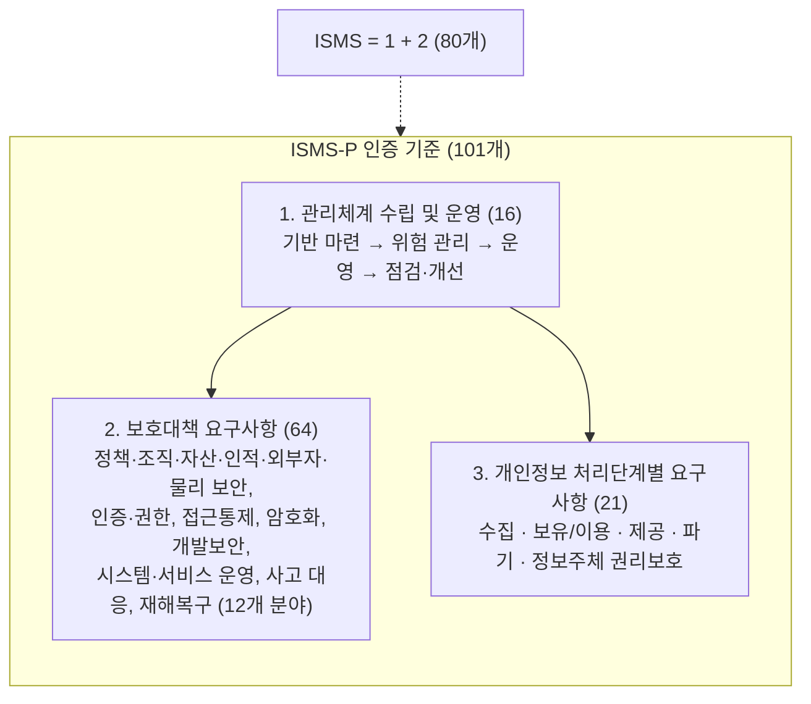

# ISMS-P (정보보호 및 개인정보보호 관리체계 인증)

---

## I. 정보보호와 개인정보보호의 통합 인증, ISMS-P의 개요

### 가. ISMS-P의 정의

- 조직이 정보자산과 개인정보를 보호하기 위해 수립·운영하는 관리체계가 **통합 인증 기준(관리체계 16 + 보호대책 64 + 개인정보 처리단계 21 = 101개)** 에 적합한지 심사하여 인증하는 국내 제도
- 기존 ISMS(정보통신망법)와 PIMS(개인정보보호법)를 2018년 통합, 2023년 기준 개정으로 개인정보 처리단계 항목이 22개 → 21개로 정비

### 나. 등장 배경 및 특징

| 구분 | 내용 |
| --- | --- |
| 중복 규제 해소 | ISMS와 PIMS의 유사·중복 항목으로 인한 심사 부담 감소 |
| 융합 보안 | 침해사고가 곧 개인정보 유출로 이어지는 환경에서 보안과 프라이버시를 통합 관리 |
| PDCA 기반 | 기반 마련 → 위험 관리 → 운영 → 점검·개선의 지속적 순환 ([[PDCA(Plan-Do-Check-Act, Deming Cycle)\|PDCA]]) |
| 생명주기 보호 | 개인정보의 수집 → 이용 → 제공 → 파기 전 단계 통제 |

---

## II. 인증 기준 체계 및 핵심 통제 요소

### 가. 인증 기준 구조

### 나. 핵심 통제 요소

| 영역 | 요소 | 설명 |
| --- | --- | --- |
| 관리체계 | 최고책임자 지정 | CISO·CPO 지정, 조직·예산 등 거버넌스 기반 |
| | 위험 관리 | 자산 식별, 위협·취약점 분석, 수용 가능 위험 수준(DoA) 설정 |
| 보호대책 | 접근통제 | 최소 권한(Need-to-Know), 통제구역 출입 통제 |
| | [[암호화]] | 비밀번호·바이오정보·고유식별정보 저장 및 전송 구간 암호화 ([[암호 알고리즘]]) |
| | 사고 대응·재해복구 | 탐지·대응·복구·재발 방지, 정기 모의훈련 |
| 개인정보 | 생명주기 관리 | 최소 수집, 안전한 이용·제공, 목적 달성 후 지체 없는 파기 |
| | 정보주체 권리 보장 | 열람·정정·삭제·처리정지 요구 대응, 자동화된 결정 대응권 |
| | 위탁·제공 통제 | 수탁자 관리·감독, 제3자 제공 적법성 검토 |

### 다. 운영 체계

| 구분 | 내용 |
| --- | --- |
| 정책 기관 | 과학기술정보통신부, 개인정보보호위원회 |
| 인증 기관 | KISA, 금융보안원 등 |
| ISMS 의무 대상 | 전기통신사업자(ISP), IDC, 정보통신서비스 매출·이용자 수 기준 초과 기업, 상급종합병원, 가상자산사업자 등 |
| 유효기간 | 3년, 매년 사후 심사 |

---

## III. ISMS와의 비교 및 동향

### 가. ISMS vs ISMS-P

| 비교 항목 | ISMS | ISMS-P |
| --- | --- | --- |
| 보호 목적 | 정보자산의 [[기밀성]]·[[무결성]]·[[가용성]] | 정보자산 + 개인정보 흐름 전체 |
| 인증 기준 | 80개 (관리체계 16 + 보호대책 64) | 101개 (ISMS 80 + 개인정보 21) |
| 근거 법령 | 정보통신망법 | 정보통신망법, [[개인정보보호법]] |
| 성격 | 의무 대상 존재 | 임의 인증 (개인정보 처리가 많은 기업 권장) |
| 적합 대상 | 인프라·B2B 기업 | B2C·대규모 개인정보 처리 기업 |

### 나. 동향

- **간편인증 도입**: 중소기업 부담 완화를 위해 핵심 항목 중심의 간편인증 제도 운영
- **클라우드·SaaS 심사 강화**: 클라우드 사업자와의 책임 공유 모델, SaaS 위탁 처리 현황 점검 강화 ([[CSAP]])
- **AI·제로 트러스트 대응**: 생성형 AI 활용 시 데이터 유출 통제, [[제로 트러스트 보안모델\|Zero Trust]] 관점의 접근통제 기준 편입 추세

---

### 🔗 연관 토픽

- **소속 도메인**: [[00_보안_MOC|🛡️ 보안]]
- **세부 분류**: `1. 정보보안 원칙 & 거버넌스 · 인증`
- **핵심 연관 토픽**:
  - [[개인정보보호법]]
  - [[CSAP|CSAP, CSAP(Cloud Security Assurance Program)]]
  - [[ISO 27701]]
  - [[PDCA(Plan-Do-Check-Act, Deming Cycle)]]
  - [[정보보호 공시제도]]
