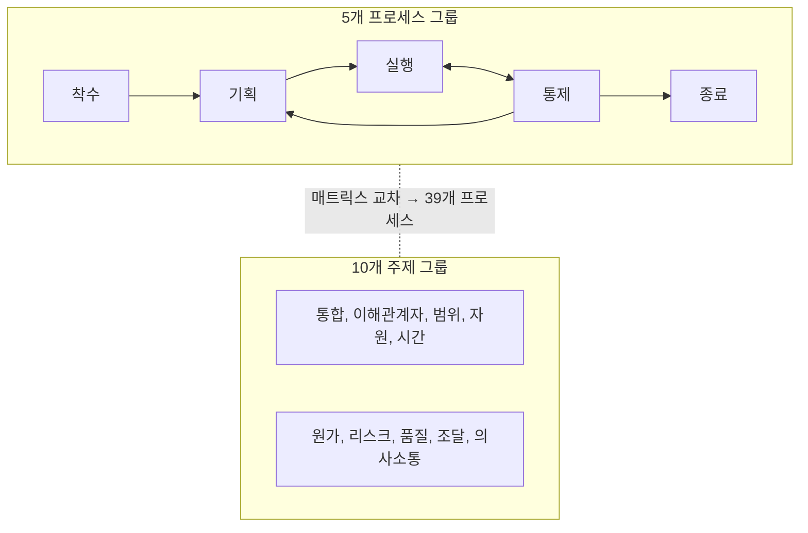

# ISO 21500 (프로젝트 관리 국제표준)

---

## I. 프로젝트 관리 용어와 프로세스의 국제 통일, ISO 21500의 개요

### 가. 정의

- 산업·규모와 무관하게 적용할 수 있는 **프로젝트 관리 개념과 프로세스**를 정의한 ISO 국제표준 (ISO 21500:2012 프로젝트 관리 지침, 2021년 개념·맥락 표준으로 개정)

### 나. 등장 배경 및 특징

| 구분 | 내용 |
| --- | --- |
| 배경 | PMBOK, PRINCE2 등 방법론이 기관·국가별로 달라 다국적 프로젝트에서 용어·체계 불일치 |
| 범용성 | 특정 산업·도구·방법론에 종속되지 않는 일반 지침 |
| 구조 (2012판) | 5개 프로세스 그룹 × 10개 주제 그룹 = 39개 프로세스 |
| PMBOK과의 정합 | PMBOK의 지식 영역·프로세스 그룹과 거의 대응 |

---

## II. 프로세스 구조

### 가. 개념도

- 프로세스 그룹과 주제 그룹이 2차원으로 교차하고, 기획·실행·통제는 수명주기 동안 반복

### 나. 구성요소

| 구분 | 요소 | 설명 |
| --- | --- | --- |
| 프로세스 그룹 | 착수 (Initiating) | 프로젝트·단계 시작 정의, 헌장 개발, 이해관계자 식별 |
| | 기획 (Planning) | 범위·일정·원가·자원 등 계획 수립 |
| | 실행 (Implementing) | 계획에 따라 작업 수행, 팀 개발, 품질 보증 |
| | 통제 (Controlling) | 성과 감시, 변경 통제, 시정 조치 |
| | 종료 (Closing) | 단계·프로젝트 종료, 교훈 수집 |
| 주제 그룹 | 통합, 이해관계자 | 활동 조정·변경 통제, 이해관계자 식별·관리 |
| | 범위, 자원, 시간, 원가 | 작업 정의와 [[WBS]], 자원 확보, 일정·예산 수립·통제 |
| | 리스크, 품질, 조달, 의사소통 | 위험 대응, 품질 보증·통제, 공급자 선정, 정보 배포 |

---

## III. 비교 및 동향

### 가. ISO 21500 vs PMBOK

| 비교 항목 | ISO 21500 (2012) | PMBOK 6판 |
| --- | --- | --- |
| 주관 | ISO (국제표준화기구) | PMI (미국 프로젝트관리협회) |
| 성격 | 상위 수준 지침 (Guidance) | 실무 지식 체계 (ITTO) |
| 구조 | 5 프로세스 그룹, 10 주제 그룹, 39 프로세스 | 5 프로세스 그룹, 10 지식 영역, 49 프로세스 |
| 명칭 차이 | 실행 Implementing, 통제 Controlling, 시간·자원 주제 | 실행 Executing, 감시·통제, 일정·자원 지식 영역 |
| 이후 개정 | 21500:2021(개념), 21502:2020(지침) | 7판(원칙·성과 영역), 8판 |

### 나. 동향

- **표준군 분화**: ISO 21500:2021(프로젝트·프로그램·포트폴리오 관리 개념과 맥락), ISO 21502:2020(프로젝트 관리 지침), ISO 21503(프로그램), ISO 21504(포트폴리오)로 체계화
- **방법론 중립**: ISO 21502는 예측형·적응형 모두에 적용 가능한 관행 중심 지침으로, [[SCRUM|스크럼]]·칸반과 결합한 하이브리드 운영을 수용

---

### 🔗 연관 토픽

- **소속 도메인**: [[00_프로젝트관리_MOC|📋 프로젝트관리]]
- **세부 분류**: `1. PMBOK 표준 & 프로젝트 거버넌스`
- **핵심 연관 토픽**:
  - [[PMBOK 프로세스 그룹 (5단계)]]
  - [[프로젝트 관리 지식 영역|프로젝트 관리 지식 영역 (Knowledge Area)]]
  - [[PMBOK 7판 (Project Management Body of Knowledge 7th Ed.)]]
  - [[Agile]]
  - [[워터폴]]
