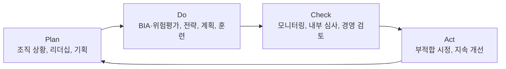

# ISO 22301

---

## I. 업무 연속성 경영시스템의 국제 표준, ISO 22301의 개요

### 가. 정의

- 업무 중단 사고에 대비해 조직이 **비즈니스 연속성 경영시스템(BCMS)을 수립·운영·점검·개선하기 위한 요구사항**을 정한 인증용 국제 표준 (2012 제정, 2019 개정)

### 나. 필요성 및 특징

| 구분 | 내용 |
| --- | --- |
| 필요성 | 재난·사이버 공격·공급망 중단에 대한 조직 회복력 확보, 대외 신뢰 입증 |
| 관리체계 표준 | ISO 상위 구조(HLS)를 따라 ISO 27001 등과 통합 운영 용이 |
| PDCA | 계획–운영–평가–개선의 지속적 개선 |
| 분석 기반 | BIA·위험 평가로 연속성 전략 결정 |

---

## II. BCMS 구조 및 구성요소

### 가. PDCA 기반 BCMS

- 조직 상황과 리더십을 바탕으로 계획하고, 운영 단계(8조)에서 BIA·위험평가·전략·계획·훈련을 수행한 뒤 심사·검토로 개선

### 나. 구성요소 (표준 조항 중심)

| 구분 | 요소 | 설명 |
| --- | --- | --- |
| 기획 | 조직 상황·리더십 (4~6조) | 이해관계자 요구, 적용 범위, 정책, 목표 |
| 운영 (8조) | [[BIA (Business Impact Analysis)\|BIA]] | 업무 중단 영향, 우선순위, 복구 목표 |
| | 위험 평가 | 중단 위험 식별·분석·평가 |
| | 연속성 전략·해결책 | 복구 방식과 필요 자원 선정 |
| | 연속성 계획·절차 | 사고 대응 조직, 경고·의사소통, 복구 절차 ([[BCP]], [[DRP(RTO, RPO 등)\|DRP]]) |
| | 훈련 프로그램 | 도상·기능·전면 훈련으로 실효성 검증 |
| 평가 (9조) | 내부 심사·경영 검토 | 요구사항 충족 여부와 효과성 검토 |
| 개선 (10조) | 시정 조치 | 부적합 원인 제거, 지속 개선 |

---

## III. ISO 27001 비교 및 동향

### 가. ISO 22301 vs ISO 27001

| 구분 | ISO 22301 (BCMS) | ISO 27001 (ISMS) |
| --- | --- | --- |
| 목적 | 업무 중단 시 연속성·복구 | 정보의 기밀성·무결성·가용성 보호 |
| 주요 위협 | 재난, 인프라·공급망 중단, 대형 사고 | 해킹, 정보 유출, 내부자 위협 |
| 핵심 산출물 | BIA, 연속성 계획, 훈련 결과 | 위험 평가, 적용성 보고서(SoA), 보안 정책 |
| 핵심 지표 | MTPD, RTO, RPO | 위험 수준, 위험 수용 기준 |
| 공통점 | ISO 상위 구조, PDCA, 인증 심사 | 동일 |

### 나. 동향

- **통합 경영시스템**: ISO 27001(예방)과 ISO 22301(복구)을 결합해 [[사이버 레질리언스]] 체계 구성
- **공급망 연속성**: 핵심 협력사·클라우드 사업자([[CSP]])에 연속성 계획·인증을 요구하는 계약 확대
- **관련 지침 정비**: ISO/TS 22317(BIA), ISO 22313(BCMS 지침) 등 하위 표준 활용

---

### 🔗 연관 토픽

- **소속 도메인**: [[00_경영전략_MOC|📈 경영전략]]
- **세부 분류**: `3. 비즈니스 프로세스 혁신 & 디지털 전환 (DX)`
- **핵심 연관 토픽**:
  - [[BCM|BCM (Business Continuity Management)]]
  - [[BCP|BCP (Business Continuity Planning)]]
  - [[BIA (Business Impact Analysis)]]
  - [[DRP(RTO, RPO 등)]]
  - [[사이버 레질리언스]]
