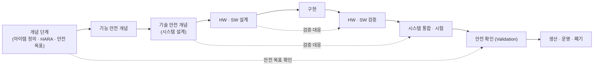

# ISO 26262

---

## I. 자동차 기능안전 표준, ISO 26262의 개요

### 가. 정의

- 도로 차량 E/E(전기·전자) 시스템의 **오작동으로 인한 비합리적 위험을 막기 위해 개발 생명주기 전반의 안전 활동과 요구사항을 규정한 기능안전 국제 표준** ([[IEC 61508]]의 자동차 분야 파생, 2011년 초판·2018년 2판)

### 나. 특징

| 구분 | 내용 |
| --- | --- |
| 등장 배경 | 전장화·[[Smart Car(자율주행)\|자율주행]]·SDV로 SW·HW 복잡도 급증, 사고 시 책임 입증 필요 |
| 위험 기반 | HARA로 위험원별 [[ASIL]] 결정, 등급에 따라 요구 수준 차등 |
| V-모델 | 시스템·HW·SW 단계별 설계와 검증의 대응, 요구사항 추적성 |
| 전 생애주기 | 개념 → 개발 → 생산 → 운영 → 폐기까지 안전 관리 |
| 구성 | 12개 Part (용어, 관리, 개념, 시스템·HW·SW 개발, 생산·운영, 지원 프로세스, ASIL 기반 분석, 가이드, 반도체, 모터사이클) |

---

## II. 안전 생명주기 및 구성요소

### 가. 안전 생명주기 (V-모델)

- 개념 단계에서 정한 안전 목표가 기능·기술 안전 요구로 구체화되고, V-모델 우측 검증 활동으로 달성 여부를 추적

### 나. 구성요소

| 구분 | 요소 | 설명 |
| --- | --- | --- |
| 위험 분석 | HARA | 위험원 식별 후 심각도·노출·통제 가능성으로 위험 평가 |
| | [[ASIL\|ASIL]] | QM, ASIL A~D(D가 가장 엄격) |
| 요구사항 | 안전 목표 → FSR → TSR | 최상위 목표를 기능·기술 안전 요구사항으로 분해 |
| HW 분석 | FMEDA, FTA | 고장률·진단 커버리지 분석, SPFM·LFM·PMHF 지표 산출 |
| SW 검증 | 정적 분석, 결함 주입 | 코딩 지침(MISRA C) 준수, 오류 주입으로 안전 상태 전환 확인 |
| 지원 프로세스 | DIA | OEM과 공급사 간 안전 활동 책임·산출물 분담 협약 |
| | 도구 신뢰 수준 (TCL) | 개발·검증 도구 오류가 안전에 미칠 영향 평가 (TCL 1~3) |
| 확인 조치 | Confirmation Review · 기능안전 감사 · 평가 | 산출물·프로세스의 독립적 확인 |

---

## III. 비교 및 동향

### 가. ISO 26262 vs ISO 21448 vs ISO/SAE 21434

| 비교 항목 | ISO 26262 (기능안전) | ISO 21448 (SOTIF) | ISO/SAE 21434 (사이버보안) |
| --- | --- | --- | --- |
| 목적 | E/E 고장·결함으로 인한 위험 방지 | 고장 없이 기능 한계·예측 가능한 오용으로 인한 위험 방지 | 사이버 공격으로 인한 위험 방지 |
| 원인 | SW 버그, HW 랜덤 고장 | 센서 인지 한계, 알고리즘 판단 오류, 악천후 | 네트워크 침투, 악성코드, 무선 인터페이스 취약점 |
| 분석 | HARA → ASIL | 시나리오 기반 미지·위험 영역 축소 | TARA → CAL |
| 대상 | 제동·조향 등 제어기 | ADAS·자율주행 인지·판단 기능 | 커넥티드 카, OTA, V2X |

### 나. 동향

- **통합 안전**: SDV 환경에서 기능안전·SOTIF·사이버보안([[차량 사이버 보안 국제 표준(ISO 21434)|ISO 21434]])을 함께 적용하는 통합 프로세스 구축
- **AI 안전**: 결정론적 SW 중심의 기존 체계를 보완하는 ISO/PAS 8800(도로 차량 AI 안전, 2024) 발행
- **3판 개정**: SOTIF·사이버보안·AI 연계를 반영한 ISO 26262 3판 개정 작업 진행

---

### 🔗 연관 토픽

- **소속 도메인**: [[00_디지털서비스_MOC|🚀 디지털서비스]]
- **세부 분류**: `3. 사물인터넷 (IoT) & 스마트 플랫폼 · 메타버스`
- **핵심 연관 토픽**:
  - [[ASIL|ASIL (Automotive Safety Integrity Level)]]
  - [[IEC 61508]]
  - [[차량 사이버 보안 국제 표준(ISO 21434)]]
  - [[STPA|STPA (System-Theoretic Process Analysis)]]
  - [[Smart Car(자율주행)]]
