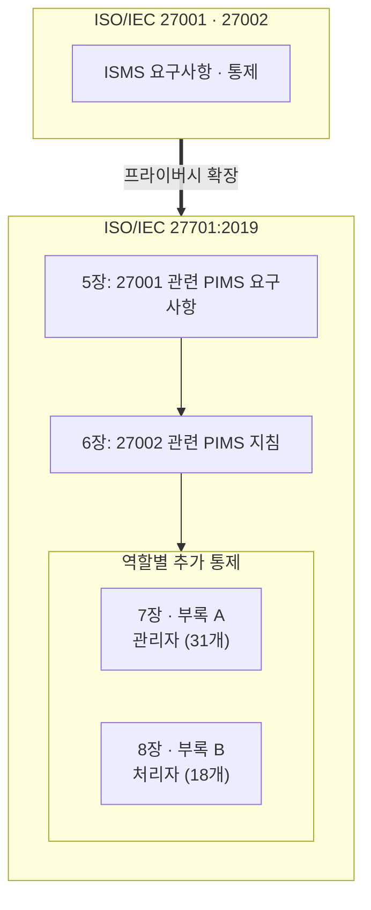

# ISO/IEC 27701

---

## I. 국제 표준 개인정보 관리체계, ISO 27701의 개요

### 가. 정의

- 조직의 **개인정보 관리체계(PIMS)를 수립·운영·개선하기 위한 요구사항과 지침**을 정한 국제 표준으로, 2019년판은 ISO/IEC 27001·27002의 확장으로 제정

### 나. 특징

| 구분 | 내용 |
| --- | --- |
| 규제 대응 | GDPR 등 각국 개인정보 법규 준수를 입증하는 공통 틀 |
| 역할 구분 | PII 관리자(Controller)와 처리자(Processor)별 통제 분리 |
| ISMS 연계 | 2019년판은 ISO 27001 인증을 전제로 확장 인증 |
| 단독 표준화 | 2025년 개정판은 27001과 분리된 독립 관리체계 표준으로 전환 |

---

## II. 구조 및 구성요소

### 가. 2019년판 구조

- 기존 ISMS 요구사항에 개인정보 관점을 덧붙이고, 조직 역할에 맞는 관리자·처리자 통제를 적용성 선언서(SoA)로 선택

### 나. 구성요소

| 구분 | 요소 | 설명 |
| --- | --- | --- |
| 관리체계 | PIMS 요구사항 (5장) | 조직 상황, 개인정보 위험 평가·처리 |
| | PIMS 지침 (6장) | 27002 통제를 개인정보 보호 관점으로 보완 |
| 관리자 통제 | 수집·처리 조건 | 처리 목적 식별, 적법 근거, 동의 기록 |
| | 정보주체 의무 | 고지, 열람·정정·삭제 요구 대응 |
| | 설계·기본 설정 보호 | [[개인정보보호 중심 설계\|Privacy by Design·Default]], 최소 수집 |
| 처리자 통제 | 위탁 조건 | 관리자 지시 범위 내 처리, 재위탁 통지 |
| 공통 | 국외 이전 | 이전 국가·근거 관리 |
| | 침해 통지 | 유출 시 관리자·감독기관·정보주체 통지 절차 |

---

## III. 비교 및 동향

### 가. ISO 27701 vs ISMS-P

| 비교 항목 | ISO/IEC 27701 | [[ISMS-P]] |
| --- | --- | --- |
| 성격 | 국제 표준, 자율 인증 | 국내 법정 인증 (ISMS 의무, ISMS-P 자율) |
| 기반 | 2019년판은 ISO 27001 전제 | 정보통신망법, [[개인정보보호법]] |
| 대응 규제 | GDPR 등 국제 규제 | 국내 개인정보보호법 |
| 역할 구분 | 관리자·처리자 구분 | 개인정보처리자 중심 (수탁자 관리 포함) |
| 통제 수 | 2019년판 부록 A 31 + 부록 B 18 | 101개 (관리체계 16, 보호대책 64, 개인정보 21) |

### 나. 동향

- **2025년 개정**: 독립 관리체계 표준(Harmonized Structure)으로 바뀌어 27001 없이 단독 인증 가능
- **글로벌 기업 채택**: 클라우드·SaaS 기업이 다국 규제 대응 근거로 활용 ([[ISO 27018]]과 병행)
- **AI 거버넌스 연계**: ISO/IEC 42001(AI 관리체계)과 통합 운영 사례 증가

---

### 🔗 연관 토픽

- **소속 도메인**: [[00_보안_MOC|🛡️ 보안]]
- **세부 분류**: `1. 정보보안 원칙 & 거버넌스 · 인증`
- **핵심 연관 토픽**:
  - [[ISMS-P]]
  - [[ISO 27018]]
  - [[ISO 27017]]
  - [[개인정보보호 중심 설계|개인정보보호 중심 설계(Privacy by Design)]]
  - [[개인정보보호법]]
