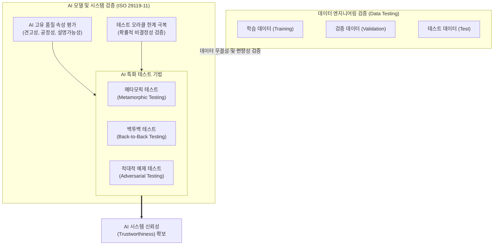

# ISO 29119-11 (AI 기반 시스템 테스트)

---

## I. AI 기반 시스템을 위한 소프트웨어 테스트 국제 표준, ISO 29119-11의 개요

블랙박스 특성과 비결정적(Non-deterministic) 확률 출력을 생성하는 인공지능(AI) 기반 소프트웨어 시스템을 체계적으로 검증하기 위해 테스트 프로세스, 기법 및 품질 가이드라인을 제공하는 국제 표준(ISO/IEC TR 29119-11)이다.

| 구분 | 주요 내용 |
| --- | --- |
| **개념** | 데이터 주도 학습(Data-Driven)을 수행하는 머신러닝/딥러닝 시스템의 신뢰성을 보증하기 위해 전통적 테스팅의 한계를 보완한 AI 특화 테스트 표준 |
| **등장 배경** | 규칙 기반(Rule-based)과 달리 명확한 기댓값을 사전에 정의하기 어려운 테스트 오라클 문제 및 AI 알고리즘의 편향·취약성 극복 필요 |
| **핵심 특징** | 테스트 오라클 부재 극복(메타모픽 테스트), AI 3대 핵심 품질(견고성, 공정성, 설명가능성) 검증, 뉴런 커버리지 및 데이터 파이프라인 검증 제시 |

---

## II. ISO 29119-11의 아키텍처 및 핵심 테스트 요소

### 가. AI 시스템 테스트 프레임워크 및 프로세스

데이터 세트의 무결성 검증부터 시작하여, 기댓값이 불분명한 AI의 비결정적 출력을 메타모픽 및 백투백 테스트로 검증하고 견고성과 공정성을 다각도로 평가한다.

### 나. ISO 29119-11의 핵심 기술 및 테스트 기법

| 분류 | 요소기술 (키워드) | 세부 설명 |
| --- | --- | --- |
| **품질 특성** | 설명가능성 (Explainability) | 블랙박스 모델의 추론 근거와 예측 과정을 인간이 이해할 수 있도록 해석 및 검증 ([[XAI]] 기법) |
| **품질 특성** | 견고성 (Robustness) | 입력 데이터의 노이즈, 센서 왜곡, 악의적인 [[적대적 공격]](FGSM 등)에 대한 시스템의 저항력 평가 |
| **품질 특성** | 공정성 (Fairness) | 학습 데이터와 모델 추론 결과에 특정 성별, 인종, 계층에 대한 차별적 [[편향]](Bias)이 없는지 검증 |
| **테스트 기법** | 메타모픽 테스트 (Metamorphic) | 명확한 참 오라클이 없을 때, 입력의 체계적 변형과 출력 간의 변형 관계(MR) 일관성을 검증하는 기법 |
| **테스트 기법** | 백투백 테스트 (Back-to-Back) | 동일한 입력에 대해 기존 모델(레퍼런스)과 신규 모델의 출력을 상호 비교하여 성능 퇴행 여부 검증 |
| **테스트 기법** | 적대적 테스트 (Adversarial) | 미세한 섭동(Perturbation)을 주입한 적대적 예제를 모델에 투입하여 오분류 유발 여부를 검증 |
| **커버리지** | 뉴런 커버리지 (Neuron Coverage) | 소스코드 라인 대신 딥러닝 내부의 인공 뉴런 중 특정 임계치 이상 활성화된 뉴런의 비율을 측정 |
| **데이터 검증** | 데이터 누수(Data Leakage) 검증 | 훈련 데이터와 평가 데이터 간의 오염 여부를 점검하고 전처리 파이프라인의 데이터 일관성 보증 |

---

## III. 전통적 SW 테스트와 AI 시스템 테스트 비교 및 최신 동향

### 가. 전통적 SW 테스트(ISO 29119-1~4) vs AI 시스템 테스트(ISO 29119-11) 비교

| 비교 항목 | 전통적 SW 테스트 ([[ISO 29119]]-1~4) | AI 시스템 테스트 (ISO 29119-11) |
| --- | --- | --- |
| **검증 대상** | 정적 소스코드 및 규칙(Rule) 기반 로직 | **데이터 품질 및 학습된 통계적 모델(Data-driven)** |
| **테스트 오라클** | 결정적 (사전에 명확한 참/거짓 판단 가능) | **비결정적** (확률적 출력, 대체 의사 오라클 필수) |
| **핵심 기법** | 동등 분할, 경계값 분석, 구문/분기 커버리지 | **메타모픽 테스팅, 적대적 공격 테스트, 뉴런 커버리지** |
| **결함 원인** | 개발자의 코딩 실수 및 명세서 불일치 | 훈련 데이터 편향, 과적합, 데이터 드리프트 |
| **유지보수 검증** | 기능 추가 및 소스코드 리팩토링 시 회귀 테스트 | 운영 데이터 분포 변화(Data Drift) 감지 시 재학습/재검증 |

### 나. 최신 기술 동향 및 발전 방향

* **글로벌 AI 규제 컴플라이언스 연계**: EU AI Act(인공지능법) 및 글로벌 규제 기구에서 고위험 AI(자율주행, 의료, 채용 등)의 시스템 안전성을 입증하기 위한 필수 심사 기준으로 ISO 29119-11 채택이 확산됨.
* **[[인공지능 경영시스템]](ISO/IEC 42001)과의 통합**: 기업 전사 차원의 AI 거버넌스(ISO 42001) 구축 시, 실무적인 AI 모델 품질 보증(QA) 실천 방법론으로 ISO 29119-11 테스트 프로세스가 표준 통합됨.

---

### 🔗 연관 토픽

- **소속 도메인**: [[00_소프트웨어공학_MOC|🏗️ 소프트웨어공학]]
- **세부 분류**: `6. 소프트웨어 테스팅 & 품질 보증 (QA/QC)`
- **핵심 연관 토픽**:
  - [[테스트 오라클]]
  - [[XAI]]
  - [[적대적 공격]]
  - [[코드 커버리지]]
  - [[인공지능 경영시스템]]
