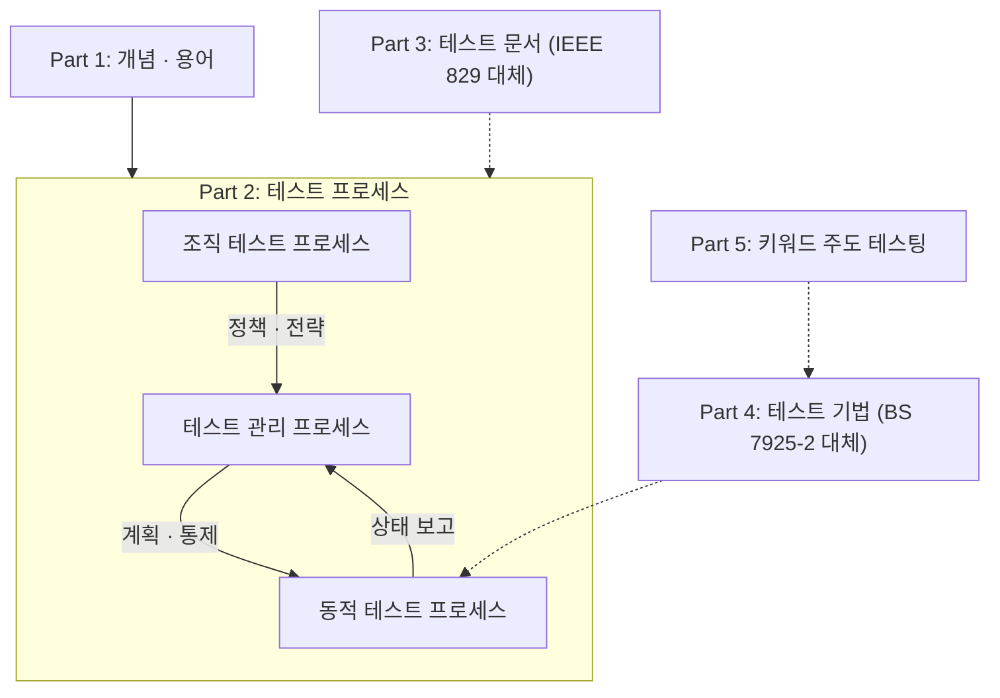

# ISO/IEC/IEEE 29119 (소프트웨어 테스팅 표준)

---

## I. 흩어진 테스트 표준의 통합, ISO/IEC/IEEE 29119의 개요

### 가. 정의

- IEEE 829, BS 7925 등 기존 테스트 표준을 통합하여 **테스트 개념·프로세스·문서·기법을 정의한 소프트웨어 테스팅 국제 표준** (Part 1~3은 2022년 개정)

### 나. 특징

| 구분 | 내용 |
| --- | --- |
| 등장 배경 | 표준 간 중복·충돌 해소, 애자일 등 다양한 [[SDLC]]에 적용 가능한 공통 틀 필요 |
| 위험 기반 | [[위험 기반 테스트]]를 프로세스 전반의 기본 접근으로 채택 |
| 3계층 프로세스 | 조직-관리-동적 테스트의 계층 구조 |
| 테일러링 | 프로젝트 특성에 맞춰 프로세스·문서를 [[테일러링\|조정]] 가능 |

---

## II. 표준 구성 및 3계층 프로세스

### 가. 표준 구성과 3계층 프로세스

- Part 1의 공통 개념 위에 Part 2의 3계층 프로세스가 동작하고, 각 단계는 Part 3 문서 양식과 Part 4·5의 설계 기법으로 지원

### 나. 구성요소

| 구분 | 요소 | 설명 |
| --- | --- | --- |
| 표준 구성 | Part 1 개념 · 정의 | 공통 용어, 테스트 원리, 다계층 프로세스 개념 |
| | Part 2 테스트 프로세스 | 조직·관리·동적 3계층 프로세스 |
| | Part 3 테스트 문서 | 정책서·전략서·계획서·명세서·보고서 양식 |
| | Part 4 테스트 기법 | 명세 기반·구조 기반·경험 기반 설계 기법 |
| | Part 5 키워드 주도 | 키워드 단위로 케이스를 추상화해 자동화 지원 ([[Keyword Driven Testing]]) |
| 3계층 프로세스 | 조직 테스트 | 조직 테스트 정책·전략 수립 및 유지 |
| | 테스트 관리 | 프로젝트 테스트 계획, 모니터링·통제, 완료 보고 |
| | 동적 테스트 | 설계·구현, 환경 구축, 실행, 인시던트 보고 |
| 관련 보고서 | Part 6 · Part 11 (TR) | 애자일 적용 가이드, [[ISO 29119-11\|AI 시스템 테스팅]] |

---

## III. 비교 및 동향

### 가. 3계층 프로세스별 산출물

| 계층 | 핵심 활동 | 주요 산출물 (Part 3) |
| --- | --- | --- |
| 조직 | 전사 테스트 정책·전략 수립 | 조직 테스트 정책, 조직 테스트 전략 |
| 관리 | 프로젝트 테스트 계획·통제·완료 | 테스트 계획서, 상태·완료 보고서 |
| 동적 | 테스트 설계·실행·결과 기록 | 테스트 명세서, 테스트 로그, 인시던트 보고서 |

### 나. 동향

- 애자일·DevOps 환경에는 Part 6 지침과 테일러링으로 문서 부담을 줄여 적용
- AI 시스템 테스트를 다루는 29119-11 등 신규 기술 대응 보고서 발간
- 키워드 주도 방식이 스크립트리스 테스트 자동화 도구의 기반으로 활용

---

### 🔗 연관 토픽

- **소속 도메인**: [[00_소프트웨어공학_MOC|🏗️ 소프트웨어공학]]
- **세부 분류**: `1. 소프트웨어 개발 생명주기(SDLC) & 방법론`
- **핵심 연관 토픽**:
  - [[소프트웨어 테스트|소프트웨어 테스트 (Software Test)]]
  - [[Test Process]]
  - [[위험 기반 테스트]]
  - [[ISO 29119-11]]
  - [[Keyword Driven Testing]]
