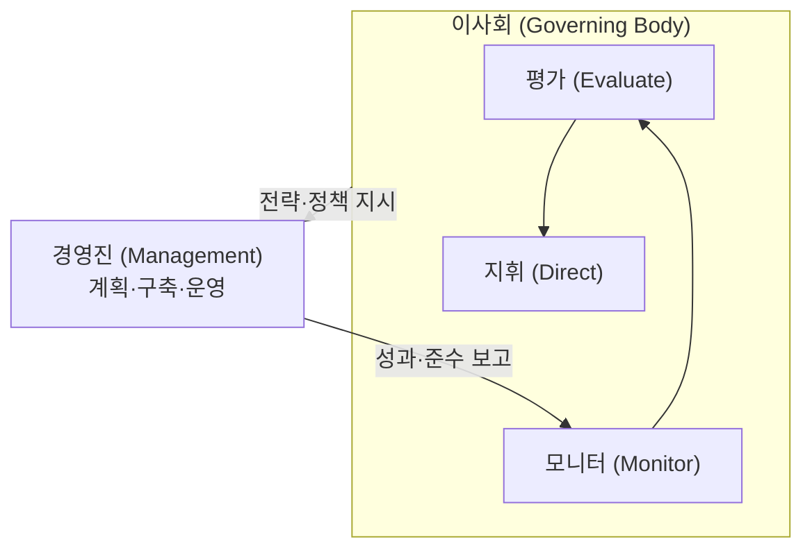

# ISO/IEC 38500:2024

---

## I. 이사회를 위한 IT·데이터 거버넌스 표준, ISO/IEC 38500:2024의 개요

### 가. 정의

- 조직의 **이사회(Governing Body)가 데이터와 IT의 효과적·효율적·수용 가능한 활용을 평가·지휘·모니터링(EDM)** 하도록 원칙과 모델을 제시하는 국제 표준의 2024년 개정판 (초판 2008, 2판 2015)

### 나. 개정 배경 및 특징

| 구분 | 내용 |
| --- | --- |
| 배경 | 조직 거버넌스 표준 ISO 37000(2021) 제정, AI·클라우드 확산에 따른 데이터 활용 위험 증가 |
| ISO 37000 정렬 | 조직 거버넌스 원칙을 IT·데이터 거버넌스에 적용하도록 구조 개편 |
| 데이터 포함 | IT뿐 아니라 데이터의 활용·위험을 거버넌스 대상에 명시 |
| 원칙 중심 | 구체적 통제 절차가 아닌 이사회의 책임과 원칙 제시 (실행은 COBIT 등 활용) |

---

## II. ISO/IEC 38500의 구조 및 구성요소

### 가. EDM 모델

- 이사회가 현재·미래 IT 활용을 평가하고, 전략·정책으로 지휘하며, 성과와 준수를 모니터링해 다시 평가에 반영

### 나. 구성요소

| 구분 | 요소 | 설명 |
| --- | --- | --- |
| 거버넌스 모델 | Evaluate (평가) | 현재·미래 IT·데이터 활용과 위험 평가 |
| | Direct (지휘) | 전략·정책 수립과 책임 부여 |
| | Monitor (모니터) | 성과·정책 준수 감시 |
| 2015판 6원칙 | 책임 (Responsibility) | IT 공급·수요 책임의 명확한 부여 |
| | 전략 (Strategy) | 현재·미래 IT 역량을 고려한 경영 전략 |
| | 획득 (Acquisition) | 타당한 분석과 투명한 의사결정에 따른 IT 획득 |
| | 성과 (Performance) | 현재·미래 업무 요구를 충족하는 서비스 수준 |
| | 준수 (Conformance) | 법규·내부 정책 준수 |
| | 인간 행동 (Human Behaviour) | 이해관계자 요구와 사람 요소 존중 |
| 2024판 | ISO 37000 기반 원칙 | 목적, 가치 창출, 전략, 감독, 책임, 이해관계자 참여, 데이터와 의사결정, 위험 거버넌스 등 조직 거버넌스 원칙을 데이터·IT에 적용 |

---

## III. 관련 프레임워크 비교 및 동향

### 가. ISO/IEC 38500 vs COBIT 2019 vs ITIL 4

| 구분 | ISO/IEC 38500 | COBIT 2019 | ITIL 4 |
| --- | --- | --- | --- |
| 목적 | 이사회의 거버넌스 원칙 | 거버넌스·관리 목표와 통제 | IT 서비스 관리 실무 |
| 초점 | What·Why | How (통제·관리) | How (서비스 운영) |
| 대상 | 이사회, 최고경영진 | 경영진, IT 관리자, 감사인 | 서비스 관리 실무자 |
| 핵심 체계 | EDM 모델, 원칙 | 40개 거버넌스·관리 목표, 7개 구성요소 | SVS, 4차원 모델, 34개 관행 |

### 나. 동향

- **계층적 결합**: 38500으로 이사회 원칙을 세우고, COBIT으로 통제 목표, [[ITIL(IT Infrastructure Library) 4.0|ITIL]]로 운영 실무를 구현
- **AI 거버넌스 연계**: ISO/IEC 38507(AI 활용의 거버넌스 영향), ISO/IEC 42001([[인공지능 경영시스템]])과 함께 적용
- **데이터 거버넌스 연계**: ISO/IEC 38505 시리즈(데이터 거버넌스)와 [[데이터 거버넌스]] 체계 구축에 활용

---

### 🔗 연관 토픽

- **소속 도메인**: [[00_경영전략_MOC|📈 경영전략]]
- **세부 분류**: `2. IT 거버넌스 & 엔터프라이즈 아키텍처 (EA/ISP)`
- **핵심 연관 토픽**:
  - [[IT 거버넌스]]
  - [[ITIL(IT Infrastructure Library) 4.0]]
  - [[데이터 거버넌스|데이터 거버넌스 (Data Governance)]]
  - [[인공지능 경영시스템|인공지능 경영시스템(ISO 42001:2023)]]
  - [[CIO]]
