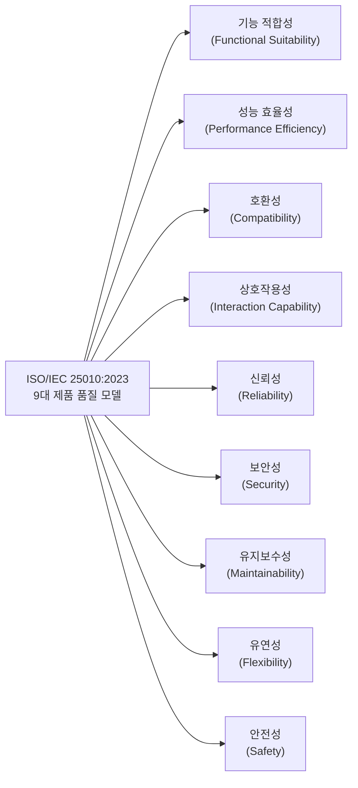

# ISO/IEC 25010:2023

---

## I. 최신 디지털 환경을 반영한 SW 제품 품질 모델, ISO/IEC 25010:2023의 개요

소프트웨어 제품 및 시스템이 갖추어야 할 품질 특성과 세부 부특성을 규정한 국제 표준으로, 기존 2011년 판본의 8대 품질 특성을 최신 IT 환경(AI, 클라우드, 자율주행 등)에 맞추어 개정·확장한 9대 제품 품질 모델이다.

| 구분 | 주요 내용 |
| --- | --- |
| **개념** | 소프트웨어 제품 자체의 정적·동적 속성을 평가하는 '제품 품질 모델'과 실제 운영 시 사용자가 체감하는 '사용 품질 모델'을 제시하는 국제 표준 |
| **등장 배경** | 기존 '사용성'과 '이식성'의 개념적 모호성 해소, SW 결함이 물리적·인명 피해로 직결되는 임베디드 및 자율주행 환경 확산에 따른 '안전성' 요건 강화 |
| **핵심 특징** | 9대 제품 품질 특성 체계 확립, 안전성(Safety)의 독립 주특성 승격, 상호작용성(Interaction Capability) 및 유연성(Flexibility) 개편 |

---

## II. ISO/IEC 25010:2023의 아키텍처 및 핵심 구성 요소

### 가. ISO/IEC 25010:2023 제품 품질 모델 구성도

기존 8대 특성 체계에서 '사용성'을 '상호작용성'으로, '이식성'을 '유연성'으로 고도화하고, 별도 사용 품질에 머물던 '안전성(Safety)'을 제품 품질의 핵심 9번째 주특성으로 신설·승격하였다.

### 나. ISO/IEC 25010:2023의 9대 핵심 품질 특성

| 분류 | 품질 특성 (키워드) | 세부 설명 및 주요 부특성 |
| --- | --- | --- |
| **기능** | 기능 적합성 (Functional Suitability) | 명시된 조건에서 사용될 때 명시적·묵시적 요구를 충족하는 기능을 제공하는 정도 (완전성, 정확성, 적절성) |
| **성능** | 성능 효율성 (Performance Efficiency) | 명시된 조건에서 사용되는 자원량 대비 발휘되는 성능의 수준 (시간 동작성, 자원 활용성, 용량) |
| **연계** | 호환성 (Compatibility) | 동일한 하드웨어/소프트웨어 환경을 공유하며 정보를 교환할 수 있는 정도 (공존성, 상호운용성) |
| **UX** | 상호작용성 (Interaction Capability) | 사용자가 시스템과 효과적·효율적으로 상호작용하는 정도 (구 사용성 대체: 포용성, 자가기술성, 학습성 등) |
| **운영** | [[신뢰성]] (Reliability) | 규정된 조건 및 시간 동안 명시된 기능을 오작동 없이 안정적으로 수행하는 정도 (무결함성, [[HA(High Availability)\|가용성]], 결함허용성) |
| **보안** | 보안성 (Security) | 인가된 사용자에게는 데이터 접근을 보장하고 무인가 접근은 방어하는 정도 ([[기밀성]], [[무결성]], 책임추적성) |
| **유지** | 유지보수성 (Maintainability) | 결함 수정이나 환경 변화에 대응하여 소프트웨어가 효과적으로 변경될 수 있는 정도 (모듈성, 재사용성, 수정성) |
| **확장** | 유연성 (Flexibility) | 변화하는 운영 환경이나 사용자 요구에 적응할 수 있는 정도 (구 이식성 대체: 적응성, 확장성, 시험성) |
| **안전** | 안전성 (Safety) | 소프트웨어 오작동이나 결함으로 인해 인명, 재산, 환경에 가해지는 위해(Harm)를 회피하는 정도 (위험 완화, 페일세이프) |

---

## III. 2011년 모델과 2023년 모델 비교 및 최신 동향

### 가. ISO/IEC 25010 2011 vs 2023 비교

| 비교 항목 | ISO/IEC 25010:2011 | ISO/IEC 25010:2023 |
| --- | --- | --- |
| **품질 특성 수** | 8대 주특성 | **9대 주특성 (1개 특성 순증)** |
| **사용자 인터페이스** | 사용성 (Usability) | **상호작용성 (Interaction Capability)** - 포용성/접근성 강조 |
| **환경 적응성** | 이식성 (Portability) | **유연성 (Flexibility)** - 시험성(Testability), 확장성 포괄 |
| **안전성(Safety)의 위상** | 사용 품질(Quality in Use)의 하위 부특성 | **제품 품질(Product Quality)의 독립 주특성으로 전면 승격** |
| **주요 반영 환경** | 전통적 웹/엔터프라이즈 데스크톱 시스템 | **AI, IoT, 클라우드 네이티브, 자율주행, 의료 등 고위험 융합 환경** |

### 나. 최신 기술 동향 및 발전 방향

* **임베디드 및 모빌리티 기능안전(Safety) 표준 연계**: 스마트카(ISO 26262), 로봇, 의료기기 분야에서 소프트웨어 오작동이 생명 안전과 직결됨에 따라 제품 평가 시 Safety 메트릭이 필수 요구 조건으로 자리 잡음.
* **글로벌 인증(GS 인증) 시험 기준 개편**: 한국정보통신기술협회(TTA) 등 주요 공인 시험기관들이 GS 인증의 기술 평가 기준 모델을 2023년 최신 개정판(9대 특성 체계)으로 개편 적용 중임.

---

### 🔗 연관 토픽

- **소속 도메인**: [[00_소프트웨어공학_MOC|🏗️ 소프트웨어공학]]
- **세부 분류**: `6. 소프트웨어 테스팅 & 품질 보증 (QA/QC)`
- **핵심 연관 토픽**:
  - [[GS 인증]]
  - [[SP 인증]]
  - [[신뢰성]]
  - [[무결성]]
  - [[기밀성]]
