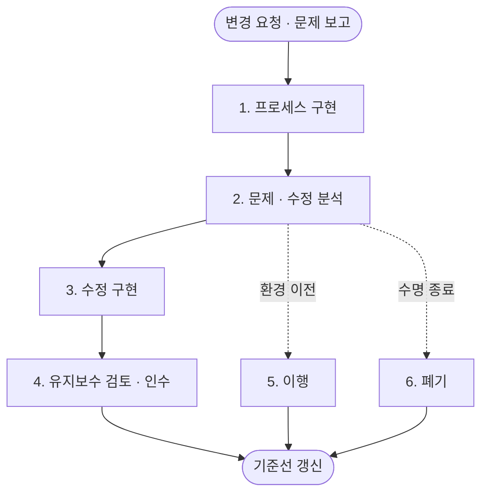

# ISO/IEC/IEEE 14764

---

## I. 유지보수 프로세스의 표준화, ISO/IEC/IEEE 14764의 개요

### 가. 정의

- 인도 이후 SW의 **수정·적응·개선·예방 활동과 유지보수 프로세스, 이행·폐기까지를 정의한 소프트웨어 [[유지보수]] 국제 표준** (최신판 2022)

### 나. 특징

| 구분 | 내용 |
| --- | --- |
| 등장 배경 | 유지보수가 생명주기 비용의 60~80%를 차지, 절차 표준화 필요 |
| 상위 표준 연계 | ISO/IEC/IEEE 12207의 유지보수 프로세스를 상세화 |
| 유형 정의 | 수정·예방·적응·완전 4가지 유형 제시 |
| 생애 전체 포괄 | 수정뿐 아니라 이행(Migration)·폐기(Retirement) 포함 |

---

## II. 유지보수 프로세스 및 활동

### 가. 유지보수 프로세스

- 계획 수립 후 문제 분석·영향 분석을 거쳐 수정·인수하며, 필요 시 환경 이행이나 폐기 활동 수행

### 나. 활동 구성

| 구분 | 요소 | 설명 |
| --- | --- | --- |
| 준비 | 프로세스 구현 | 유지보수 계획·절차, [[형상 관리]] 체계, 문제 처리 조직 마련 |
| 분석 | 문제 · 수정 분석 | 문제 재현·원인 파악, 대안 도출, 영향 분석 후 승인 |
| 수정 | 수정 구현 | 분석·설계·코딩·[[통합 테스트\|통합 시험]]으로 변경 반영 |
| 인수 | 검토 · 인수 | 변경 무결성 검토, [[인수 테스트]], 기준선 갱신 |
| 생애 관리 | 이행 (Migration) | 신규 플랫폼·환경으로 SW·데이터 이전, 병행 운영 |
| | 폐기 (Retirement) | 사용 중지 계획, 데이터 보존, 사용자 통지 |

---

## III. 비교 및 동향

### 가. 4가지 유지보수 유형

| 비교 항목 | 수정 (Corrective) | 적응 (Adaptive) | 완전 (Perfective) | 예방 (Preventive) |
| --- | --- | --- | --- | --- |
| 목적 | 발견된 결함 수정 | 환경 변화 대응 | 기능·성능·유지보수성 개선 | 잠재 결함의 사전 수정 |
| 대응 시점 | 사후 (Reactive) | 사후 (Reactive) | 사전 (Proactive) | 사전 (Proactive) |
| 그룹 | 정정 (Correction) | 개선 (Enhancement) | 개선 (Enhancement) | 정정 (Correction) |
| 계기 | 운영 중 장애 | OS·HW·법제도 변경 | 사용자 개선 요구 | 결함 징후·구조 노후화 |
| 비중 (Lientz & Swanson) | 약 20% | 약 25% | 약 50% | 약 5% |

### 나. 동향

- [[Agile]]·[[DevOps]] 환경에서 완전 유지보수가 CI/CD를 통한 상시 개선 형태로 수행
- AIOps·정적 분석으로 장애 징후와 취약점을 미리 찾는 예방 유지보수 비중 확대

---

### 🔗 연관 토픽

- **소속 도메인**: [[00_소프트웨어공학_MOC|🏗️ 소프트웨어공학]]
- **세부 분류**: `1. 소프트웨어 개발 생명주기(SDLC) & 방법론`
- **핵심 연관 토픽**:
  - [[유지보수]]
  - [[Lehman의 Software 변화의 원리]]
  - [[형상 관리]]
  - [[SDLC]]
  - [[정보시스템 운영 유지보수 감리|정보시스템 운영/유지보수 감리]]
