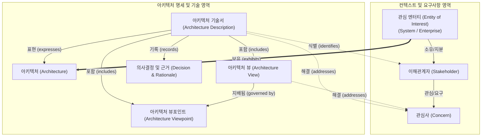

# ISO/IEC/IEEE 42010:2022 (아키텍처 기술 표준)

---

## I. 소프트웨어, 시스템 및 엔터프라이즈 아키텍처 기술 국제표준, ISO 42010:2022의 개요

소프트웨어, 시스템뿐만 아니라 엔터프라이즈(Enterprise) 전반의 아키텍처를 일관되고 체계적으로 기술(Description)하기 위한 개념적 메타 모델과 공통 어휘를 제공하는 국제 표준(ISO/IEC/IEEE 42010:2022)이다.

| 구분 | 주요 내용 |
| --- | --- |
| **개념** | 다양한 이해관계자의 관심사를 수렴하여 이를 해결하기 위한 관점(Viewpoint), 뷰(View), 아키텍처 결정(Decision) 및 근거를 명세하는 표준 프레임워크 |
| **등장 배경** | 2011년 판본의 시스템 중심 한계를 극복하고, 복잡한 현대 IT 환경에 맞추어 엔터프라이즈 영역까지 적용 범위를 확장하며 타 생명주기 표준(ISO 15288 등)과 정합성 확보 필요 |
| **핵심 특징** | 적용 대상(Scope)의 엔터프라이즈 확장, 이해관계자-관심사-뷰포인트-뷰 간의 명확한 지배 관계 규정, 아키텍처 의사결정 기록(ADR) 체계 공식화 |

---

## II. ISO/IEC/IEEE 42010:2022의 아키텍처 메타 모델 및 핵심 구성 요소

### 가. ISO/IEC/IEEE 42010:2022 아키텍처 기술(AD) 개념 모델

관심 대상 엔터티의 이해관계자가 가진 관심사를 식별하고, 특정 관심사를 프레이밍하는 규약인 뷰포인트(Viewpoint)에 따라 구체적인 뷰(View)를 작성하며, 의사결정의 근거를 기록한다.

### 나. ISO/IEC/IEEE 42010:2022의 핵심 개념 요소

| 분류 | 요소기술 (키워드) | 세부 설명 |
| --- | --- | --- |
| **적용 대상** | 관심 엔터티 (Entity of Interest) | 아키텍처 기술의 대상이 되는 소프트웨어, 시스템, 시스템-오브-시스템즈(SoS), 엔터프라이즈 조직 |
| **핵심 본질** | 아키텍처 (Architecture) | 엔터티가 환경 속에서 구체화되는 근본적인 개념 및 속성 (컴포넌트 구조, 상호 관계, 설계 원칙) |
| **작업 산출물** | 아키텍처 기술서 (AD) | 아키텍처를 공식적으로 기록하고 이해관계자에게 전달하기 위한 산출물의 집합 (문서, 저장소, 모델) |
| **요구 주체** | 이해관계자 (Stakeholder) | 시스템의 성공이나 결과에 권리, 몫, 관심 또는 법적 책임을 가지는 개인, 팀 또는 조직 |
| **품질/요구** | 관심사 (Concern) | 성능, 보안, 가용성, 비즈니스 목표 등 이해관계자 관점에서 해결되어야 하는 핵심 요구사항 |
| **설계 규약** | 뷰포인트 (Viewpoint) | 특정 관심사를 다루기 위해 뷰를 작성하는 규칙, 표기법(UML 등), 모델링 패턴 및 분석 기법의 정의 |
| **구체적 표현** | 뷰 (View) | 정의된 뷰포인트의 규칙에 따라 전체 아키텍처 중 특정 관심사 영역을 구체적으로 표현한 산출물 |
| **추적성** | 의사결정 및 근거 (Rationale) | 복수의 아키텍처 대안 중 특정 설계를 채택한 기술적·비즈니스적 선택 이유와 트레이드오프 기록 |

---

## III. 2011년 판본과 2022년 판본 비교 및 최신 동향

### 가. ISO/IEC/IEEE 42010:2011 vs 42010:2022 비교

| 비교 항목 | ISO/IEC/IEEE 42010:2011 | ISO/IEC/IEEE 42010:2022 |
| --- | --- | --- |
| **표준 명칭** | Systems and software engineering | **Software, systems and enterprise** |
| **적용 범위** | 시스템 (System of Interest) 한정 | 시스템뿐만 아니라 **엔터프라이즈(Enterprise) 전반 확장** |
| **타 표준 연계** | 개별 아키텍처 명세 위주 정렬 | **ISO/IEC/IEEE 15288(시스템 수명주기), ISO 15704(EA)** 완벽 연계 |
| **의사결정 기록** | 아키텍처 기술서 내 개념적 권고 | **ADR(Architecture Decision Record) 기록 의무 강화** |
| **주요 목적** | 소프트웨어/시스템 아키텍처 문서화 표준화 | 비즈니스-시스템-소프트웨어를 아우르는 **통합 아키텍처 거버넌스** |

### 나. 최신 기술 동향 및 발전 방향

* **ADR(Architecture Decision Record) 실무 정착**: 클라우드 네이티브 및 마이크로서비스 환경에서 아키텍처 드리프트를 방지하고 설계 이력을 Git 리포지토리에서 코드와 함께 관리하는 ADR 실무가 본 표준의 Rationale 모델을 기반으로 대중화됨.
* **엔터프라이즈 아키텍처(EA/TOGAF)와의 융합**: 기업의 비즈니스 아키텍처(BA), 데이터 아키텍처(DA), 애플리케이션 아키텍처(AA), 기술 아키텍처(TA)를 일관된 메타 모델로 통합 기술하는 거버넌스 프레임워크로 활용됨.

---

### 🔗 연관 토픽

- **소속 도메인**: [[00_소프트웨어공학_MOC|🏗️ 소프트웨어공학]]
- **세부 분류**: `4. 아키텍처 스타일 & 객체지향 설계 원리`
- **핵심 연관 토픽**:
  - [[SW Architecture 구축 절차]]
  - [[SW Architecture 평가]]
  - [[MSA (Micro Service Architecture)]]
  - [[Agile]]
  - [[CBAM]]
