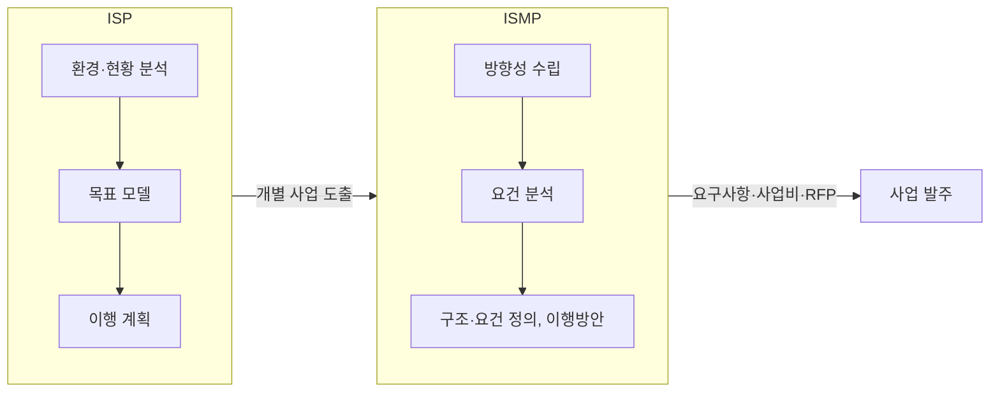

# ISP 및 ISMP 수립 공통가이드 9판

---

## I. 공공 정보화 사전 기획의 표준 절차, 공통가이드의 개요

### 가. 정의

- 공공기관이 정보화사업을 기획할 때 **[[ISP (Information Strategy Plan)|ISP]](정보화전략계획)와 [[ISMP]](정보시스템 마스터플랜)를 수립하는 절차·산출물·점검 항목**을 정리한 행정안전부·한국지능정보사회진흥원(NIA)의 실무 가이드 (2025년 5월 9판)

### 나. 필요성 및 특징

| 구분 | 내용 |
| --- | --- |
| 필요성 | 중복 투자 방지, 사업 범위·예산의 사전 확정, 부실 RFP로 인한 과업 변경 예방 |
| 계층적 기획 | ISP(전사 전략) → ISMP(개별 사업 상세화) → 발주 |
| 정책 부합성 점검 | 클라우드 우선, 데이터 공동활용, 보안 등 정부 정책 반영 여부 확인 |
| 산출물 표준화 | 단계별 활동·산출물 양식 제공으로 기관 간 품질 편차 축소 |

---

## II. 수립 체계 및 핵심 점검 요소

### 가. ISP → ISMP → 발주 흐름

- ISP에서 도출한 과제 중 구축 사업을 ISMP로 상세화해 요구사항·사업비·RFP를 확정한 뒤 발주

### 나. 핵심 점검 요소

| 구분 | 요소 | 설명 |
| --- | --- | --- |
| 아키텍처 | 클라우드 우선 검토 | 민간 클라우드·[[클라우드 네이티브]] 적용 가능성 검토 |
| | 공동활용·연계 | 기존 시스템·공통 기반 재사용, [[공공데이터]] 개방·연계 |
| 보안 | 보안 요구사항 | [[CSAP]] 등 클라우드 보안인증, [[제로 트러스트 보안모델\|제로 트러스트]] 원칙 반영 |
| 신기술 | AI 도입 검토 | AI·데이터 활용 과제의 타당성과 데이터 확보 방안 |
| 사용자 | 서비스 디자인 | 사용자 중심 UI/UX, 접근성 요구사항 정의 |
| 예산 | 사업비 산정 | FP 기반 SW 개발비, 클라우드 이용료 산정 |
| 산출물 | 요구사항·RFP | 기능·비기능 요구사항, 제안요청서 |

---

## III. ISP·ISMP 비교 및 고려사항

### 가. 가이드상 ISP vs ISMP

| 구분 | ISP | ISMP |
| --- | --- | --- |
| 목적 | 기관 정보화 비전과 중장기 방향 | 특정 사업의 상세 요구사항·예산 |
| 범위 | 기관 전체 업무 | 개별 시스템 구축·고도화 |
| 산출물 | 목표 아키텍처, 이행 로드맵 | [[요구사항 명세서\|요구사항 정의서]], 사업비, RFP |
| 수행 시점 | 중장기 계획 수립·갱신 시 | 구축 사업 예산 요구·발주 전 |

### 나. 고려사항

- **실질적 클라우드 전환**: 단순 이전(Lift & Shift)보다 서비스 특성에 맞는 전환 방식(재구성·재개발) 타당성 검토
- **요구사항 내실화**: 요구사항 상세화로 과업 범위를 명확히 하고, 사업 초기 [[PMO]] 활용으로 품질 관리
- **후속 관리 연계**: 성과 지표를 기획 단계에서 정의해 [[전자정부 성과관리 지침]]의 성과측정과 연결

---

### 🔗 연관 토픽

- **소속 도메인**: [[00_경영전략_MOC|📈 경영전략]]
- **세부 분류**: `2. IT 거버넌스 & 엔터프라이즈 아키텍처 (EA/ISP)`
- **핵심 연관 토픽**:
  - [[ISP (Information Strategy Plan)]]
  - [[ISMP|ISMP (Information System Master Plan)]]
  - [[전자정부 성과관리 지침]]
  - [[클라우드 네이티브]]
  - [[CSAP|CSAP, CSAP(Cloud Security Assurance Program)]]
