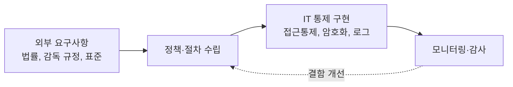

# IT 컴플라이언스 (IT Compliance)

---

## I. 법규·표준을 IT에 내재화하는, IT 컴플라이언스의 개요

### 가. 정의

- IT 시스템의 구축·운영·관리 전 과정에서 **법규, 감독 규정, 산업 표준, 내부 정책을 준수하도록 통제하고 이를 입증**하는 체계와 활동

### 나. 필요성 및 특징

| 구분 | 내용 |
| --- | --- |
| 필요성 | 개인정보·금융·AI 규제 강화, 과징금·소송·평판 위험 |
| 거버넌스 연계 | [[IT 거버넌스]]의 위험 관리·준수 영역 실행 수단 |
| 설계 내재화 | 기획·설계 단계부터 요구사항 반영 (Compliance by Design) |
| 입증 가능성 | 로그·증적·감사로 준수 사실을 증명 |

---

## II. IT 컴플라이언스 체계 및 구성요소

### 가. 체계도

- 외부 요구사항을 식별해 정책으로 만들고, 시스템 통제로 구현한 뒤 감사 결과를 정책·통제 개선에 반영

### 나. 구성요소

| 구분 | 요소 | 설명 |
| --- | --- | --- |
| 법규·규제 | [[개인정보보호법]] / GDPR | 개인정보 처리 원칙, 정보주체 권리, 국외 이전 |
| | 전자금융거래법·감독규정 | 금융권 IT 보안·재해복구·외부 주문 관리 |
| | SOX / 내부회계관리제도 | 재무 보고 관련 IT 일반통제(ITGC) |
| 인증·표준 | [[ISMS-P]] / ISO 27001 | 정보보호·개인정보보호 관리체계 |
| | [[CSAP]] | 공공 클라우드 보안 인증 (상·중·하 등급) |
| 통제 | [[IAM]] | 계정·권한 생명주기, 최소 권한 |
| | 로그·증적 관리 | 접속 기록 보관, 변조 방지 |
| 지원 기술 | RegTech / e-Discovery | 규제 준수 자동화 / 소송 대비 전자 증거 식별·보존 |
| 감사 | IT 감사 | 독립적 평가로 통제 효과성 보증 |

---

## III. 대응 방식 비교 및 동향

### 가. 사후 대응형 vs 예방·자동화형

| 구분 | 사후 대응형 | 예방·자동화형 |
| --- | --- | --- |
| 시점 | 감사·점검 시 대응 | 설계 단계부터 반영 |
| 방식 | 체크리스트, 수작업 증적 | 정책의 코드화, 자동 증적 수집 |
| 범위 | 개별 법규 단위 | 통합 통제 프레임워크 (한 통제로 여러 규정 대응) |
| 효과 | 지적 사항 해소 | 상시 준수, 감사 비용 절감 |

### 나. 동향

- **AI 규제 대응**: EU AI Act(2024 발효, 단계 적용), 국내 [[AI 기본법]](2026 시행)에 따른 고영향 AI 위험 관리·투명성 의무 ([[AI 윤리]], [[XAI]])
- **망분리 규제 개선**: 금융·공공의 획일적 물리 망분리를 다층 보안 체계로 전환하며 클라우드·생성형 AI 활용 허용 범위 확대
- **RegTech·SupTech**: 규제 변경 모니터링, 이상 거래·보고 자동화, 감독 당국의 데이터 기반 감독

---

### 🔗 연관 토픽

- **소속 도메인**: [[00_경영전략_MOC|📈 경영전략]]
- **세부 분류**: `3. 비즈니스 프로세스 혁신 & 디지털 전환 (DX)`
- **핵심 연관 토픽**:
  - [[IT 거버넌스]]
  - [[ISMS-P]]
  - [[개인정보보호법]]
  - [[AI 기본법]]
  - [[IAM]]
