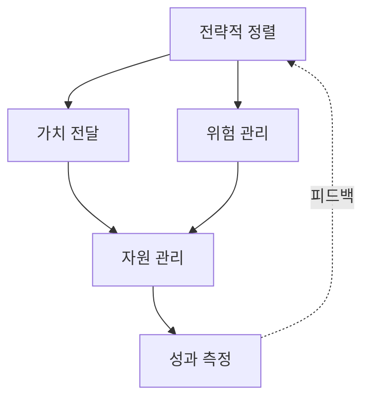

# IT 거버넌스 (IT Governance)

---

## I. IT에 대한 경영진의 지휘와 통제, IT 거버넌스의 개요

### 가. 정의

- IT가 경영 목표 달성에 기여하도록 **이사회·최고경영진이 IT의 방향을 정하고(Direct), 평가(Evaluate)하며, 감시(Monitor)하는** 리더십·조직·프로세스 체계

### 나. 필요성 및 특징

| 구분 | 내용 |
| --- | --- |
| 필요성 | 대규모 IT 투자의 가치 입증, 규제 준수, 사이버 위험 통제 |
| 경영진 책임 | IT 의사결정 책임이 IT 부서가 아닌 이사회·경영진에 있음 |
| 거버넌스–관리 분리 | 방향 제시·감독(거버넌스)과 계획·실행(관리)을 구분 |
| 비즈니스 정렬 | 경영 전략에서 출발하는 하향식 의사결정 |

---

## II. IT 거버넌스의 구조 및 구성요소

### 가. 5대 중점 영역 (ITGI)

- 전략적 정렬을 출발점으로 가치 전달과 위험 관리를 균형 있게 수행하고, 자원 관리와 성과 측정으로 이를 뒷받침하는 순환 구조

### 나. 구성요소

| 구분 | 요소 | 설명 |
| --- | --- | --- |
| 중점 영역 (ITGI) | 전략적 정렬 (Strategic Alignment) | IT 전략을 경영 전략에 맞춤 |
| | 가치 전달 (Value Delivery) | 약속한 편익을 예산·일정 내에 실현 |
| | 위험 관리 (Risk Management) | 보안·연속성·규제 위험 통제 |
| | 자원 관리 (Resource Management) | 인력·인프라·정보·애플리케이션 최적 배분 |
| | 성과 측정 (Performance Measurement) | IT-BSC 등으로 목표 달성도 측정 |
| 표준 | [[ISO 38500 2024\|ISO/IEC 38500]] | 이사회의 EDM(평가·지휘·모니터) 모델, 2015판 6원칙(책임, 전략, 획득, 성과, 준수, 인간 행동) |
| 프레임워크 | COBIT 2019 (ISACA) | 거버넌스·관리 목표 40개, 설계 요소 기반 맞춤 적용 |
| | [[ITIL(IT Infrastructure Library) 4.0\|ITIL]] | 서비스 관리 실무 지침 ([[ITSM(Information Technology Service Management)\|ITSM]]) |
| | EA (전사 아키텍처) | 업무·데이터·애플리케이션·기술 구조의 표준화·통제 |

---

## III. IT 관리 비교 및 동향

### 가. IT 거버넌스 vs IT 관리 (COBIT 관점)

| 구분 | IT 거버넌스 | IT 관리 |
| --- | --- | --- |
| 목적 | 방향 설정과 감독 | 방향에 맞춘 계획·구축·운영 |
| 주체 | 이사회, CEO | [[CIO]] 이하 IT 경영진·관리자 |
| COBIT 영역 | EDM (Evaluate, Direct and Monitor) | APO(정렬·계획·조직), BAI(구축·획득·구현), DSS(전달·서비스·지원), MEA(모니터링·평가·진단) |
| 관점 | 전사·이해관계자 가치 | IT 프로세스·서비스 운영 |

### 나. 동향

- **애자일 거버넌스**: [[DevOps]]·[[클라우드 네이티브]] 환경에 맞춰 사전 승인 중심에서 자동화된 정책 준수(Policy as Code)·사후 모니터링 중심으로 경량화
- **AI 거버넌스로 확장**: 생성형 AI의 데이터·윤리·편향 위험을 다루는 [[AI 거버넌스]] 체계 (ISO/IEC 42001 AI 경영시스템)
- **표준 개정**: ISO/IEC 38500:2024가 조직 거버넌스 표준 ISO 37000과 정렬되도록 개정

---

### 🔗 연관 토픽

- **소속 도메인**: [[00_경영전략_MOC|📈 경영전략]]
- **세부 분류**: `1. 경영 환경 분석 & 전략 수립 프레임워크`
- **핵심 연관 토픽**:
  - [[ISO 38500 2024|ISO 38500:2024]]
  - [[CIO]]
  - [[ITSM(Information Technology Service Management)]]
  - [[IT 투자성과 평가]]
  - [[AI 거버넌스|AI 거버넌스 (AI Governance)]]
