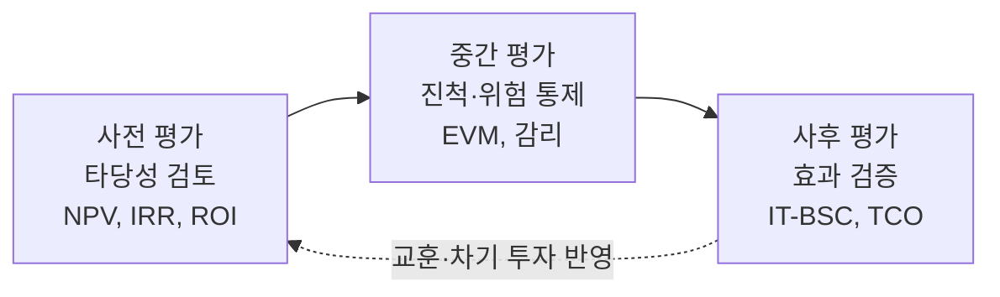

# IT 투자성과 평가

---

## I. 투자 전·중·후 전 주기의 가치 검증, IT 투자성과 평가의 개요

### 가. 정의

- IT 투자의 **타당성(사전), 진행 통제(중간), 효과 실현(사후)** 을 재무·비재무 지표로 측정하고 의사결정에 반영하는 전 주기 관리 활동

### 나. 필요성 및 특징

| 구분 | 내용 |
| --- | --- |
| 필요성 | 대규모 IT 투자의 불확실성 통제, 제한된 예산의 우선순위 결정 |
| 전 주기 평가 | 사전 → 중간 → 사후 평가로 이어지는 순환 관리 |
| 균형 지표 | 재무(NPV·ROI)와 비재무(고객·프로세스·역량) 지표 병행 |
| 거버넌스 연계 | [[IT 거버넌스]]의 가치 전달·성과 측정 영역 실행 수단 |

---

## II. 평가 주기 및 평가 기법

### 가. 평가 주기

- 사전 타당성 검토 → 구축 중 일정·비용·품질 통제 → 완료 후 목표 편익 실현 여부 검증, 결과를 다음 투자 결정에 반영

### 나. 평가 기법

| 구분 | 요소 | 설명 |
| --- | --- | --- |
| 재무적 기법 | NPV (순현재가치) | 미래 현금흐름을 할인율로 현재가치화한 합, NPV > 0이면 타당 |
| | IRR (내부수익률) | NPV = 0이 되는 할인율, IRR > 자본비용이면 타당 |
| | PP (회수기간) | 투자금 회수에 걸리는 기간, 짧을수록 유리 |
| | ROI (투자수익률) | 순이익 ÷ 투자비용 |
| 비용 | TCO (총소유비용) | 도입비 + 운영·[[유지보수]]·교육·장애 등 간접비 포함 |
| 비재무적 기법 | IT-[[BSC]] | 기업 공헌, 사용자 지향, 운영 우수성, 미래 지향 4개 관점 |
| | 정보경제학 (IE) | 재무 분석에 무형 편익·위험을 점수로 가감 (Parker & Benson) |
| 불확실성 | 실물 옵션 | 연기·확장·포기 등 경영 유연성의 가치 반영 |

- 세부 모델과 지표 체계는 [[IT-ROI 투자 성과평가 모델]] 참고

---

## III. 전통적 평가 vs 클라우드·애자일 평가 및 동향

### 가. 비교

| 구분 | 전통적 평가 | 클라우드·애자일 환경 평가 |
| --- | --- | --- |
| 단위 | 프로젝트 (일회성 사전·사후 평가) | 제품·가치 흐름 (지속 평가) |
| 비용 구조 | CapEx 중심, 도입 시점 확정 | OpEx 종량제, 사용량에 따라 변동 |
| 지표 | ROI, NPV, 사후 BSC | 단위 비용(Unit Economics), 리드타임, 배포 빈도 |
| 기법 | NPV·IRR, IT-BSC | FinOps, 가치 흐름 관리(VSM) |

### 나. 동향

- **FinOps**: 클라우드 비용을 실시간 가시화하고 사업 단위별 비용–가치를 연결해 관리 (FinOps Foundation 프레임워크)
- **AI 투자 효과 측정**: 생성형 AI 도입 효과를 업무 단위 생산성·품질 지표로 측정하는 방식 확산
- **공공 부문**: [[전자정부 성과관리 지침]]에 따른 정보화사업 성과 계획·측정·평가

---

### 🔗 연관 토픽

- **소속 도메인**: [[00_경영전략_MOC|📈 경영전략]]
- **세부 분류**: `1. 경영 환경 분석 & 전략 수립 프레임워크`
- **핵심 연관 토픽**:
  - [[IT 거버넌스]]
  - [[BSC|BSC (Balanced Scorecard), IT-BSC (IT-Balanced Scorecard)]]
  - [[IT-ROI 투자 성과평가 모델]]
  - [[경제성 분석 기법|NPV IRR BCR PP]]
  - [[전자정부 성과관리 지침]]
