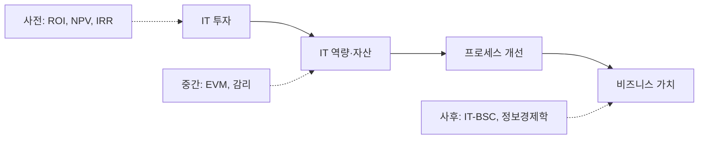

# IT-ROI 투자 성과평가 모델

---

## I. 재무 수익률을 넘어 IT 가치를 측정하는, IT-ROI 모델의 개요

### 가. 정의

- IT 투자가 **역량 → 프로세스 개선 → 비즈니스 성과**로 이어지는 가치를 재무·비재무 지표로 계량화해 평가하는 모델 체계

### 나. 필요성 및 특징

| 구분 | 내용 |
| --- | --- |
| 필요성 | 단순 ROI로는 업무 효율·고객 만족 등 무형 편익을 측정하기 어려움 |
| 인과 관점 | IT 투자 → IT 역량 → 프로세스 → 성과의 인과 사슬로 평가 |
| 다중 기법 | 재무(ROI·NPV), 비재무(IT-BSC), 종합(정보경제학) 기법 조합 |
| 지표 연계 | CSF → KPI로 측정 가능한 지표 도출 |

---

## II. IT-ROI 모델의 구조 및 평가 기법

### 가. 가치 창출 사슬과 평가 시점

- 투자 단계별로 적합한 기법을 적용해 투자 → 성과의 인과 사슬 전체를 평가

### 나. 평가 기법

| 구분 | 요소 | 설명 |
| --- | --- | --- |
| 재무 | ROI / PP | 투자 대비 순이익 비율, 투자 회수 기간 |
| | NPV / IRR | 화폐의 시간 가치를 반영한 타당성 검증 ([[경제성 분석 기법|NPV IRR BCR PP]]) |
| | TCO | 도입·운영·[[유지보수]]·교육 등 수명주기 총비용 |
| 비재무 | IT-[[BSC]] | 기업 공헌, 사용자 지향, 운영 우수성, 미래 지향 4개 관점 (Van Grembergen) |
| 종합 | 정보경제학 (IE) | 재무 ROI에 무형 편익(가점)과 위험(감점)을 점수화해 합산 |
| 유연성 | 실물 옵션 | 연기·확장·포기 선택권의 가치 산정 |
| 거버넌스 | Val IT (ISACA) | IT 투자 가치 거버넌스 프레임워크, COBIT 5에 통합 |
| 지표 체계 | CSF / KPI | 핵심 성공 요인을 측정 가능한 성과 지표로 연결 |

---

## III. 기법 비교 및 동향

### 가. 주요 기법 비교

| 구분 | ROI·NPV | IT-BSC | 정보경제학 | 실물 옵션 |
| --- | --- | --- | --- | --- |
| 측정 대상 | 재무 편익 | 다면적 성과 | 재무 + 무형 편익·위험 | 경영 유연성 가치 |
| 장점 | 객관적·비교 용이 | 전략 정렬 확인 | 무형 가치 반영 | 불확실성 반영 |
| 한계 | 무형 편익 누락 | 지표 설정 주관성 | 점수 부여 주관성 | 계산 복잡 |
| 적합 시점 | 사전 평가 | 사후·운영 평가 | 사전·사후 | 대형·불확실 투자 사전 평가 |

### 나. 동향

- **FinOps와 단위 경제**: 클라우드 종량제 환경에서 서비스 단위 비용과 편익을 실시간 연결
- **가치 흐름 관리 (VSM)**: 프로젝트 단위 일회성 ROI 대신 제품 단위로 리드타임·품질 등 가치 흐름을 지속 측정
- **AI 투자 ROI**: 생성형 AI의 효과를 업무 단위 생산성(처리 시간, 품질)으로 측정하는 미시적 접근 확산

---

### 🔗 연관 토픽

- **소속 도메인**: [[00_경영전략_MOC|📈 경영전략]]
- **세부 분류**: `1. 경영 환경 분석 & 전략 수립 프레임워크`
- **핵심 연관 토픽**:
  - [[IT 투자성과 평가]]
  - [[BSC|BSC (Balanced Scorecard), IT-BSC (IT-Balanced Scorecard)]]
  - [[경제성 분석 기법|NPV IRR BCR PP]]
  - [[IT 거버넌스]]
  - [[기술 가치 평가]]
