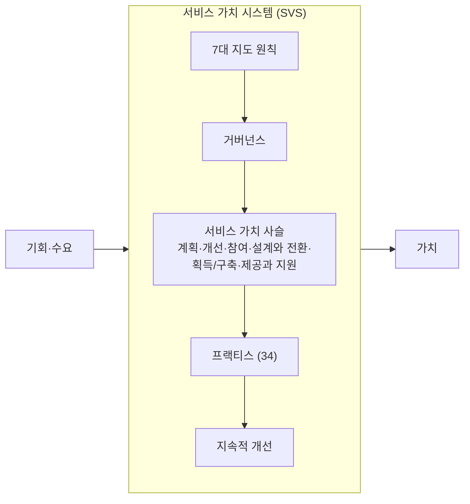

# ITIL 4 (IT Infrastructure Library 4)

---

## I. 프로세스에서 가치 시스템으로, ITIL 4의 개요

### 가. 정의

- 서비스 제공자와 소비자가 **함께 가치를 창출(Value Co-creation)** 하도록 조직의 구성요소와 활동을 서비스 가치 시스템(SVS)으로 정리한 IT 서비스 관리([[ITSM(Information Technology Service Management)|ITSM]]) 모범 사례 (AXELOS, 2019)

### 나. 등장 배경 및 특징

| 구분 | 내용 |
| --- | --- |
| 배경 | ITIL v3 수명주기 모델의 경직성, [[Agile]]·[[DevOps]]·[[린 방법론\|Lean]] 확산 |
| SVS 중심 | 수명주기 대신 가치 시스템·가치 사슬로 구조화 |
| 프랙티스 | v3의 프로세스·기능을 34개 관리 프랙티스로 재편 |
| 가치 공동 창출 | 공급자 일방 제공이 아닌 소비자와의 상호작용으로 가치 형성 |

---

## II. ITIL 4의 구조 및 구성요소

### 가. 서비스 가치 시스템 (SVS)

- 기회·수요가 입력되면 원칙·거버넌스 아래에서 가치 사슬 활동과 프랙티스가 결합해 가치를 만들고, 전 과정을 지속적으로 개선

### 나. 구성요소

| 구분 | 요소 | 설명 |
| --- | --- | --- |
| 핵심 체계 | SVS (Service Value System) | 원칙, 거버넌스, 가치 사슬, 프랙티스, 지속적 개선의 5요소 |
| | SVC (Service Value Chain) | 계획, 개선, 참여, 설계·전환, 획득·구축, 제공·지원의 6개 활동 |
| | 4차원 모델 | 조직과 사람, 정보와 기술, 파트너와 공급자, 가치 흐름과 프로세스 |
| 지침 | 7대 지도 원칙 | 가치에 집중, 현재에서 시작, 피드백 기반 반복 진행, 협업·가시성, 총체적 사고, 단순·실용, 최적화·자동화 |
| 실행 | 34 프랙티스 | 일반 관리 14, 서비스 관리 17, 기술 관리 3 |
| 개선 | 지속적 개선 모델 | 비전 → 현재 위치 → 목표 → 실행 → 확인 → 유지의 반복 |

---

## III. ITIL v3 비교 및 동향

### 가. ITIL v3 (2011) vs ITIL 4 (2019)

| 구분 | ITIL v3 (2011) | ITIL 4 |
| --- | --- | --- |
| 구조 | 서비스 수명주기 5단계 | 서비스 가치 시스템 (SVS) |
| 가치 관점 | 가치 전달 | 가치 공동 창출 |
| 실행 단위 | 26개 프로세스, 4개 기능 | 34개 프랙티스 |
| 접근 방식 | 단계 중심, 상대적으로 경직 | Agile·DevOps·Lean 수용 |
| 관심 범위 | IT 운영 중심 | 디지털 서비스·비즈니스 전반 |

### 나. 동향

- **AIOps 결합**: 인시던트 관리·서비스 데스크에 이상 탐지·자동 분류·챗봇 적용
- **DevOps·SRE 연계**: 변경 관리를 자동화된 배포 파이프라인 통제로 경량화하고 SLO 기반 운영과 결합
- **소유 구조 변화**: AXELOS가 2021년 PeopleCert에 인수되어 인증·콘텐츠를 PeopleCert가 운영

---

### 🔗 연관 토픽

- **소속 도메인**: [[00_경영전략_MOC|📈 경영전략]]
- **세부 분류**: `2. IT 거버넌스 & 엔터프라이즈 아키텍처 (EA/ISP)`
- **핵심 연관 토픽**:
  - [[ITSM(Information Technology Service Management)]]
  - [[서비스 수준 관리|서비스 수준 관리 (SLM)]]
  - [[IT 거버넌스]]
  - [[DevOps|데브옵스 (DevOps)]]
  - [[Agile]]
