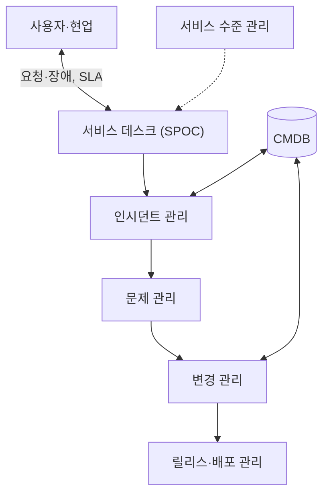

# ITSM (Information Technology Service Management)

---

## I. 기술 관리에서 서비스 관리로, ITSM의 개요

### 가. 정의

- IT를 사용자에게 제공되는 **서비스 단위로 기획·설계·전환·운영·개선**하고, 합의된 서비스 수준을 보장하는 프로세스 기반 IT 관리 체계

### 나. 필요성 및 특징

| 구분 | 내용 |
| --- | --- |
| 필요성 | 장비·기술 중심 관리로는 사용자 관점의 서비스 품질 보장이 어려움 |
| 서비스 수준 합의 | [[SLA]]로 품질 목표를 정하고 측정·보고 |
| 단일 접점 (SPOC) | 서비스 데스크가 모든 요청·장애 접수 |
| 지속적 개선 | 측정 결과로 서비스·프로세스를 반복 개선 |

---

## II. ITSM의 구조 및 구성요소

### 가. 프로세스 구조 (ITIL 기반)

- 서비스 데스크가 접수한 장애는 인시던트(신속 복구) → 문제(근본 원인) → 변경·릴리스(영구 조치)로 처리되고, CMDB가 구성 정보와 영향도 분석을 지원

### 나. 구성요소

| 구분 | 요소 | 설명 |
| --- | --- | --- |
| 접점 | 서비스 데스크 | 요청·장애 접수, 1차 처리, 진행 안내 |
| 운영 | 인시던트 관리 | 서비스 중단을 최대한 빨리 정상화 |
| | 문제 관리 | 근본 원인 분석, 재발 방지 (알려진 오류 관리) |
| | 변경 관리 | 변경의 위험·영향 평가와 승인 (CAB) |
| | 릴리스·배포 관리 | 변경 사항의 계획적 배포 |
| 서비스 수준 | [[서비스 수준 관리\|서비스 수준 관리 (SLM)]] | SLA 협상·측정·보고·개선 |
| 기반 | CMDB | 구성 항목(CI)과 상호 관계 저장 |
| 표준 | [[ITIL(IT Infrastructure Library) 4.0\|ITIL]] / ISO/IEC 20000 | 모범 사례 / ITSM 인증 표준 (BS 15000 기원) |

---

## III. IT 거버넌스 비교 및 동향

### 가. ITSM vs IT 거버넌스

| 구분 | ITSM | [[IT 거버넌스]] |
| --- | --- | --- |
| 목적 | IT 서비스의 안정적·효율적 제공 | IT 방향 설정과 위험 통제 |
| 관점 | 운영·실무 | 경영·전략 |
| 주체 | IT 서비스 관리자, 운영 조직 | 이사회, CEO, [[CIO]] |
| 핵심 활동 | 인시던트·문제·변경 관리, SLM | 평가·지휘·모니터링(EDM), 가치 전달, 위험 관리 |
| 대표 기준 | ITIL, ISO/IEC 20000 | COBIT, ISO/IEC 38500 |

### 나. 동향

- **ITIL 4 전환**: 프로세스 중심에서 서비스 가치 시스템·프랙티스 중심으로, Agile·[[DevOps]]와 결합
- **AIOps**: 로그·메트릭 분석으로 이상 탐지, 인시던트 자동 분류·연관 분석
- **ESM 확장**: ITSM 방식을 인사·재무·시설 등 비IT 부서 서비스로 확장(Enterprise Service Management)

---

### 🔗 연관 토픽

- **소속 도메인**: [[00_경영전략_MOC|📈 경영전략]]
- **세부 분류**: `2. IT 거버넌스 & 엔터프라이즈 아키텍처 (EA/ISP)`
- **핵심 연관 토픽**:
  - [[ITIL(IT Infrastructure Library) 4.0]]
  - [[SLA|SLA (Service Level Agreement)]]
  - [[서비스 수준 관리]]
  - [[IT 거버넌스]]
  - [[DevOps|데브옵스 (DevOps)]]
