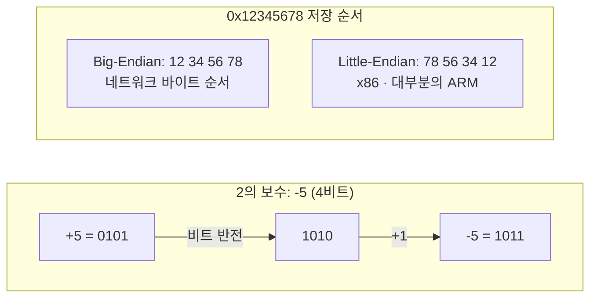

# Int Type (정수형)

---

## I. 소수점 없는 수를 고정 비트로, 정수형의 개요

### 가. 정의

- 소수점이 없는 수(음수·0·양수)를 **고정된 비트 수와 2의 보수 표현으로 저장·연산하는 원시 자료형**([[Data Type]])

### 나. 특징

| 구분 | 내용 |
| --- | --- |
| 정확성 | 표현 범위 안에서는 반올림 오차 없이 정확 |
| 연산 속도 | ALU에서 직접 처리, 주소·인덱스 계산의 기본 |
| 범위 제한 | n비트 부호 있는 정수는 -2ⁿ⁻¹ ~ 2ⁿ⁻¹-1 (32비트: 약 ±21억) |
| 플랫폼 의존 | C의 int 크기는 구현 정의(보통 32비트), long은 LP64(Linux)·LLP64(Windows)에 따라 다름 |

---

## II. 표현 방식 및 구성요소

### 가. 메모리 표현

- 2의 보수로 뺄셈을 덧셈 회로로 처리하고 0의 표현이 하나뿐, 다중 바이트 값은 엔디안에 따라 저장 순서가 다름

### 나. 구성요소

| 구분 | 요소 | 설명 |
| --- | --- | --- |
| 표현 | 2의 보수 | 비트 반전 후 +1, 음수 표준 표현 (C23부터 표준으로 명시) |
| | 부호 비트 (MSB) | 최상위 비트 0이면 양수, 1이면 음수 |
| 범위 | signed / unsigned | unsigned는 0 ~ 2ⁿ-1로 양수 범위 2배 |
| 크기 | 고정 폭 정수 | int8_t·int32_t·uint64_t 등 <stdint.h> |
| 오류 | 오버플로우 | 범위 초과 결과, C에서 unsigned는 모듈로 랩어라운드, signed는 정의되지 않은 동작(UB) |
| 변환 | 부호 확장 / 0 확장 | 작은 정수를 넓힐 때 부호 비트(signed) 또는 0(unsigned)으로 채움 |
| 저장 | 엔디안 | Big(상위 바이트 먼저) / Little(하위 바이트 먼저) |
| 확장 | 임의 정밀도 정수 | 크기 제한 없는 정수 (Python int, Java BigInteger) |

---

## III. 비교 및 동향

### 가. 정수형 vs 부동소수점형

| 비교 항목 | 정수형 | [[Float Type\|부동소수점형]] |
| --- | --- | --- |
| 저장 형식 | 2의 보수 | IEEE 754 (부호·지수·가수) |
| 정확성 | 범위 내 정확 | 근사값, 반올림 오차 |
| 연산 장치 | ALU | FPU·SIMD 유닛 |
| 한계 | 범위 초과(오버플로우) | 정밀도 한계 (표현 범위는 매우 넓음) |
| 용도 | 카운터, 인덱스, 금액(최소 단위), 암호·비트 연산 | 과학 계산, 그래픽, 머신러닝 |

### 나. 동향

- **정수 오버플로우 보안**: 버퍼 크기 계산의 오버플로우가 버퍼 오버플로우로 이어져 CWE-190으로 관리, 연산 전 범위 검사·검사형 연산(Rust checked_add 등) 사용
- **AI 정수 양자화**: INT8·INT4로 신경망 가중치를 줄여 [[NPU]] 추론 속도·전력 개선
- **이식성**: 이기종 간 직렬화 시 고정 폭 정수와 htonl()/ntohl()로 바이트 순서 통일

---

### 🔗 연관 토픽

- **소속 도메인**: [[00_컴퓨터구조_MOC|💻 컴퓨터구조]]
- **세부 분류**: `2. 캐시 & 메모리 계층 구조 · 스토리지`
- **핵심 연관 토픽**:
  - [[Data Type]]
  - [[Float Type]]
  - [[Char Type]]
  - [[연산자]]
  - [[변수]]
