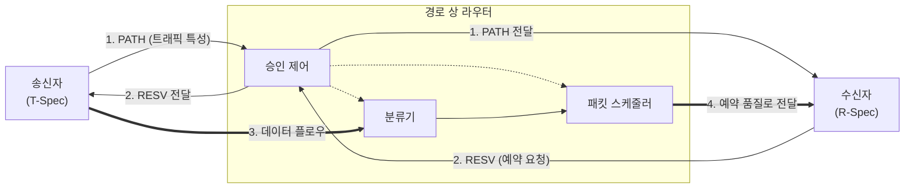

# IntServ (Integrated Services)

---

## I. 미리 예약하고 보장받는, IntServ의 개요

### 가. 정의

- 데이터 전송 전에 **RSVP로 경로 상 모든 라우터에 플로우 단위 자원(대역·버퍼)을 예약해 종단 간 품질을 보장**하는 [[QoS]] 구조 (RFC 1633, RSVP는 RFC 2205)

### 나. 등장 배경 및 특징

| 구분 | 내용 |
| --- | --- |
| 등장 배경 | Best-Effort IP망에서 음성·화상의 지연·지터·손실 문제 |
| 사전 시그널링 | 전송 전 PATH/RESV 메시지로 예약 |
| 플로우 상태 | 경로 상 라우터가 플로우별 상태 유지 (Stateful) |
| 승인 제어 | 자원이 부족하면 예약 거절 → 수락된 플로우는 보장 |
| 확장성 한계 | 플로우 수에 비례해 라우터 상태·시그널링 부하 증가 |

---

## II. 구조 및 구성요소

### 가. RSVP 예약 흐름

- 송신자가 PATH로 경로와 트래픽 특성을 알리면, 수신자가 역경로로 RESV를 보내고 각 라우터가 승인 제어 후 자원을 예약 (수신자 주도 예약)

### 나. 구성요소

| 구분 | 요소 | 설명 |
| --- | --- | --- |
| 시그널링 | RSVP | 단방향 플로우 자원 예약, PATH(송신→수신)·RESV(수신→송신) |
| 명세 | T-Spec | 송신 트래픽 특성 (토큰 버킷 속도·크기, 최대 속도) |
| | R-Spec | 요구 품질 (예약 대역, 지연 한계) |
| 라우터 기능 | 승인 제어 (Admission Control) | 가용 자원 확인 후 예약 수락·거절 |
| | 분류기 (Classifier) | 5-튜플로 예약 플로우 식별 |
| | 스케줄러 | 예약 대역에 맞춰 전송 ([[WFQ]] 등) |
| 상태 | Soft State | 주기적 갱신이 없으면 예약 자동 해제 |
| 서비스 | Guaranteed Service | 지연 상한까지 수학적으로 보장 |
| | Controlled-Load Service | 혼잡 없는 망과 비슷한 품질 제공 |

---

## III. 비교 및 동향

### 가. IntServ vs DiffServ

| 비교 항목 | IntServ | [[DiffServ (Differentiated Services)\|DiffServ]] |
| --- | --- | --- |
| 단위 | 플로우 | 등급 (Class) |
| 보장 수준 | 절대적 (Hard QoS) | 상대적 (Soft QoS) |
| 시그널링 | RSVP 사전 예약 | 없음 (DSCP 마킹) |
| 라우터 상태 | 플로우별 상태 유지 | 코어 무상태 |
| 확장성 | 낮음 | 높음 |
| 복잡도 위치 | 경로 상 모든 라우터 | 경계 라우터 |

### 나. 동향

- **IntServ over DiffServ (RFC 2998)**: 접속망에서는 RSVP로 승인 제어, 코어에서는 DiffServ로 집합 처리하는 결합 모델
- **RSVP-TE**: 예약 개념은 MPLS 트래픽 엔지니어링의 경로·대역 예약으로 계승 (Segment Routing으로 일부 대체 중)
- **결정적 네트워크**: 지연 상한 보장 요구는 TSN·DetNet, [[네트워크 슬라이싱]]으로 이어짐

---

### 🔗 연관 토픽

- **소속 도메인**: [[00_네트워크_MOC|🌐 네트워크]]
- **세부 분류**: `1. OSI 7계층 & 데이터링크 계층 (L1/L2)`
- **핵심 연관 토픽**:
  - [[DiffServ (Differentiated Services)]]
  - [[QoS|QoS (Quality of Service)]]
  - [[WFQ|WFQ (Weighted Fair Queuing)]]
  - [[Traffic Shaping (트래픽 쉐이핑)]]
  - [[네트워크 슬라이싱]]
