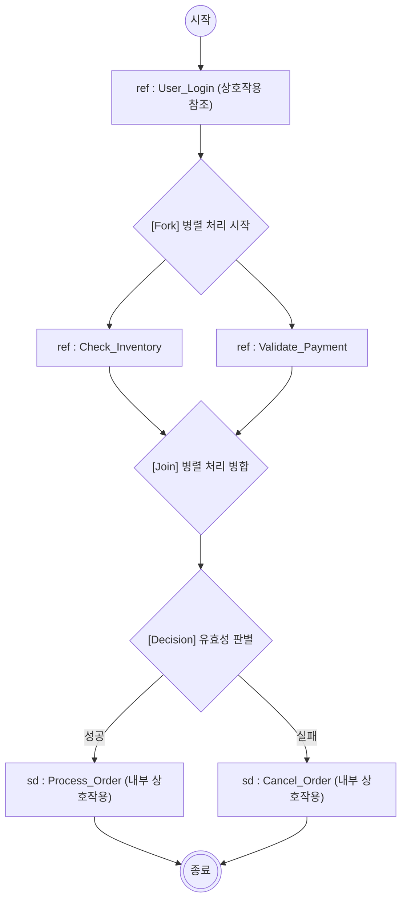

# Interaction Overview Diagram (상호작용 개요 다이어그램)

---

## I. 복잡한 상호작용의 거시적 제어, Interaction Overview Diagram의 개요

활동 다이어그램(Activity Diagram)의 제어 흐름 구조 내에 시퀀스 다이어그램 등 상호작용 조각들을 결합하여, 시스템 전체의 복잡한 상호작용 흐름을 조감도 형태로 시각화하는 UML 2.0 행위 다이어그램이다.

| 구분 | 주요 내용 |
| --- | --- |
| **개념** | 제어 노드(분기, 병렬, 병합)를 사용하여 개별 상호작용 다이어그램 간의 실행 순서와 제어 로직을 거시적으로 조망하는 상호작용 다이어그램 |
| **등장 배경** | 단일 순차 다이어그램(Sequence Diagram)에서 조건문(alt)과 반복문(loop)이 과도하게 중첩될 때 발생하는 가독성 저하 및 복잡도 한계 극복 |
| **핵심 특징** | 상호작용 단위의 모듈화 및 재사용(`ref`), 활동 다이어그램 기반의 명확한 제어 흐름 표현, 하향식(Top-Down) 아키텍처 모델링 지원 |

---

## II. Interaction Overview Diagram의 아키텍처 및 핵심 구성 요소

### 가. Interaction Overview Diagram의 동작 메커니즘

활동 다이어그램의 제어 노드(Fork, Join, Decision)를 뼈대로 삼고, 각 작업 노드 자리에 독립적인 상호작용 다이어그램(`ref` 또는 인라인 `sd`)을 배치하여 제어 흐름과 메시지 교환 시나리오를 통합 표현한다.

### 나. Interaction Overview Diagram의 핵심 구성 요소

| 분류 | 구성 요소 (키워드) | 세부 설명 및 표기법 |
| --- | --- | --- |
| **상호작용 단위** | Interaction Use (`ref`) | 외부에 별도로 정의된 상호작용 다이어그램(시퀀스 등)을 참조 호출하여 재사용 (`ref` 키워드 표기) |
| **상호작용 단위** | Inline Interaction (`sd`) | 다이어그램 내부 프레임 안에 직접 시퀀스 다이어그램 등의 메시지 흐름을 내장 표기 (`sd` 키워드) |
| **제어 노드** | Initial / Final Node | 상호작용 시나리오의 시작점(채워진 원)과 최종 완료 종료점(이중 원) |
| **제어 노드** | Decision / Merge | 가드 조건(Guard Condition)에 따른 조건 분기(Decision) 및 분기된 경로의 결합(Merge, 마름모 표기) |
| **제어 노드** | Fork / Join | 복수의 상호작용이 동시에 병렬 실행되도록 분할(Fork)하거나 완료를 대기하여 동기화(Join, 굵은 막대) |
| **연결선** | Control Flow (제어 흐름) | 상호작용 블록 간의 실행 순서와 전이 경로를 나타내는 방향성 화살표 실선 |
| **외곽 경계** | Frame (다이어그램 프레임) | 전체 다이어그램을 둘러싸는 사각형 테두리로, 좌측 상단 헤더에 `int` 키워드와 다이어그램 명칭 기술 |

---

## III. Activity Diagram과의 비교 및 최신 동향

### 가. Activity Diagram vs Interaction Overview Diagram 비교

| 비교 항목 | Activity Diagram (활동 다이어그램) | Interaction Overview Diagram (상호작용 개요 다이어그램) |
| --- | --- | --- |
| **모델링 초점** | 시스템의 업무 프로세스 및 알고리즘 제어 흐름 | **컴포넌트/객체 간 상호작용(메시지 교환)의 거시적 요약** |
| **기본 실행 단위** | **Action** (원자적 작업 단위) | **Interaction** (시퀀스, 커뮤니케이션 등 상호작용 묶음) |
| **표현 관점** | 데이터 및 제어 흐름 중심 (What to do) | 메시지 교환 기반 협업 구조 중심 (How to interact) |
| **재사용 방식** | CallBehaviorAction (서브 액티비티 호출) | **`ref` 프레임을 통한 독립 다이어그램 단위 재사용** |
| **적용 시점** | 비즈니스 분석 및 유스케이스 상세화 단계 | 시스템 아키텍처 상세 설계 및 인터페이스 통합 단계 |

### 나. 최신 기술 동향 및 발전 방향

* **마이크로서비스(MSA) 오케스트레이션 모델링**: 마이크로서비스 간에 복잡하게 얽히는 비동기 이벤트 발행-구독 및 동기 REST 호출 시나리오를 한눈에 파악하기 위한 아키텍처 조감도로 활용됨.
* **도메인 이벤트 워크플로우 명세**: 도메인 주도 설계(DDD)의 Bounded Context 간 이벤트 흐름과 Saga 패턴의 보상 트랜잭션 전개 시나리오를 명확하게 시각화하는 커뮤니케이션 도구로 채택됨.

---

### 🔗 연관 토픽

- **소속 도메인**: [[00_소프트웨어공학_MOC|🏗️ 소프트웨어공학]]
- **세부 분류**: `3. 요구사항 공학 & UML 객체지향 분석/설계`
- **핵심 연관 토픽**:
  - [[UML]]
  - [[추상화]]
  - [[모듈화]]
  - [[MSA (Micro Service Architecture)]]
  - [[Agile]]
