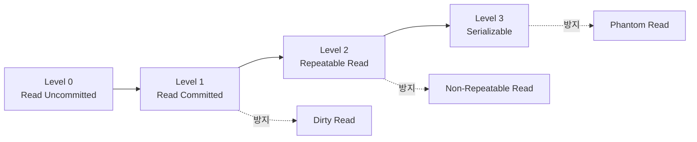

# Isolation Level (격리 수준 / 고립화 수준)

---

## I. 동시성과 일관성의 트레이드오프 제어, Isolation Level의 개요

### 가. 정의

- 여러 [[트랜잭션]]이 동시에 실행될 때 ACID의 **고립성(Isolation)** 을 어느 수준까지 보장할지 정한 ANSI/ISO SQL 표준 **4단계 격리 수준**
- 허용하는 이상 현상(Dirty Read, Non-Repeatable Read, [[Phantom Read]])의 범위로 단계를 구분

### 나. 필요성 및 특징

| 구분 | 내용 |
| --- | --- |
| 정합성 유지 | 커밋되지 않은 데이터 참조([[Dirty Read]]) 등 이상 현상 차단 |
| 동시성 확보 | 완전한 직렬화로 인한 락 경합·대기를 업무 특성에 맞게 완화 |
| 트레이드오프 | 수준을 올리면 정합성↑ 동시성↓, 내리면 동시성↑ 이상 현상↑ |

---

## II. 격리 수준별 동작 및 구현 기술

### 가. 격리 수준과 이상 현상

| 격리 수준 | Dirty Read | Non-Repeatable Read | Phantom Read | 비고 |
| --- | --- | --- | --- | --- |
| Read Uncommitted | 발생 | 발생 | 발생 | 미커밋 데이터 읽기 허용 |
| Read Committed | 방지 | 발생 | 발생 | 문장 단위 스냅샷 (Oracle, PostgreSQL 기본값) |
| Repeatable Read | 방지 | 방지 | 발생 | 트랜잭션 단위 스냅샷 (MySQL InnoDB 기본값, Next-Key Lock으로 팬텀 실질 방지) |
| Serializable | 방지 | 방지 | 방지 | 순차 실행과 동일한 결과 보장 |

### 나. 이상 현상

| 현상 | 설명 |
| --- | --- |
| Dirty Read | A가 수정 후 커밋하지 않은 값을 B가 읽었는데 A가 롤백 |
| Non-Repeatable Read | 같은 조회를 반복하는 사이 다른 트랜잭션의 **UPDATE**로 값이 바뀜 |
| Phantom Read | 같은 범위 조회를 반복하는 사이 **INSERT/DELETE**로 행 수가 바뀜 |

### 다. 구현 기술

| 구분 | 기술 | 설명 |
| --- | --- | --- |
| 락 기반 | [[2PL]] / Strict 2PL | 확장·수축 단계로 직렬성 보장, 커밋까지 X-Lock 유지로 연쇄 복귀 방지 |
| 다중 버전 | MVCC | Undo 영역에 이전 버전을 유지해 읽기–쓰기 간 블로킹 제거 ([[MVCC(다중 버전 동시성 제어) 2가지 유형\|MVCC]]) |
| 스냅샷 | Snapshot Isolation | 트랜잭션 시작 시점 스냅샷으로 읽기 일관성 보장 |
| 팬텀 방지 | Gap Lock / Next-Key Lock | 레코드 사이 공백까지 잠가 팬텀 삽입 차단 |
| | Predicate Lock | 검색 조건 범위 전체를 잠금 (Serializable) |
| 직렬화 | SSI (Serializable SI) | 스냅샷 환경에서 rw 의존 사이클을 감지해 Abort (PostgreSQL) |
| 분산 | Strict Serializability | 물리 시간 순서와 직렬 순서 일치 (TrueTime, HLC) |

---

## III. 비교 및 동향

### 가. 직렬성 구현 방식 비교

| 비교 항목 | 락 기반 Serializable (2PL) | Snapshot Isolation | SSI |
| --- | --- | --- | --- |
| 읽기–쓰기 충돌 | 블로킹 | 블로킹 없음 | 블로킹 없음 |
| Write Skew | 방지 | 발생 가능 | 방지 (사이클 감지 후 Abort) |
| 비용 | 락 경합·교착상태 | 버전 저장 공간 | 의존성 추적, 재시도 |
| 예 | SQL Server Serializable | Oracle Serializable, PostgreSQL Repeatable Read | PostgreSQL Serializable (9.1+) |

- ANSI SQL-92 정의는 Dirty Write, Lost Update, Write Skew 등을 다루지 못한다는 비판(Berenson 외, 1995) 이후 SI·SSI가 실무 표준으로 자리 잡음

### 나. 동향

- **분산 직렬성**: [[New SQL|NewSQL]](Spanner, [[CockroachDB]])은 TrueTime·HLC로 글로벌 환경에서 Strict Serializability 또는 Serializable 제공
- **업무별 선택**: 조회 위주 서비스는 Read Committed, 금융·결제는 Serializable 또는 명시적 잠금(SELECT … FOR UPDATE)

---

### 🔗 연관 토픽

- **소속 도메인**: [[00_데이터베이스_MOC|🗄️ 데이터베이스]]
- **세부 분류**: `2. 트랜잭션 & 동시성 제어 (Concurrency)`
- **핵심 연관 토픽**:
  - [[트랜잭션]]
  - [[Dirty Read]]
  - [[Phantom Read]]
  - [[2PL|2PL (Two-Phase Locking Protocol)]]
  - [[병행 제어]]
