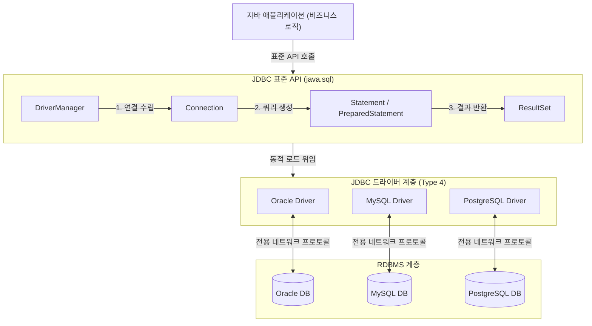

# JDBC (Java Database Connectivity)

---

## I. 자바 표준 데이터베이스 연동 인터페이스, JDBC의 개요

### 가. 정의

- 자바(Java) 애플리케이션이 다양한 관계형 데이터베이스(RDBMS)에 독립적으로 접속하여 **SQL 문을 실행하고 결과를 처리할 수 있도록 추상화된 표준 API 인터페이스 규격**

### 나. 특징 및 필요성

| 구분 | 내용 |
| --- | --- |
| 벤더 독립성 | DBMS 종류(Oracle, MySQL, PostgreSQL 등)와 무관하게 동일한 인터페이스(`java.sql`)로 개발 |
| 드라이버 구조 | [[어댑터 패턴]](Adapter Pattern)을 적용하여 각 DBMS 벤더가 제공하는 JDBC 드라이버를 플러그인 형태로 로드 |
| Type 1~4 구조 | 순수 자바 네트워크 프로토콜(Type 4 Thin Driver)을 표준으로 채택하여 플랫폼 독립적 고속 통신 |
| 상위 프레임워크 기반 | MyBatis(SQL Mapper), JPA/Hibernate(ORM), Spring Data 등 모든 자바 영속성 프레임워크의 기초 엔진 |

---

## II. 개념도 및 핵심 구성요소

### 가. 개념도

- 애플리케이션은 표준 JDBC API만 호출하고, 런타임에 DriverManager가 등록된 벤더별 드라이버를 통해 실제 DBMS와 네트워크 통신 수행

### 나. 핵심 구성요소 및 인터페이스

| 구분 | 요소 | 설명 |
| --- | --- | --- |
| 연결 관리 | DriverManager | 등록된 JDBC 드라이버 목록을 관리하고 요청된 DB URL에 맞는 Connection 객체 생성 |
| | Connection | 특정 데이터베이스와의 물리적 연결 세션을 유지하며, 트랜잭션 제어(Commit, Rollback) 수행 |
| 쿼리 실행 | Statement | 정적 SQL 문을 실행하기 위한 기본 인터페이스 (매 실행 시마다 파싱 및 컴파일 발생) |
| | PreparedStatement | 사전에 컴파일된 SQL을 캐싱하고 바인딩 변수(`?`)를 사용하여 **[[SQL Injection]] 원천 차단** 및 성능 향상 |
| | CallableStatement | DBMS 내부에 저장된 프로시저(Stored Procedure) 및 함수를 호출하기 위한 인터페이스 |
| 결과 처리 | ResultSet | SELECT 쿼리의 실행 결과 테이블을 유지하며, 커서(Cursor)를 통해 행(Row) 단위로 데이터 순차 탐색 |
| 커넥션 풀링 | Connection Pool | 연결 생성 오버헤드를 줄이기 위해 커넥션을 미리 풀에 생성해두고 재사용하는 기법 (HikariCP, DBCP) |

---

## III. 데이터 접근 기술 비교 및 동향

### 가. JDBC vs SQL Mapper vs ORM

| 비교 항목 | JDBC (Java Database Connectivity) | SQL Mapper (MyBatis) | ORM (JPA / Hibernate) |
| --- | --- | --- | --- |
| 핵심 개념 | 로우레벨 자바 표준 DB 접근 API | SQL 문과 자바 객체(DTO) 간 매핑 | RDB 테이블과 자바 객체(Entity) 간 매핑 |
| 추상화 수준 | 낮음 (Low-Level) | 중간 (SQL 개발자 작성) | 높음 (객체 중심, SQL 자동 생성) |
| 개발 생산성 | 낮음 (반복적 자원 해제 코드 다수) | 중간 (XML/어노테이션 기반 분리) | 높음 (단순 CRUD 쿼리 작성 불필요) |
| 성능 최적화 | 개발자가 직접 100% 튜닝 가능 | 복잡한 통계 및 조인 쿼리 튜닝 용이 | 복잡 쿼리 시 N+1 문제 주의 필요 |
| DB 방언 지원 | 쿼리 내 DBMS 전용 문법 직접 작성 | DBMS별 매퍼 분리 필요 | Dialect 설정을 통해 DB 종속성 최소화 |

### 나. 동향

- **HikariCP 기반 커넥션 풀 표준화**: 바이트코드 최적화와 가벼운 풋프린트로 지연 시간을 극소화한 HikariCP가 스프링 부트(Spring Boot)의 기본 커넥션 풀로 정착
- **비동기 논블로킹 R2DBC(Reactive Relational Database Connectivity)**: 동기-블로킹 방식인 기존 JDBC의 한계를 극복하고, 리액티브 스트림(Reactive Streams) 기반으로 완전한 논블로킹 I/O를 지원하는 R2DBC 표준 채택 확산
- **JPA와 QueryDSL/MyBatis 하이브리드 조합**: 일반적인 트랜잭션 도메인 처리는 JPA로 생산성을 극대화하고, 대규모 복합 통계 및 튜닝이 필수적인 쿼리는 QueryDSL이나 MyBatis를 병행하는 구조가 엔터프라이즈 표준으로 정착

---

### 🔗 연관 토픽

- **소속 도메인**: [[00_데이터베이스_MOC|🗄️ 데이터베이스]]
- **세부 분류**: `6. SQL 표준 문법 & 쿼리 성능 튜닝`
- **핵심 연관 토픽**:
  - [[SQL(Structured Query Language)|SQL]]
  - [[SQL Injection]]
  - [[트랜잭션]]
  - [[어댑터 패턴]]
  - [[RDBMS 인덱스(index)|인덱스]]
