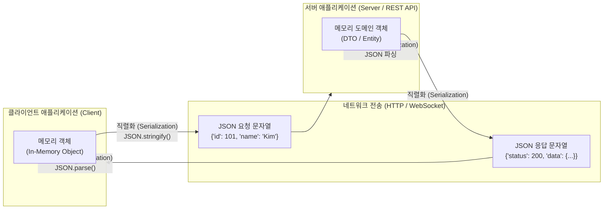

# JSON (JavaScript Object Notation)

---

## I. 이기종 시스템 간 경량 데이터 교환 표준, JSON의 개요

네트워크 환경에서 구조화된 데이터를 효율적으로 교환하기 위해 속성-값 쌍(Key-Value Pairs)과 배열(Array) 데이터 타입으로 구성된 텍스트 기반의 개방형 경량 데이터 포맷이다.

| 구분 | 주요 내용 |
| --- | --- |
| **개념** | JavaScript의 객체 표기법에서 파생되었으나 특정 프로그래밍 언어에 종속되지 않고(Language Independent), 기계와 사람 모두 직관적으로 읽고 쓸 수 있는 표준 텍스트 포맷 |
| **등장 배경** | 기존 [[XML]]의 장황한 태그 구조로 인한 패킷 오버헤드와 복잡한 DOM 파싱 성능 저하를 극복하고, RESTful API 및 웹 통신 속도 극대화 필요 |
| **핵심 특징** | 경량성(Lightweight), 높은 인간 가독성, 언어 독립적 파싱 지원, 웹 브라우저 및 모바일 네이티브 연동 최적화 |

---

## II. JSON의 아키텍처 및 핵심 기술 요소

### 가. JSON의 데이터 직렬화 및 교환 메커니즘

발신 측에서는 메모리 내 객체를 JSON 텍스트 문자열로 직렬화(Serialization)하여 HTTP 페이로드로 전송하고, 수신 측에서는 이를 다시 언어별 메모리 객체로 역직렬화(Deserialization)하여 처리한다.

### 나. JSON의 핵심 기술 요소 및 데이터 타입

| 분류 | 요소기술 (키워드) | 세부 설명 |
| --- | --- | --- |
| **기본 구조** | 객체 (Object) | 이름(Key)과 값(Value)의 무순서 집합으로, 중괄호 `{ }` 내에 쉼표로 구분하여 표현 |
| **기본 구조** | 배열 (Array) | 순서가 있는 값(Value)들의 정렬된 컬렉션으로, 대괄호 `[ ]` 내에 쉼표로 나열 |
| **데이터 타입** | String, Number | 큰따옴표(`" "`)로 둘러싸인 유니코드 문자열과 부동소수점 및 정수형 숫자 |
| **데이터 타입** | Boolean, Null | 논리적 참/거짓 값(`true`, `false`)과 데이터 부재를 나타내는 빈 값(`null`) |
| **변환 처리** | 직렬화 (Serialization) | 프로그래밍 언어의 런타임 객체/인스턴스를 네트워크 전송 가능한 JSON 문자열로 변환 |
| **변환 처리** | 역직렬화 (Deserialization) | 수신된 텍스트 JSON 문자열을 언어별 데이터 구조(Map, DTO, 클래스 인스턴스)로 복원 |
| **구조 검증** | JSON Schema | JSON 데이터의 키 타입, 필수 여부, 포맷 규칙을 선언하여 데이터 유효성을 검증하는 명세 |
| **이진 포맷** | BSON (Binary JSON) | JSON을 이진 데이터로 인코딩하여 스토리지 공간을 절약하고 파싱 속도를 향상시킨 포맷 (MongoDB) |

---

## III. JSON과 XML 비교 및 최신 동향

### 가. JSON vs XML 비교

| 비교 항목 | JSON (JavaScript Object Notation) | XML (eXtensible Markup Language) |
| --- | --- | --- |
| **데이터 모델** | **Name-Value 쌍 및 리스트(Array)** | **사용자 정의 태그 기반 트리(DOM)** |
| **가독성 및 간결성** | 문법이 간결하여 인간과 기계 모두 가독성 우수 | 여는 태그와 닫는 태그의 중복으로 장황함 |
| **크기 및 파싱 속도** | 오버헤드가 적어 패킷 크기 작고 **파싱 속도 빠름** | 메타 태그 오버헤드가 크고 XML 파서 부하 큼 |
| **데이터 타입 지원** | 문자열, 숫자, 불리언, 배열, 객체 지원 | 모든 값을 기본적으로 문자열(String)로 취급 |
| **유효성 검증** | JSON Schema (경량 검증) | DTD, XML Schema (엄격하고 정교한 검증) |
| **주요 활용처** | **RESTful API**, OpenAPI, 웹/모바일 프론트엔드 통신 | SOAP 통신, 금융 전산망, 대규모 문서 설정 파일 |

### 나. 최신 기술 동향 및 발전 방향

* **GraphQL 및 반정형 데이터 표준화**: REST API뿐만 아니라 클라이언트 맞춤형 쿼리를 제공하는 GraphQL 질의 및 응답의 기본 포맷이자, MongoDB/ElasticSearch 등 Document DB의 내부 데이터 표준으로 확고히 자리 잡음.
* **고성능 통신을 위한 Protobuf/gRPC와의 보완 관계**: 극초저지연과 고밀도 직렬화가 필요한 내부 마이크로서비스 간 통신은 Protobuf(이진)로 처리하되, 외부 클라이언트 노출 구간은 범용성과 호환성이 뛰어난 JSON을 사용하는 이원화 아키텍처가 정착됨.

---

### 🔗 연관 토픽

- **소속 도메인**: [[00_소프트웨어공학_MOC|🏗️ 소프트웨어공학]]
- **세부 분류**: `4. 아키텍처 스타일 & 객체지향 설계 원리`
- **핵심 연관 토픽**:
  - [[XML]]
  - [[AJAX]]
  - [[MSA (Micro Service Architecture)]]
  - [[MVC 패턴 (Model-View-Controller Pattern)]]
  - [[스키마]]
