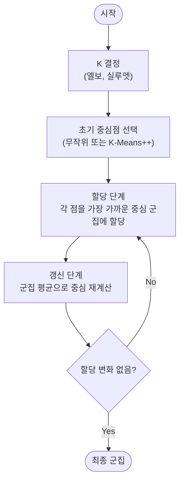

# K-평균 알고리즘 (K-Means Algorithm)

---

## I. 중심점으로 나누는 군집화, K-평균 알고리즘의 개요

### 가. 정의

- 데이터를 **K개 군집으로 나누고, 각 점과 소속 군집 중심(평균) 사이 거리 제곱합(SSE)이 최소가 되도록 할당·갱신을 반복**하는 [[비지도 학습]] 군집화 알고리즘

### 나. 필요성 및 특징

| 구분 | 내용 |
| --- | --- |
| 활용 | 고객 세분화, 이미지 색상 양자화, 벡터 양자화(IVF 색인의 클러스터링) |
| 거리 기반 | 주로 유클리드 거리 사용, 구형 군집 가정 |
| 반복 최적화 | 할당·갱신 단계 반복 (Lloyd 알고리즘, EM의 하드 할당 형태) |
| 효율 | 단순하고 반복당 $O(nKd)$로 대용량에 적합 |
| 한계 | K 사전 지정, 초기값에 따라 지역 최적, [[이상치]]에 민감 |

---

## II. 동작 원리 및 핵심 요소

### 가. 동작 흐름

- 할당과 갱신을 반복할 때마다 SSE가 줄어들어 반드시 수렴하나, 전역 최적은 보장하지 않음

### 나. 핵심 요소

| 구분 | 요소 | 설명 |
| --- | --- | --- |
| K 결정 | 엘보 기법 | K별 SSE 감소폭이 급격히 줄어드는 지점 선택 |
| | 실루엣 계수 | 군집 내 응집도와 군집 간 분리도를 -1~1로 평가, 1에 가까울수록 좋음 |
| 초기화 | K-Means++ | 첫 중심은 무작위, 이후 기존 중심과의 거리 제곱 $D(x)^2$에 비례하는 확률로 다음 중심 선택 |
| | 다중 초기화 | 여러 번 실행 후 SSE가 가장 작은 결과 선택 |
| 거리 | 유클리드 (L2) | 평균 갱신과 짝을 이루는 기본 척도 |
| 최적화 | Lloyd 알고리즘 | E단계(할당)·M단계(평균 갱신)를 반복하는 좌표 하강 |
| 경계 | 보로노이 분할 | 중심점 기준으로 공간을 가장 가까운 영역으로 분할한 형태가 군집 경계 |
| 평가 | SSE (Inertia) | 점과 중심 간 거리 제곱합, 응집도 지표 |

---

## III. 비교 및 동향

### 가. K-Means vs K-Medoids vs DBSCAN

| 비교 항목 | K-Means | K-Medoids (PAM) | [[DBSCAN(밀도 기반 클러스터링)\|DBSCAN]] |
| --- | --- | --- | --- |
| 군집 중심 | 평균 (실제 점 아님) | 실제 데이터 점 (메도이드) | 중심 없음, 밀도 기준 |
| K 지정 | 필요 | 필요 | 불필요 (Eps, MinPts) |
| 군집 형태 | 구형 | 구형 | 임의 형태 |
| 이상치 | 민감 | 덜 민감 | 노이즈로 분리 |
| 비용 | 낮음 | 높음 | 중간 |

### 나. 동향

- **확장 변형**: 범주형용 K-Modes, 혼합형용 K-Prototypes, 대용량용 Mini-Batch K-Means
- **확률적 군집**: 가우시안 혼합 모델(GMM)은 소프트 할당과 타원형 군집으로 K-Means를 일반화
- **벡터 검색**: 임베딩을 K-Means로 클러스터링해 IVF 색인 구성 ([[벡터 데이터베이스]])

---

### 🔗 연관 토픽

- **소속 도메인**: [[00_인공지능_MOC|🤖 인공지능]]
- **세부 분류**: `1. 수학 · 통계학 & 데이터 전처리`
- **핵심 연관 토픽**:
  - [[비지도 학습]]
  - [[DBSCAN(밀도 기반 클러스터링)]]
  - [[KNN 알고리즘]]
  - [[유사도|유사도(Similarity)]]
  - [[거리 공식|거리 공식(Distance Formula)]]
