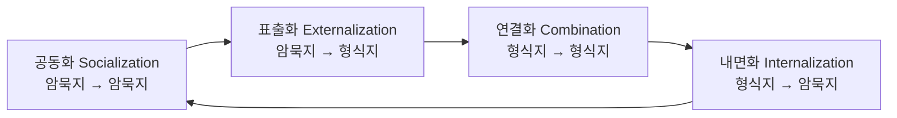

# KMS (Knowledge Management System)

---

## I. 조직의 지식을 축적·공유하는, KMS의 개요

### 가. 정의

- 조직 구성원의 **암묵지와 형식지를 체계적으로 수집·저장·공유·활용**해 업무 성과와 혁신을 높이는 지식경영 정보시스템 (지식관리시스템)

### 나. 필요성 및 특징

| 구분 | 내용 |
| --- | --- |
| 필요성 | 산업사회에서 지식사회로 전환, 인력 이동에 따른 노하우 유실 방지 |
| 지식 순환 | 암묵지 ↔ 형식지 전환으로 지식을 확대 (SECI 모델) |
| 재사용 | 중복 작업 감소, 모범 사례 확산 |
| 문화 의존 | 시스템보다 공유 문화와 보상 체계가 성패 좌우 |

---

## II. KMS의 구조 및 구성요소

### 가. SECI 지식 변환 모델 (Nonaka & Takeuchi, 1995)

- 경험 공유(공동화) → 문서화(표출화) → 결합·체계화(연결화) → 학습·체득(내면화)이 나선형으로 반복되며 조직 지식이 확대

### 나. 구성요소

| 구분 | 요소 | 설명 |
| --- | --- | --- |
| 지식 유형 | 암묵지 (Tacit) | 경험·노하우처럼 말로 표현하기 어려운 지식 |
| | 형식지 (Explicit) | 문서·매뉴얼·데이터로 표현된 지식 |
| 프로세스 | 획득·생성 | 보고서, 사례, 교훈(Lessons Learned) 수집 |
| | 저장·분류 | 지식 맵, 분류 체계(Taxonomy), 메타데이터 |
| | 공유·활용 | 검색, 커뮤니티(CoP), 전문가 찾기 |
| 기술 | 지식 저장소·검색 | 문서 관리, 전사 검색, 협업 도구 |
| | 지식 그래프·AI | 개념 관계 연결, 의미 검색, 생성형 AI 질의응답 |
| 조직 | CKO·지식 관리자 | 지식경영 전략·운영 책임 |

---

## III. 유사 시스템 비교 및 동향

### 가. KMS vs EDMS vs 협업 도구

| 구분 | KMS | EDMS (전자문서관리) | 협업 도구 |
| --- | --- | --- | --- |
| 목적 | 지식 공유·재사용 | 문서 보관·통제 | 실시간 커뮤니케이션 |
| 대상 | 노하우, 사례, 문서 | 공식 문서, 이력 | 대화, 작업, 파일 |
| 핵심 기능 | 지식 분류, 전문가 찾기, 평가 | 버전·권한·보존 관리 | 메신저, 공동 편집 |

### 나. 동향

- **RAG 기반 사내 지식 검색**: 문서를 벡터화해 생성형 AI가 근거를 인용하며 답하는 사내 지식 비서로 KMS 진화 ([[RAG (Retrieval Augmented Generation) 검색 증강 생성 AI|RAG]])
- **지식 그래프 결합**: 사람·문서·프로젝트 관계를 그래프로 연결해 전문가·연관 지식 추천
- **거버넌스**: 접근 권한, 민감정보 필터링, 지식 최신성 관리가 AI 활용 시 핵심 과제 ([[데이터 거버넌스]])

---

### 🔗 연관 토픽

- **소속 도메인**: [[00_경영전략_MOC|📈 경영전략]]
- **세부 분류**: `4. 기업 핵심 정보시스템 (ERP · CRM · SCM)`
- **핵심 연관 토픽**:
  - [[데이터 거버넌스|데이터 거버넌스 (Data Governance)]]
  - [[CRM]]
  - [[SCM (Supply Chain Management)]]
  - [[데이터 마이닝|Data Mining (데이터 마이닝)]]
  - [[CIO]]
