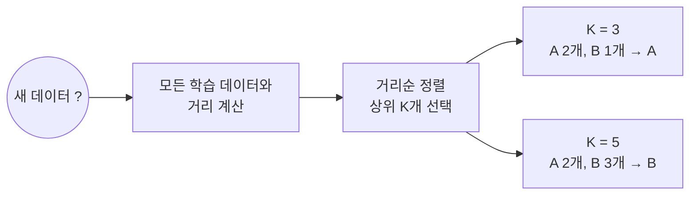

# K-NN (K-Nearest Neighbor) 알고리즘

---

## I. 가까운 이웃에게 묻는, K-NN의 개요

### 가. 정의

- 새 데이터와 **가장 가까운 K개 학습 데이터의 레이블로 다수결(분류) 또는 평균(회귀)** 하여 예측하는 [[지도학습]] 알고리즘

### 나. 특징

| 구분 | 내용 |
| --- | --- |
| 게으른 학습 | 학습 단계는 데이터 저장뿐, 예측 시점에 거리 계산 |
| 비모수 | 데이터 분포를 가정하지 않음 |
| 지역 구조 의존 | K값과 거리 척도에 성능이 크게 좌우 |
| 비용 | 예측 시 전체 데이터와 비교해 느리고 메모리 많이 사용 |

---

## II. 동작 원리 및 핵심 요소

### 가. 분류 원리

- 같은 데이터라도 K값에 따라 예측이 달라질 수 있어 K 선택이 중요

### 나. 핵심 요소

| 구분 | 요소 | 설명 |
| --- | --- | --- |
| 파라미터 | K | 작으면 노이즈에 민감(과적합), 크면 경계가 뭉개짐(과소적합), 이진 분류는 동률 방지를 위해 홀수 |
| 거리 | 유클리드 (L2) | 연속형 데이터 기본 척도 |
| | 맨해튼 (L1) | 축 방향 거리 합, 큰 차이에 덜 민감 |
| | 코사인 [[유사도]] | 방향 기반, 텍스트·임베딩 |
| 예측 | 다수결 | K개 이웃 중 최다 클래스 |
| | 거리 가중 | 가까운 이웃에 큰 가중치(예: 1/거리) |
| | 회귀 | 이웃 값의 평균 |
| 전처리 | 스케일링 | 변수 단위 차이가 거리를 왜곡하므로 Min-Max 정규화·표준화 필수 |

---

## III. 비교 및 동향

### 가. 장단점 및 대응

| 구분 | 내용 | 대응 |
| --- | --- | --- |
| 장점 | 단순·직관적, 분포 가정 불필요, 학습 즉시 반영 | 베이스라인·추천 시스템에 활용 |
| 단점 (속도) | 예측마다 $O(nd)$ 거리 계산 | KD-Tree·Ball-Tree(저차원), ANN 색인(고차원) |
| 단점 (차원의 저주) | 고차원에서 거리 차이가 줄어 변별력 저하 | [[PCA(Principal Component Analysis)\|PCA]] 등 [[차원 축소]] 후 적용 |
| 단점 (불균형) | 다수 클래스가 이웃을 점유 | 거리 가중, 리샘플링 ([[클래스 불균형]]) |

### 나. 동향

- **근사 최근접 이웃(ANN)**: 정확도를 약간 양보하고 속도를 크게 높인 HNSW·IVF-PQ(FAISS 등)가 [[벡터 데이터베이스]]와 RAG 검색의 핵심
- **kNN-LM·검색 기반 모델**: 언어 모델 예측에 최근접 이웃 데이터 저장소를 결합해 사실성·도메인 적응 향상

---

### 🔗 연관 토픽

- **소속 도메인**: [[00_인공지능_MOC|🤖 인공지능]]
- **세부 분류**: `1. 수학 · 통계학 & 데이터 전처리`
- **핵심 연관 토픽**:
  - [[지도학습]]
  - [[유사도|유사도(Similarity)]]
  - [[K-평균 알고리즘]]
  - [[벡터 데이터베이스|벡터 데이터베이스(Vector Database)]]
  - [[차원 축소|차원 축소(Dimensionality Reduction)]]
