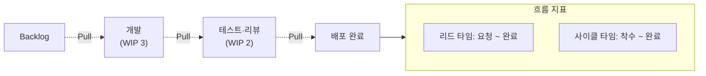

# 칸반 (Kanban) 개발 프로세스

---

## I. 흐름을 보이게 하고 WIP를 제한하는, 칸반의 개요

### 가. 정의

- 작업 흐름을 **시각화**하고 단계별 **진행 중 작업(WIP)을 제한**해 당김(Pull) 방식으로 가치 흐름을 최적화하는 지식 노동 관리 방법 (TPS의 칸반을 David J. Anderson이 SW 개발에 적용, 2010 『Kanban』)

### 나. 특징

| 구분 | 내용 |
| --- | --- |
| 기원 | 도요타 JIT의 칸반 카드, [[린 방법론\|린]] 사고 |
| 연속 흐름 | 고정 타임박스 없이 작업 단위로 흐름 |
| 점진적 변화 | 현재 프로세스·역할에서 시작해 점진적으로 개선 (기존 역할 존중) |
| 흐름 지표 | 리드 타임, 사이클 타임, 처리량으로 관리 |

---

## II. 동작 원리와 구성요소

### 가. 개념도

- 후속 단계에 여력이 생길 때만 앞 단계 작업을 당겨오고, WIP 제한으로 작업 전환과 대기를 줄여 병목을 드러냄

### 나. 구성요소

| 구분 | 요소 | 설명 |
| --- | --- | --- |
| 핵심 실천 | 시각화 | 칸반 보드의 열(상태)과 카드(작업)로 흐름 표현 |
| | WIP 제한 | 단계별 동시 작업 수 상한, 병목 노출 |
| | 흐름 관리 | 대기·막힘을 줄여 흐름 속도와 예측성 향상 |
| | 명시적 정책 | 열 진입·완료 기준(DoD), 우선순위·서비스 등급 명문화 |
| | 피드백 루프 | 일일 칸반 미팅, 리플레니시먼트, 서비스 전달 리뷰 |
| | 협업적 개선 | 모델·데이터 기반 실험으로 지속 개선 |
| 지표 | 리드 타임·사이클 타임 | 요청~완료, 착수~완료 소요 시간 |
| | 처리량 (Throughput) | 단위 기간 완료 항목 수 |
| | 누적 흐름도 (CFD) | 상태별 누적 항목 수로 병목·WIP 증가 식별 |

---

## III. 비교 및 동향

### 가. 스크럼 vs 칸반

| 비교 항목 | [[SCRUM\|스크럼]] | 칸반 |
| --- | --- | --- |
| 주기 | 1개월 이하 스프린트 | 연속 흐름 |
| 작업량 제한 | 스프린트 단위 (Velocity) | 상태별 WIP 제한 |
| 역할 | PO, 스크럼 마스터, 개발자 | 기존 역할 유지, 필수 역할 없음 |
| 변경 수용 | 스프린트 중 목표 변경 지양 | WIP 여유가 있으면 언제든 반영 |
| 지표 | Velocity, [[번다운차트]] | 리드·사이클 타임, CFD |
| 적합 업무 | 신규 제품 개발 | 운영·[[유지보수]], [[ITSM(Information Technology Service Management)\|ITSM]] 티켓 처리 |

### 나. 동향

- **스크럼반 (Scrumban)**: 스크럼 이벤트·역할에 칸반의 WIP 제한·흐름 관리를 결합
- **가치 흐름 관리**: [[DevOps]] 파이프라인 데이터와 칸반 보드를 연동하고 DORA 지표로 흐름 측정
- **확률적 예측**: 처리량 이력 기반 [[몬테카를로 시뮬레이션]]으로 완료 시점 예측

---

### 🔗 연관 토픽

- **소속 도메인**: [[00_프로젝트관리_MOC|📋 프로젝트관리]]
- **세부 분류**: `5. 애자일 프로젝트 관리 & 개발 운영 (Agile PM)`
- **핵심 연관 토픽**:
  - [[SCRUM|스크럼 (SCRUM)]]
  - [[린 방법론|린 (Lean) 방법론]]
  - [[번다운차트|번다운차트 (Burn Down Chart)]]
  - [[ITSM(Information Technology Service Management)]]
  - [[Agile]]
