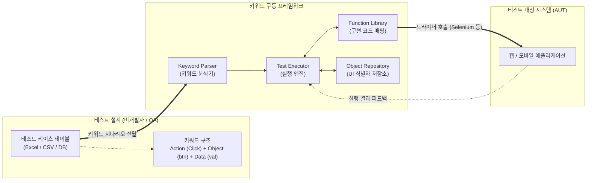

# 키워드 주도 테스트 (Keyword Driven Testing)

---

## I. 테스트 자동화의 유지보수성 극대화, 키워드 주도 테스트의 개요

테스트 케이스의 수행 동작을 모듈화된 키워드(Action Word)로 추상화하여 정의하고, 이를 기반으로 비즈니스 테스트 설계와 자동화 스크립트 구현을 분리하는 테스트 자동화 방법론이다.

| 구분 | 주요 내용 |
| --- | --- |
| **개념** | 동작(Action), 대상(Object), 데이터(Value)를 키워드 형태로 테이블에 작성하고, 실행 엔진이 이를 파싱하여 백엔드 자동화 라이브러리와 매핑 실행하는 기법 |
| **등장 배경** | 빈번한 UI 변경 시 자동화 스크립트 전면 재작성 비용 급증, 프로그래밍 역량이 부족한 도메인 분석가(BA) 및 수동 테스터의 자동화 참여 필요 |
| **핵심 특징** | 테스트 로직의 추상화(Abstraction), 테스트 스크립트와 케이스 데이터의 완전 분리, 높은 재사용성 및 장기적 유지보수 비용 절감 |

---

## II. 키워드 주도 테스트의 아키텍처 및 핵심 구성 요소

### 가. 키워드 주도 테스트의 개념도 및 실행 메커니즘

작성된 키워드 시나리오를 파서(Parser)가 분석하여 대상 UI 객체 정보(Object Repository)와 실제 실행 함수(Function Library)를 결합하고, 실행 엔진(Executor)이 자동화 도구를 통해 애플리케이션을 구동한다.

### 나. 키워드 주도 테스트의 핵심 기술 및 구성 요소

| 분류 | 요소기술 (키워드) | 세부 설명 |
| --- | --- | --- |
| **테스트 설계** | 키워드 (Action Word) | Click, Type, Verify, Select 등 시스템 동작이나 검증 로직을 고수준으로 추상화한 명령어 |
| **테스트 설계** | 테스트 케이스 데이터 | 수행 동작(Action), 대상 요소(Object), 입력 값(Data)을 엑셀이나 스프레드시트 형태로 작성한 시나리오 |
| **프레임워크** | 키워드 파서 (Parser) | 외부 문서(Excel, CSV)에서 키워드와 매개변수를 읽어와 내부 실행 데이터 구조로 변환하는 모듈 |
| **프레임워크** | 함수 라이브러리 (Library) | 각 키워드와 1:1로 매핑되어 실제 브라우저/기기를 제어하는 자동화 코드(Java, Python 등) 스크립트 |
| **프레임워크** | 객체 저장소 (Object Repo) | 화면 UI 요소의 식별자(XPath, CSS Selector, ID)를 중앙 집중적으로 관리하여 변경 시 일괄 수정 |
| **실행 엔진** | 테스트 실행기 (Executor) | 파싱된 키워드 순서대로 함수를 호출하고, 예외 처리, 화면 캡처, 재시도를 통제하는 구동 엔진 |
| **하부 도구** | 자동화 드라이버 | 실제 브라우저 및 앱을 물리적으로 제어하는 자동화 도구 (Selenium, Playwright, Appium 등) |
| **결과 관리** | 리포팅 시스템 | 각 키워드별 실행 성공/실패 여부, 실행 시간, 실패 지점 스크린샷을 취합하여 대시보드 제공 |

---

## III. 테스트 자동화 기법 비교 및 최신 동향

### 가. 데이터 주도 테스트(DDT) vs 키워드 주도 테스트(KDT) 비교

| 비교 항목 | 데이터 주도 테스트 (Data-Driven Testing) | 키워드 주도 테스트 (Keyword-Driven Testing) |
| --- | --- | --- |
| **분리 대상** | 테스트 스크립트와 **입력 데이터(Data)** 분리 | 테스트 설계(업무 로직)와 **구현 스크립트** 분리 |
| **주요 작성자** | 개발자 및 전문 테스트 자동화 엔지니어(SDET) | 현업 도메인 전문가(BA), 매뉴얼 테스터, QA |
| **구축 난이도** | 스크립트 작성 수준으로 초기 구현 용이 | 초기 키워드 파서 및 라이브러리 구축 비용 높음 |
| **유지보수성** | UI 흐름 변경 시 스크립트 코드 직접 수정 필요 | UI 변경 시 엑셀 내 키워드 순서 및 객체만 수정 |
| **주요 목적** | 동일 기능에 대한 대량의 입력값 커버리지 검증 | 비개발자의 테스트 자동화 참여 및 장기 유지보수 최적화 |

### 나. 최신 기술 동향 및 발전 방향

* **BDD(행위 주도 개발) 프레임워크와의 융합**: 자연어 기반 Gherkin 문법(Given-When-Then)을 사용하는 Cucumber, SpecFlow 등과 키워드 테이블이 결합하여 기획자와 개발자 간 단일 진실 공급원(SSOT)을 형성함.
* **AI 기반 자가 치유(Self-Healing) 및 키워드 자동화**: 화면 UI 식별자가 변경되어도 AI가 유사도를 분석해 객체를 자동 재식별(Self-Healing)하고, 자연어 요구사항으로부터 키워드 시나리오를 자동 생성하는 지능형 QA 솔루션 도입이 가속화됨.

---

### 🔗 연관 토픽

- **소속 도메인**: [[00_소프트웨어공학_MOC|🏗️ 소프트웨어공학]]
- **세부 분류**: `6. 소프트웨어 테스팅 & 품질 보증 (QA/QC)`
- **핵심 연관 토픽**:
  - [[프레임워크]]
  - [[추상화]]
  - [[유지보수]]
  - [[재사용]]
  - [[화이트박스 테스트]]
