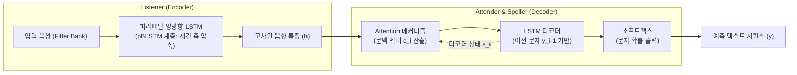

# LAS (Listen, Attend and Spell)

---

## I. 음성 신호를 텍스트로 변환하는 End-to-End 음성인식, LAS의 개요

### 가. LAS의 정의
음향 스펙트로그램 입력을 받아 청취(Listen), 어텐션 정렬(Attend), 철자 생성(Spell)의 3단계를 통해 음향 신호를 문자 시퀀스로 직접 변환하는 구글의 종단간(End-to-End) 신경망 음성인식 모델이다.

### 나. LAS의 특징 및 한계
| 구분 | 세부 특징 |
| --- | --- |
| 완전한 종단간 학습 | 전통적 HMM 기반의 음향 모델, 발음 사전, 언어 모델을 단일 신경망 네트워크로 통합 |
| 시퀀스-투-시퀀스 어텐션 | Attention 메커니즘을 통해 가변 길이 음성 프레임과 출력 문자 간의 소프트 정렬(Soft Alignment) 학습 |
| 실시간 스트리밍 한계 | 양방향(pBLSTM) 인코더 구조로 전체 발화 완료 후 처리가 가능하여 온디바이스 실시간 스트리밍에는 제약 |

---

## II. LAS의 아키텍처 및 핵심 구성 요소

### 가. LAS의 아키텍처 개념도

* 피라미달 양방향 LSTM(pBLSTM)을 통해 긴 음성 프레임의 시간 축을 축소하며 고차원 특징을 추출(Listen)
* 어텐션 메커니즘으로 현재 출력 문자와 관련된 음성 특징 가중합을 계산(Attend)하고 LSTM 디코더를 통해 문자 생성(Spell)

### 나. LAS의 핵심 기술 및 구성 요소

| 구분 | 요소기술 | 세부 설명 |
| --- | --- | --- |
| **청취 인코더** | pBLSTM (Pyramidal BLSTM) | 각 계층마다 연속된 시간 프레임을 병합(Downsampling)하여 시퀀스 길이를 1/8 수준으로 단축 |
| **음향 특징 추출** | Filter Bank Spectra | 원시 오디오 신호를 40차원 로그-멜 필터뱅크(Log-mel Filterbank) 에너지 스펙트럼으로 변환 입력 |
| **정렬 모듈** | Attention Mechanism | 디코더 은닉 상태와 인코더 특징 간 유사도를 소프트맥스로 계산하여 발화와 문자 간 문맥 벡터 생성 |
| **철자 디코더** | RNN/LSTM Decoder | 이전 시점의 출력 문자와 문맥 벡터를 입력받아 다음 문자(Characters)의 조건부 확률 분포 예측 |
| **추론 탐색** | Beam Search | 단일 그리디(Greedy) 선택 대신 상위 k개 유망 문자 시퀀스를 유지하며 최적의 문장 디코딩 수행 |

---

## III. 음성인식 아키텍처 비교 및 발전 동향

### 가. 음성인식(ASR) 핵심 모델 비교

| 비교 항목 | 전통적 하이브리드 (HMM-DNN) | LAS (Listen, Attend and Spell) | [[RNN-T]] (Recurrent Neural Network Transducer) |
| --- | --- | --- | --- |
| **학습 방식** | 음향/발음/언어 모델 분리 학습 | **단일 신경망 완전 종단간(E2E) 학습** | 단일 신경망 완전 종단간(E2E) 학습 |
| **정렬 방식** | Viterbi 강제 정렬 기반 | **글로벌 Attention 소프트 정렬** | 전방-후방(Forward-Backward) 정렬 |
| **스트리밍 여부** | 실시간 처리 가능 | **오프라인 배치 처리 (실시간 불가)** | **초저지연 온디바이스 실시간 스트리밍 지원** |
| **복잡도** | 사전/외부 모듈 구축 비용 큼 | 구조 단순하나 긴 오디오에서 연산량 급증 | 구현 난이도 높으나 모바일 환경에 최적화 |

### 나. LAS의 기술적 영향 및 발전 동향

* **종단간(E2E) 음성인식 패러다임 전환**: 복잡한 음향 공학 파이프라인(HMM, GMM)을 단일 Seq2Seq 신경망으로 대체할 수 있음을 입증하며 현대 E2E ASR 연구의 기폭제 역할 수행
* **스트리밍 한계 극복을 위한 RNN-T/Conformer 전환**: 전체 발화 입력이 필요한 LAS의 지연 문제를 극복하기 위해 모바일 디바이스에서는 RNN-T 및 온디바이스 Conformer 아키텍처로 진화
* **파운데이션 음성 모델로의 확장**: 최근 대규모 멀티태스크 음성 파운데이션 모델(OpenAI Whisper 등)의 인코더-디코더 트랜스포머 아키텍처 설계에 직간접적 토대 제공

---

### 🔗 연관 토픽

- **소속 도메인**: [[00_인공지능_MOC|🤖 인공지능]]
- **세부 분류**: `3. 딥러닝 핵심 아키텍처 & 신경망`
- **핵심 연관 토픽**:
  - [[인공지능]]
  - [[RNN-T]]
  - [[딥페이크|딥페이크(Deepfake)]]
  - [[AGI|범용 인공지능]]
  - [[MOE(Mixture of Experts)]]
