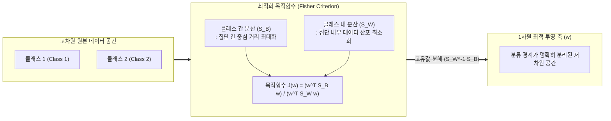

# LDA (Linear Discriminant Analysis)

---

## I. 클래스 간 분별력을 극대화하는 지도학습 차원 축소, LDA의 개요

### 가. LDA의 정의
데이터의 분류 성능을 극대화하기 위해 클래스 간 분산(Between-class Variance)은 최대화하고 클래스 내 분산(Within-class Variance)은 최소화하는 최적의 투영 축을 찾아 차원을 축소하는 지도학습(Supervised) 기반의 통계적 [[알고리즘]]이다.

### 나. LDA의 필요성 및 특징
| 구분 | 세부 특징 |
| --- | --- |
| 클래스 분리도 극대화 | 비지도 방식([[PCA(Principal Component Analysis)\|PCA]])과 달리 데이터 레이블 정보를 활용하여 분류에 최적화된 저차원 공간 형성 |
| 차원 축소 상한 제약 | 투영 축의 최대 개수가 최대 (클래스 수 - 1)개로 제한되어 다중 클래스 분류 전처리에 적합 |
| 통계적 기본 가정 | 각 클래스가 정규분포를 따르며, 클래스 간 공분산 행렬이 동일하다는 통계적 전제 하에 동작 |

---

## II. LDA의 개념도 및 핵심 수학적 원리

### 가. LDA의 투영 축 결정 메커니즘 개념도

* 클래스 간 중심 거리를 벌리고($S_B$ 최대화), 각 클래스 내부 데이터들의 흩어짐을 좁혀($S_W$ 최소화) 두 집단이 가장 명확히 구분되는 방향 벡터 $w$로 투영함

### 나. LDA의 핵심 기술 및 수학적 구성 요소

| 구분 | 요소기술 | 세부 설명 및 수식 원리 |
| --- | --- | --- |
| **클래스 내 분산** | Within-class Scatter ($S_W$) | 각 클래스 내부 샘플들이 해당 클래스 평균 벡터로부터 흩어진 정도를 나타내는 산포 행렬 ($\sum S_i$) |
| **클래스 간 분산** | Between-class Scatter ($S_B$) | 각 클래스의 평균 벡터들이 전체 데이터 평균 벡터로부터 떨어진 거리를 나타내는 산포 행렬 |
| **목적함수** | Fisher's Linear Discriminant | 분산 비율 목적함수 $J(w) = \frac{w^T S_B w}{w^T S_W w}$를 최대화하는 방향 벡터 $w$ 탐색 |
| **고유값 문제 해결** | Generalized Eigenvalue Problem | $S_W^{-1} S_B w = \lambda w$ 방정식의 고유값 분해(Eigendecomposition)를 통해 최대 고유값에 대응하는 고유벡터 산출 |
| **투영 및 변환** | Linear Transformation | 도출된 최적 고유벡터 행렬 $W$를 원본 데이터 $X$에 곱하여 저차원 공간으로 선형 변환 ($Y = XW$) |
| **분류 예측** | 판별 경계 (Decision Boundary) | 투영된 저차원 공간 상에서 베이즈 정리 기반 사후확률이나 유클리드 거리를 이용해 신규 샘플 클래스 할당 |

---

## III. 차원 축소 기법 비교 및 최신 동향

### 가. PCA와 LDA의 핵심 비교

| 비교 항목 | PCA (Principal Component Analysis) | LDA (Linear Discriminant Analysis) |
| --- | --- | --- |
| **학습 유형** | **비지도 학습 (Unsupervised)** | **지도 학습 (Supervised)** |
| **최적화 목표** | 데이터 전체의 **분산(정보량) 최대화** | **클래스 간 분리도(판별력) 최대화** |
| **데이터 레이블** | 클래스 레이블 불필요 | **클래스 레이블 필수 활용** |
| **축소 가능 차원** | 최대 원본 특성 수 ($D$) | 최대 **(클래스 수 $C$ - 1)** |
| **주요 활용** | 데이터 압축, 노이즈 제거, 다중공선성 해소 | 분류기 전처리, 얼굴 인식(Fisherfaces), 바이오마커 선별 |

### 나. LDA의 발전 동향 및 현대적 활용

* **비선형 한계 극복을 위한 커널 LDA (Kernel LDA)**: 원본 공간에서 선형 분리가 불가능한 복잡한 데이터 분포를 고차원 힐베르트 공간으로 매핑하여 비선형 판별 경계를 도출하는 커널 트릭 융합
* **특이 행렬 문제(Small Sample Size) 해결**: 샘플 수보다 특성 차원이 훨씬 큰 고차원 유전체/영상 데이터에서 $S_W$의 역행렬이 존재하지 않는 문제를 Regularized LDA 및 PCA-LDA 하이브리드 파이프라인으로 극복
* **머신러닝 경량 분류 모델 전처리 표준**: 딥러닝 임베딩 벡터의 차원을 빠르게 축소하고 클래스 간 분별력을 사전에 높여 경량 엣지 디바이스 분류 추론의 핵심 전처리 단계로 활용

---

### 🔗 연관 토픽

- **소속 도메인**: [[00_인공지능_MOC|🤖 인공지능]]
- **세부 분류**: `2. 머신러닝 기초 & 전통적 머신러닝`
- **핵심 연관 토픽**:
  - [[차원 축소|차원 축소(Dimensionality Reduction)]]
  - [[PCA(Principal Component Analysis)]]
  - [[알고리즘]]
  - [[지도학습]]
  - [[K-평균 알고리즘]]
