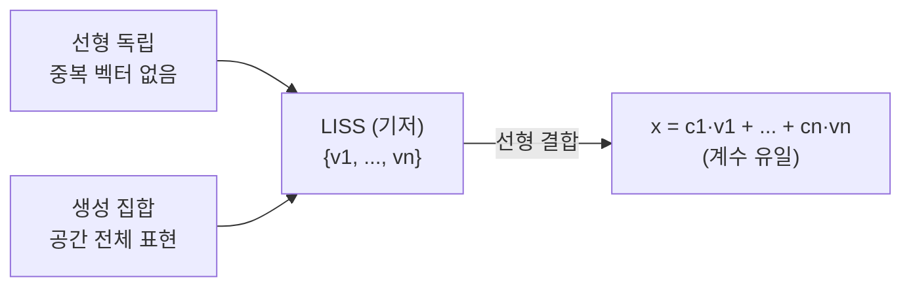

# LISS (Linearly Independent Spanning Set)

---

## I. 벡터 공간의 최소 좌표계, LISS의 개요

### 가. 정의

- 벡터 공간 V에서 **서로 선형 독립이면서 V 전체를 생성(Span)하는 벡터 집합**, 즉 기저(Basis)

### 나. 특징

| 구분 | 내용 |
| --- | --- |
| 표현의 유일성 | V의 모든 벡터는 기저 벡터의 선형 결합으로 단 한 가지 방법으로 표현 |
| 최소 생성 집합 | 원소를 하나라도 빼면 V를 생성하지 못함 |
| 최대 독립 집합 | 원소를 하나라도 더하면 선형 종속이 됨 |
| 차원 결정 | 기저의 원소 수 = dim(V), 기저는 여러 개지만 원소 수는 같음 |

---

## II. LISS의 성립 조건 및 구성요소

### 가. 개념도

- 선형 독립(군더더기 없음)과 생성(빠짐없음) 두 조건을 모두 만족해야 기저가 되며, 각 벡터는 기저에 대한 좌표 (c1, ..., cn)로 유일하게 표현

### 나. 구성요소

| 구분 | 요소 | 설명 |
| --- | --- | --- |
| 조건 | 선형 독립 | c1·v1 + ... + cn·vn = 0의 해가 c1 = ... = cn = 0뿐 |
| | 생성 (Span) | 선형 결합으로 V의 모든 원소를 만들 수 있음 |
| 관련 개념 | 선형 결합 | 벡터에 스칼라를 곱해 더하는 연산 |
| | 차원 (Dimension) | 기저 원소의 개수 |
| | 좌표 (Coordinate) | 기저에 대한 선형 결합 계수 |
| 확장 | 직교·정규직교 기저 | 기저 벡터끼리 내적 0 (정규직교는 길이도 1), 좌표 계산이 내적만으로 가능 |
| | 기저 변환 | 다른 기저로의 좌표 변환 (변환 행렬 이용) |

---

## III. 벡터 집합 비교 및 활용

### 가. 생성 집합 vs 선형 독립 집합 vs 기저

| 구분 | 생성 집합 | 선형 독립 집합 | LISS (기저) |
| --- | --- | --- | --- |
| 원소 수 n | n ≥ dim(V) | n ≤ dim(V) | n = dim(V) |
| 생성 | O | 아닐 수 있음 | O |
| 독립 | 아닐 수 있음 | O | O |
| 특징 | 잉여 벡터 존재 가능 | 공간 일부만 표현 가능 | 잉여 없이 전체 표현 |

### 나. 활용

- **[[차원 축소]]**: [[PCA(Principal Component Analysis)|PCA]]·[[SVD(Singular Value Decomposition)|SVD]]는 데이터 분산을 잘 설명하는 정규직교 기저를 찾아 상위 k개 축으로 데이터를 표현
- **신호·영상 처리**: 푸리에·웨이블릿 변환은 신호를 다른 기저로 표현해 압축·필터링 (JPEG의 DCT 등)
- **문제 구조화 응용**: 경영 분석에서 독립된 축으로 전체를 설명하는 원칙으로 차용 ([[MECE와 LISS]])

---

### 🔗 연관 토픽

- **소속 도메인**: [[00_경영전략_MOC|📈 경영전략]]
- **세부 분류**: `2. IT 거버넌스 & 엔터프라이즈 아키텍처 (EA/ISP)`
- **핵심 연관 토픽**:
  - [[MECE와 LISS]]
  - [[PCA(Principal Component Analysis)]]
  - [[SVD(Singular Value Decomposition)]]
  - [[차원 축소|차원 축소(Dimensionality Reduction)]]
  - [[거리 공식]]
