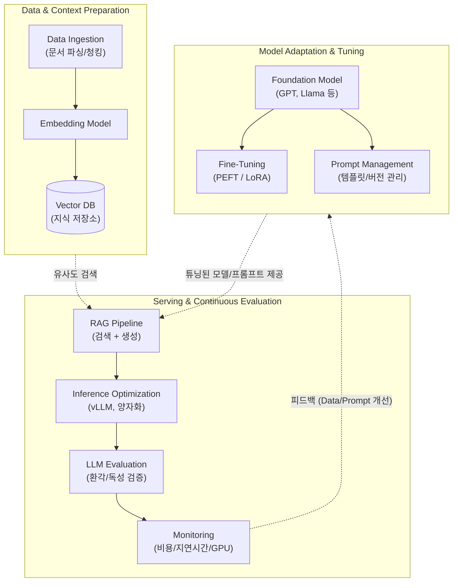

# LLMOps (Large Language Model Operations)

---

## I. 대규모 언어 모델의 생명주기 관리 프레임워크, LLMOps의 개요

### 가. LLMOps의 정의
[[파운데이션 모델|파운데이션 모델(Foundation Model)]] 기반의 대규모 언어 모델([[초거대 언어 모델|LLM]])을 개발, 미세조정([[Fine-Tuning]]), 배포, 평가 및 지속 모니터링하는 전체 생명주기를 자동화하고 최적화하기 위한 엔터프라이즈 운영 실무 체계이다.

### 나. LLMOps의 필요성 및 특징
| 구분 | 세부 특징 |
| --- | --- |
| GPU 인프라 및 비용 통제 | 수십억 개 이상의 파라미터 운영에 따른 막대한 하드웨어 컴퓨팅 및 추론 토큰 과금 비용 최적화 |
| 환각 및 신뢰성 제어 | RAG 및 프롬프트 검증, 가드레일을 통해 생성형 모델 고유의 Hallucination과 데이터 편향 억제 |
| 파운데이션 모델 적응 가속 | Scratch 학습 대신 사전 학습 모델 기반의 PEFT(LoRA) 경량 튜닝 및 프롬프트 파이프라인 표준화 |

---

## II. LLMOps의 파이프라인 아키텍처 및 핵심 구성 요소

### 가. LLMOps의 라이프사이클 및 아키텍처 개념도

* 사전 학습된 거대 모델을 튜닝하고, 외부 지식(Vector DB)과 프롬프트를 결합하여 추론(Inference) 서비스로 제공하며, 그 품질과 인프라 비용을 지속적으로 평가하는 순환형 파이프라인임

### 나. LLMOps의 핵심 기술 및 구성 요소

| 구분 | 요소기술(키워드) | 세부 설명 |
| --- | --- | --- |
| **모델 튜닝** | PEFT (Parameter-Efficient FT) | 모델의 전체 가중치가 아닌 핵심 파라미터([[LoRA(Low-rank adaptation)\|LoRA]] 등)만 미세조정하여 GPU 메모리와 학습 시간을 혁신적으로 절감 |
| **컨텍스트 강화** | RAG (Retrieval-Augmented Gen) | 답변 생성 전 최신/내부 데이터를 벡터 DB에서 검색하여 프롬프트에 주입, 모델의 환각(Hallucination) 현상 최소화 |
| **데이터 인프라** | Vector DB ([[벡터 데이터베이스]]) | 비정형 텍스트를 고차원 임베딩 벡터로 변환 및 저장하여, 코사인 [[유사도]] 기반의 초고속 의미 검색 지원 (예: Pinecone, Milvus) |
| **인터페이스 관리** | Prompt Management | 다양한 프롬프트 템플릿의 버전 관리, A/B 테스트 및 실험(Tracing) 이력을 관리하는 [[프레임워크]] (예: LangChain, PromptFlow) |
| **추론 최적화** | 양자화 (Quantization) | FP16/FP32 형태의 모델 가중치를 INT8/INT4 수준으로 압축하여 메모리 사용량을 줄이고 추론 속도를 극대화 |
| **추론 최적화** | PagedAttention (vLLM) | OS의 [[가상 메모리]] 페이징 기법을 차용하여 KV 캐시(Key-Value Cache)의 메모리 단편화를 제거, [[처리량]](Throughput) 향상 |
| **모델 평가** | LLM Evaluation Metrics | 정답이 없는 생성형 텍스트 품질을 평가하기 위한 지표 (BLEU, ROUGE, LLM-as-a-Judge 기법 적용) |
| **운영 모니터링** | Cost & GPU Monitoring | 토큰(Token) 단위의 API 사용 비용 산정, GPU 가동률 및 메모리 병목 현상 실시간 추적 |

---

## III. MLOps와 LLMOps의 비교 및 최신 동향

### 가. MLOps와 LLMOps의 차이점 비교

| 비교 항목 | MLOps (기존 머신러닝 운영) | LLMOps (거대 언어 모델 운영) |
| --- | --- | --- |
| **모델 획득 방식** | Scratch부터 직접 모델 학습 중심 | **Foundation Model 활용 및 튜닝 중심** |
| **데이터 파이프라인** | 정형 데이터 및 Feature Store 중심 | **비정형 텍스트 중심, Vector DB 및 Chunking** |
| **핵심 최적화 대상** | Hyperparameter 튜닝, 모델 경량화 | **Prompt Engineering, PEFT(LoRA), RAG 통합** |
| **평가 및 검증 지표** | Accuracy, F1-Score, RMSE 등 | **환각(Hallucination), 편향성, 유창성, 응답 지연(Latency)** |
| **인프라 비용 관리** | 학습 리소스([[CPU]]/GPU) 최적화 | **추론(Inference) 시 토큰 과금 및 고비용 GPU(VRAM) 통제** |

### 나. LLMOps의 최신 발전 동향 및 향후 전망

* **에이전틱 워크플로우(Agentic Workflow) 오케스트레이션 확장**: 단일 모델 서빙을 넘어 다중 에이전트 간 도구 호출과 상태를 제어하는 [[LangGraph]] 기반 멀티 에이전트 운영 관리로 고도화
* **경량화 모델(sLLM) 기반 온디바이스 운영 확산**: 클라우드 API 호출 비용 절감과 데이터 프라이버시 보장을 위해 INT4/INT8 양자화 기반 엣지 디바이스 배포 표준화
* **LLM-as-a-Judge 기반 실시간 지속 평가 체계 정착**: 사용자 질의-응답 데이터를 실시간으로 수집하여 고성능 심판 모델로 품질을 자동 채점하고 저품질 응답 발생 시 프롬프트 롤백 수행

---

### 🔗 연관 토픽

- **소속 도메인**: [[00_인공지능_MOC|🤖 인공지능]]
- **세부 분류**: `4. 거대언어모델 (LLM) & 생성형 AI`
- **핵심 연관 토픽**:
  - [[MLOps]]
  - [[Fine-Tuning]]
  - [[프롬프트 엔지니어링|프롬프트 엔지니어링(Prompt Engineering)]]
  - [[PEFT|PEFT(Parameter-Efficient Fine-Tuning)]]
  - [[LangGraph]]
