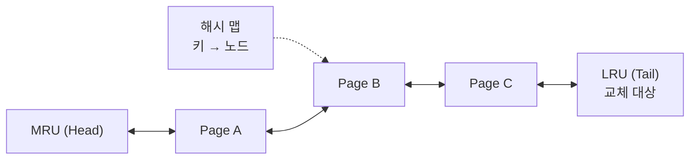

# LRU (Least Recently Used)

---

## I. 가장 오래 안 쓴 것을 내보내는, LRU의 개요

### 가. 정의

- 교체가 필요할 때 **가장 오랫동안 참조되지 않은 페이지·캐시 블록을 교체**하는 [[페이지 교체 알고리즘]]

### 나. 특징

| 구분 | 내용 |
| --- | --- |
| 시간 [[지역성]] | 최근 참조한 데이터는 곧 다시 참조된다는 가정 |
| OPT 근사 | 미래를 알 수 없는 [[OPT]] 대신 과거 참조 시점으로 미래를 추정 |
| 스택 알고리즘 | 포함 성질 만족, [[Belady's Anomaly]] 없음 |
| 비용 | 참조마다 순서 갱신 필요 → 하드웨어 지원이나 근사 기법 사용 |
| 약점 | 한 번만 읽는 대용량 순차 스캔이 기존 데이터를 모두 밀어냄 |

---

## II. 동작 구조 및 구현 기법

### 가. 해시 + 이중 연결 리스트 구조

- 참조된 노드는 해시로 찾아 Head로 옮기고, 가득 차면 Tail 노드를 제거 → 조회·갱신·교체 모두 O(1)

### 나. 구현 기법

| 구분 | 요소 | 설명 |
| --- | --- | --- |
| 소프트웨어 | 해시 + 이중 연결 리스트 | 캐시 라이브러리의 표준 구현, O(1) |
| 하드웨어 | 카운터 (시간 기록) | 참조 시 클록 값을 기록, 가장 작은 값을 교체 (탐색 비용) |
| | 스택 | 참조된 페이지를 Top으로 이동, Bottom을 교체 |
| | 행렬 | n×n 비트 행렬로 참조 순서 추적, 소규모 캐시 웨이 선택 |
| 근사 | Second Chance (Clock) | 참조 비트가 1이면 0으로 바꾸고 한 번 더 기회, 0인 페이지 교체 |
| | [[NUR]] | 참조·변경 비트 조합으로 4개 등급 분류 |
| | Aging | 참조 비트를 주기적으로 8비트 레지스터에 오른쪽 시프트해 넣고 가장 작은 값 교체 |

---

## III. 비교 및 동향

### 가. 교체 알고리즘 비교

| 비교 항목 | [[FIFO]] | LRU | [[LFU]] | Clock·[[NUR]] |
| --- | --- | --- | --- | --- |
| 기준 | 적재 시점 | 마지막 참조 시점 | 참조 횟수 | 참조(·변경) 비트 |
| Belady's Anomaly | 발생 가능 | 없음 | 없음 | 발생 가능 (스택 알고리즘 아님) |
| 오버헤드 | 매우 낮음 | 높음 (정확 구현 시) | 높음 | 낮음 |
| 적용 | 단순 버퍼 | 소프트웨어 캐시, DB 버퍼 | 빈도 중심 캐시 | OS 페이지 교체 |

### 나. 동향

- **스캔 내성 변형**: LRU-K(K번째 최근 참조 기준), 2Q(첫 참조는 임시 큐, 재참조 시 메인 큐로 승격)로 일회성 스캔 오염 방지, Linux active·inactive 리스트도 같은 발상
- **Linux MGLRU**: 6.1부터 다세대(Multi-Generational) LRU로 페이지 최근성을 여러 세대로 근사
- **적응형 캐시**: ARC(LRU·LFU 리스트 크기 자동 조절, ZFS 적용), Redis는 샘플링 기반 근사 LRU 사용

---

### 🔗 연관 토픽

- **소속 도메인**: [[00_운영체제_MOC|⚙️ 운영체제]]
- **세부 분류**: `5. 가상 메모리 관리 & 페이지 교체 알고리즘`
- **핵심 연관 토픽**:
  - [[OPT]]
  - [[LFU]]
  - [[NUR]]
  - [[Belady's Anomaly]]
  - [[캐시 메모리]]
