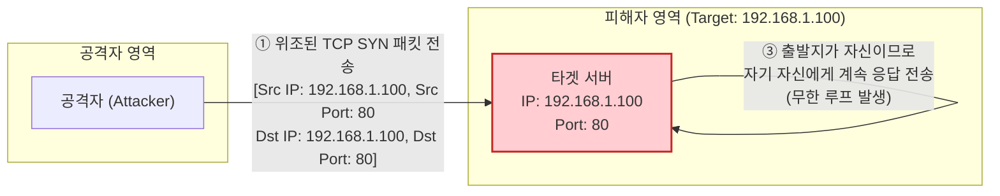

# Land Attack (랜드 어택)

---

## I. 자원 고갈을 유발하는 자기 참조 루프형 DoS 공격, Land Attack의 개요

### 가. Land Attack의 정의
- 공격자가 [[TCP]] SYN 패킷의 출발지 IP 주소와 포트를 타겟 시스템의 목적지 IP 주소 및 포트와 동일하게 위조(Spoofing)하여 전송함으로써, 타겟 시스템이 자기 자신에게 무한 응답하게 만들어 자원을 고갈시키는 [[DoS (Denial of Service)|DoS(Denial of Service)]] 공격 기법.

### 나. Land Attack의 주요 특징 및 위험성
| 구분 | 내용 |
| --- | --- |
| 주소 위조 (Spoofing) | 패킷의 출발지 IP/Port를 목적지 IP/Port와 완전 일치시켜 발송 |
| 핸드셰이크 악용 | TCP 3-Way Handshake 과정의 연결 응답(SYN/ACK) 메커니즘 악용 |
| 자원 고갈 메커니즘 | 자기 참조(Self-Referencing) 무한 루프로 인한 [[CPU]] 100% 점유 및 메모리·세션 자원 고갈 |
| 잠재적 위험 대상 | 패치 미적용 레거시 OS, 산업용 제어 시스템(ICS/OT), 보안 기능이 취약한 소형 IoT 기기 |

---

## II. Land Attack의 동작 원리 및 핵심 구성 요소

### 가. Land Attack의 공격 메커니즘 및 동작 원리

* 출발지와 목적지가 동일한 패킷을 수신한 타겟 서버는 응답 패킷(SYN/ACK)을 자신에게 다시 보내고, 이를 받은 서버가 다시 응답하는 과정을 반복하며 가용성을 상실함

### 나. Land Attack의 핵심 구성 요소 및 대응 기술

| 분류 | 요소기술(키워드) | 세부 설명 |
| --- | --- | --- |
| **공격 기법** | IP Spoofing (주소 위조) | 공격자가 자신의 IP를 숨기고, 패킷의 출발지 IP를 타겟의 IP와 동일하게 조작 |
| **공격 기법** | TCP SYN Flooding 원리 | 정상적인 3-Way Handshake를 완료하지 못하고 [[세션]] 대기 상태를 유지하도록 유도 |
| **피해 현상** | Self-Referencing Loop | 출발지와 목적지가 같아 시스템 내부에서 응답 패킷이 무한히 순환하는 논리적 오류 |
| **피해 현상** | Resource Exhaustion | 무의미한 루프 처리 및 빈 세션 유지로 인해 CPU 사용률 100% 도달 및 메모리 고갈 |
| **대응 기술** | Ingress Filtering | [[라우터]]/방화벽에서 외부망으로부터 유입되는 패킷 중 출발지 IP가 내부망 IP인 경우 차단 |
| **대응 기술** | OS Security Patch | 최신 운영체제의 TCP/IP 스택에서 출발지와 목적지가 동일한 패킷을 식별 즉시 Drop(폐기) 처리 |
| **대응 기술** | Stateful Inspection | 방화벽에서 세션의 상태(State)를 추적하여 비정상적인 연결 요청(자기 자신 연결) 차단 |

---

## III. 유사 DoS 공격과의 비교 및 보안 동향

### 가. IP Spoofing 기반 주요 DoS 공격 비교 (Land Attack vs Smurf Attack)

| 비교 항목 | Land Attack (랜드 어택) | Smurf Attack (스머프 어택) |
| --- | --- | --- |
| **주요 활용 [[프로토콜]]** | TCP (연결 지향, SYN 패킷) | [[ICMP]] (비연결형, Echo Request) |
| **주소 위조(Spoofing) 방식** | **출발지 IP = 목적지 IP (타겟 IP)** | 출발지 IP = 타겟 IP, **목적지 IP = 브로드캐스트** |
| **피해 발생 메커니즘** | 타겟 시스템 스스로 무한 응답 (Self-Loop) | 다수의 호스트(반사체)가 타겟에게 일제히 응답 (Reflection) |
| **핵심 대응 방안** | Src IP와 Dst IP가 동일한 패킷 차단 | 라우터 설정에서 Direct Broadcast 기능 비활성화 |

### 나. Land Attack 관련 최신 보안 동향
- **레거시 및 IoT 디바이스 위협 지속**: 최신 범용 OS는 스택 레벨에서 자체 필터링하나, 패치 지원이 중단된 노후 구형 운영체제 및 보안 기능이 제한된 IoT·ICS/OT 환경에서는 여전히 서비스 불능 유발 위험 잔존.
- **DDoS 복합 벡터로의 진화**: 단독 공격 형태보다는 대규모 봇넷(Botnet)을 활용해 SYN Flood, UDP Flood 등과 혼합 전송하는 멀티벡터 [[DDOS|DDoS]] 공격 기법의 구성 요소로 변형 활용.
- **경계 보안 및 제로트러스트 심층 방어**: 경계 방화벽의 Ingress Filtering뿐만 아니라 내부망 마이크로세그멘테이션 및 [[SDP(Software Defined Perimeter)|SDP]]를 적용해 내부 스푸핑 패킷 전달 원천 차단.

---

### 🔗 연관 토픽

- **소속 도메인**: [[00_보안_MOC|🛡️ 보안]]
- **세부 분류**: `2. 현대 암호학 & 키 관리 · 전자서명`
- **핵심 연관 토픽**:
  - [[DoS (Denial of Service)]]
  - [[DDOS]]
  - [[방화벽]]
  - [[ICMP]]
  - [[프로토콜]]
