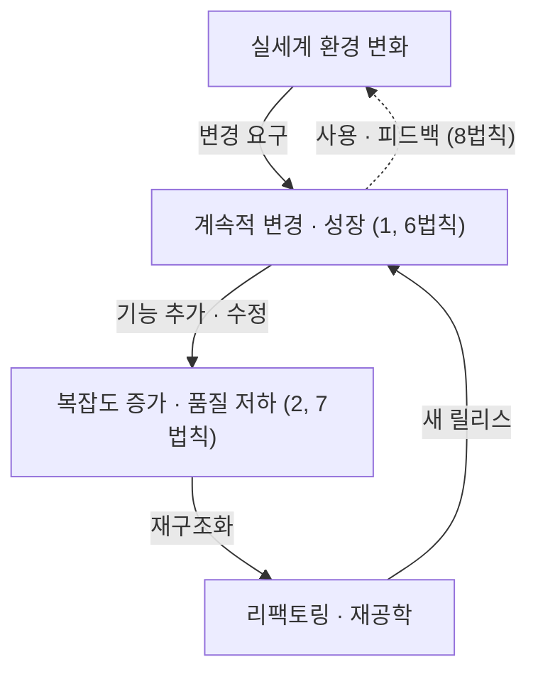

# Lehman의 Software 변화의 원리 (소프트웨어 진화 법칙)

---

## I. 변하지 않으면 쓸모없어진다, Lehman 법칙의 개요

### 가. 정의

- 실세계에서 운영되는 **E-Type 소프트웨어가 시간에 따라 어떻게 변화·성장·퇴화하는지를 경험적으로 정리한 8가지 법칙** (M. M. Lehman, 1974~1996)

### 나. 특징

| 구분 | 내용 |
| --- | --- |
| 대상 | E-Type (실세계 환경에 내재된 SW). 명세로 정확성이 정의되는 S-Type, 문제 근사 해법인 P-Type과 구분 |
| 진화 불가피성 | 환경이 변하므로 SW도 계속 변경되어야 함 |
| 퇴화 경고 | 변경이 누적되면 복잡도 증가·품질 저하 |
| 시사점 | [[유지보수]] 계획, 리팩토링·재공학의 근거 제공 |

---

## II. 진화 피드백 구조 및 8가지 법칙

### 가. E-Type SW의 진화 피드백 구조

- 환경 변화가 변경을 요구하고 변경은 복잡도를 키우므로, 구조 개선 노력과 피드백 순환이 함께 있어야 함

### 나. 8가지 법칙

| 구분 | 요소 | 설명 |
| --- | --- | --- |
| 변화 | 1. 계속적 변경 | 환경에 맞게 계속 변경되지 않으면 점차 유용성 상실 |
| 구조 | 2. 복잡도 증가 | 진화할수록 복잡도가 커지며, 줄이려면 별도 노력 필요 |
| 통제 | 3. 자기 규제 | 진화 과정의 제품·프로세스 측정치는 정규 분포에 가까운 자기 규제적 경향 |
| 조직 | 4. 조직 안정성 유지 | 시스템 수명 동안 평균 작업률(실효 활동량)은 거의 일정 |
| 인지 | 5. 친숙성 유지 | 관련자가 시스템을 이해할 수 있도록 릴리스당 증가분이 일정 수준 유지 |
| 성장 | 6. 지속적 성장 | 사용자 만족을 위해 기능 규모가 계속 증가 |
| 품질 | 7. 품질 저하 | 환경 변화에 맞춰 엄격히 유지보수하지 않으면 품질이 떨어져 보임 |
| 순환 | 8. 피드백 시스템 | 진화 프로세스는 다단계·다중 루프·다중 주체 피드백 시스템 |

---

## III. 비교 및 동향

### 가. 법칙별 문제와 대응

| 관련 법칙 | 문제 현상 | 대응 방안 |
| --- | --- | --- |
| 2, 7 (복잡도 · 품질) | 스파게티 코드, [[기술 부채]] 누적 | [[소프트웨어 리팩토링\|리팩토링]]·재공학, [[MSA (Micro Service Architecture)\|MSA]]로 [[결합도]] 축소 |
| 1, 6 (변경 · 성장) | 잦은 변경에 따른 배포 지연·장애 | CI/CD 자동화, [[DevOps]] |
| 5, 8 (친숙성 · 피드백) | 지식 유실, 요구와 구현의 괴리 | [[Agile]] 반복 피드백, [[DDD (Domain Driven Design)\|DDD]]의 도메인 모델 공유 |

### 나. 동향

- 피트니스 함수로 복잡도·결합도를 지속 측정해 2·7법칙에 따른 퇴화를 조기 감지
- LLM 코드 어시스턴트가 레거시 분석·리팩토링 제안을 보조

---

### 🔗 연관 토픽

- **소속 도메인**: [[00_소프트웨어공학_MOC|🏗️ 소프트웨어공학]]
- **세부 분류**: `1. 소프트웨어 개발 생명주기(SDLC) & 방법론`
- **핵심 연관 토픽**:
  - [[유지보수]]
  - [[ISO IEC IEEE 14764|ISO/IEC/IEEE 14764]]
  - [[기술 부채]]
  - [[소프트웨어 리팩토링]]
  - [[3R]]
