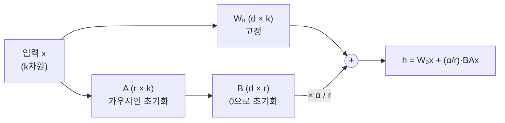

# LoRA (Low-Rank Adaptation)

---

## I. 변화량만 저랭크로 학습하는, LoRA의 개요

### 가. 정의

- 사전학습 가중치 $W_0$는 고정하고 **가중치 변화량 $\Delta W$를 두 저랭크 행렬의 곱 $BA$로 표현해 그 행렬만 학습**하는 [[PEFT]] 기법 (Microsoft, 2021)

### 나. 등장 배경 및 특징

| 구분 | 내용 |
| --- | --- |
| 전체 미세조정의 한계 | 모든 파라미터 갱신 시 GPU 메모리·연산·태스크별 저장 비용이 큼 ([[Fine-Tuning]]) |
| 저랭크 가설 | 적응에 필요한 가중치 변화는 낮은 내재 차원(Intrinsic Rank)을 가짐 |
| 파라미터 절감 | 학습 파라미터를 전체의 1% 미만으로 축소 (GPT-3 175B 기준 약 1만 분의 1) |
| 추론 지연 없음 | 학습 후 $W_0 + BA$로 병합하면 추가 연산 없음 |
| 모듈성 | 태스크별 작은 어댑터만 저장·교체 |

---

## II. 구조 및 핵심 요소

### 가. 순전파 구조

- $W_0 \in \mathbb{R}^{d \times k}$, $B \in \mathbb{R}^{d \times r}$, $A \in \mathbb{R}^{r \times k}$, $r \ll \min(d, k)$
- $B = 0$으로 시작해 학습 초기 $\Delta W = 0$, 원 모델 출력에서 안정적으로 출발

### 나. 핵심 요소

| 구분 | 요소 | 설명 |
| --- | --- | --- |
| 분해 | 저랭크 행렬 $B, A$ | $d \times k$ 대신 $r(d + k)$개 파라미터만 학습 |
| 초기화 | $A \sim \mathcal{N}$, $B = 0$ | 시작 시 $\Delta W = 0$ 보장 |
| 하이퍼파라미터 | 랭크 $r$ | 보통 4~64, 작을수록 효율적이나 표현력 제한 |
| | 스케일 $\alpha$ | $\frac{\alpha}{r}BA$로 적용, $r$을 바꿔도 학습률 재조정 부담 완화 |
| 적용 위치 | 어텐션 투영 | 원 논문은 $W_q, W_v$, 실무에서는 모든 선형층에 적용하기도 함 |
| 메모리 | 옵티마이저 상태 절감 | $W_0$의 기울기·Adam 상태를 저장하지 않음 |
| 배포 | 가중치 병합 | $W = W_0 + \frac{\alpha}{r}BA$로 합쳐 지연 제거 |
| | 어댑터 교체 | 하나의 기반 모델에 태스크별 어댑터(수 MB~수백 MB) 교체 |

---

## III. 비교 및 동향

### 가. 미세조정 방식 비교

| 비교 항목 | 전체 미세조정 | Prefix·Prompt Tuning | LoRA |
| --- | --- | --- | --- |
| 학습 파라미터 | 100% | 0.1% 미만 (가상 토큰) | 약 0.01~1% |
| 추론 지연 | 없음 | 가상 토큰이 컨텍스트 차지 | 병합 시 없음 |
| 메모리 | 매우 큼 | 작음 | 작음 |
| 저장 | 태스크마다 전체 모델 | 매우 작음 | 작음 |
| 성능 | 기준 | 소형 모델·어려운 태스크에서 저하 | 많은 태스크에서 전체 미세조정에 근접 |

### 나. 동향

- **QLoRA (2023)**: 기반 모델을 4비트 NF4로 양자화하고 이중 양자화·페이지드 옵티마이저를 결합해 65B 모델을 단일 48GB GPU에서 미세조정
- **DoRA (2024)**: 가중치를 크기와 방향으로 분해하고 방향에 LoRA 적용, 크기는 별도 학습해 전체 미세조정과의 격차 축소
- **멀티 LoRA 서빙**: S-LoRA, vLLM 등이 하나의 기반 모델에서 다수 어댑터를 동시에 배치 처리
- **확산 모델 적용**: 이미지 생성 모델의 스타일·인물 학습에 LoRA가 표준적으로 사용 ([[Diffusion 모델]])

---

### 🔗 연관 토픽

- **소속 도메인**: [[00_인공지능_MOC|🤖 인공지능]]
- **세부 분류**: `1. 수학 · 통계학 & 데이터 전처리`
- **핵심 연관 토픽**:
  - [[PEFT|PEFT(Parameter-Efficient Fine-Tuning)]]
  - [[Fine-Tuning]]
  - [[프롬프트 튜닝|프롬프트 튜닝(Prompt Tuning)]]
  - [[SVD(Singular Value Decomposition)]]
  - [[초거대 언어 모델|초거대 언어 모델(Large Language Model)]]
