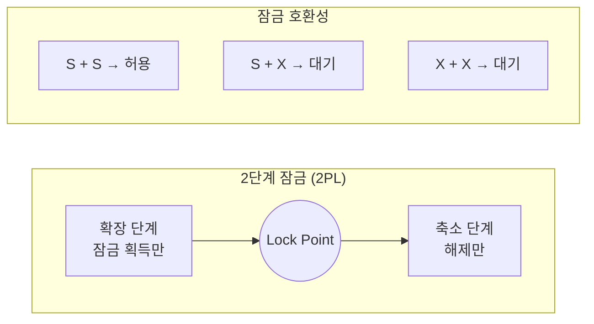

# Locking (로킹, 잠금)

---

## I. 접근 순서를 잠금으로 통제, Locking의 개요

### 가. 정의

- 트랜잭션이 데이터에 접근하기 전에 **잠금을 획득하고 끝나면 해제하여, 동시 접근 시 충돌하는 연산을 상호 배제하는 병행 제어 기법**

### 나. 필요성 및 특징

| 구분 | 내용 |
| --- | --- |
| 방지 대상 | 갱신 손실, 현황 파악 오류(Dirty Read), 모순성, 연쇄 복귀 |
| 비관적 제어 | 충돌을 가정하고 사전에 차단 |
| 잠금 단위 | 단위가 작을수록 동시성 ↑, 관리 오버헤드 ↑ |
| 위험 | [[교착상태]], 기아 상태 |

---

## II. 동작 원리 및 구성요소

### 가. 잠금 모드와 2PL

- 모든 트랜잭션이 2PL을 지키면 충돌 직렬 가능성이 보장되지만, 교착상태는 막지 못함 ([[2PL]])

### 나. 구성요소

| 구분 | 요소 | 설명 |
| --- | --- | --- |
| 잠금 모드 | S-Lock (공유) | 읽기용, 다른 S-Lock과 공존 |
| | X-Lock (배타) | 쓰기용, 다른 모든 잠금과 충돌 |
| | 의도 잠금 (IS·IX·SIX) | 다중 단위 잠금에서 하위 잠금 의도를 상위에 표시 |
| 잠금 단위 | Granularity | DB·테이블·페이지·행, 잠금 확대(Lock Escalation) |
| 규약 | 2PL | 확장·축소 단계 분리로 직렬 가능성 보장 |
| | Strict·Rigorous 2PL | X-Lock(또는 모든 잠금)을 커밋까지 유지해 연쇄 복귀 방지 |
| 교착상태 대응 | 예방 | Wait-Die(오래된 쪽 대기·젊은 쪽 철회), Wound-Wait(오래된 쪽이 젊은 쪽 철회) |
| | 탐지·회복 | 대기 그래프(Wait-for Graph) 사이클 탐지 후 희생자 철회 |
| 분산 | 분산 락 | Redis·ZooKeeper·etcd로 여러 서버 간 자원 상호 배제 |

---

## III. 비교 및 동향

### 가. 비관적 잠금 vs 낙관적 잠금 vs MVCC

| 비교 항목 | 비관적 잠금 | [[낙관적 검증 기법\|낙관적 잠금]] | [[MVCC(다중 버전 동시성 제어) 2가지 유형\|MVCC]] |
| --- | --- | --- | --- |
| 가정 | 충돌 잦음 | 충돌 드묾 | 읽기·쓰기 분리 |
| 방식 | S·X 잠금 선점 | 버전·타임스탬프 비교 후 실패 시 재시도 | 읽기는 스냅샷, 쓰기는 행 잠금 |
| 장점 | 경합이 심해도 정합성 확실 | 대기 없음 | 읽기와 쓰기가 서로 막지 않음 |
| 단점 | 대기·교착상태 | 충돌 시 재시도 비용 | 버전 저장·정리 비용 |
| 적합 | 재고 차감·결제 | 읽기 위주 | 대부분의 현대 RDBMS 기본 |

### 나. 동향

- **분산 락**: [[MSA (Micro Service Architecture)|MSA]]에서 Redis Redlock·etcd 리스로 중복 처리 방지, 펜싱 토큰으로 안전성 보완
- **잠금 회피 설계**: 단일 파티션 순차 처리(Kafka 키 파티셔닝), 조건부 UPDATE로 잠금 경합 감소

---

### 🔗 연관 토픽

- **소속 도메인**: [[00_데이터베이스_MOC|🗄️ 데이터베이스]]
- **세부 분류**: `2. 트랜잭션 & 동시성 제어 (Concurrency)`
- **핵심 연관 토픽**:
  - [[병행 제어|DB 동시성제어]]
  - [[2PL|2PL (Two-Phase Locking Protocol)]]
  - [[교착상태]]
  - [[타임스탬프 순서 기법|Timestamp Ordering]]
  - [[트랜잭션]]
