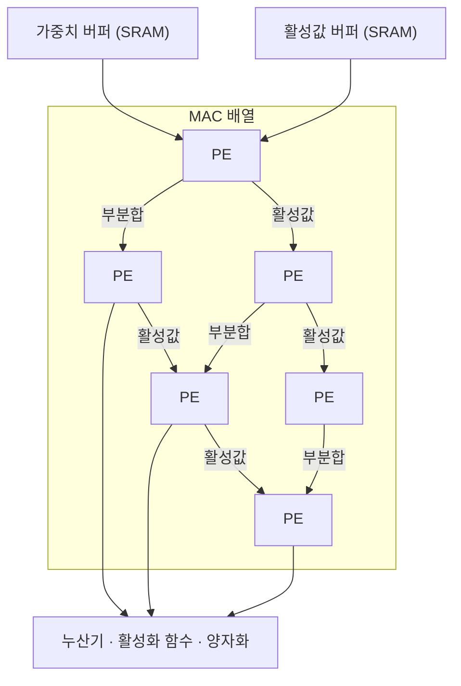

# MAC 배열 (Multiply-Accumulate Array)

---

## I. 곱하고 더하기를 대량으로, MAC 배열의 개요

### 가. 정의

- **곱셈-누산(a × b + c) 유닛을 1차원·2차원 격자로 대량 집적**해 [[딥러닝]]의 행렬 곱·합성곱을 병렬 처리하는 하드웨어 연산 구조

### 나. 특징

| 구분 | 내용 |
| --- | --- |
| 연산 특화 | 신경망 연산 대부분을 차지하는 MAC에 회로 집중 |
| 대규모 병렬 | 수천~수만 개 MAC를 동시에 구동 |
| 데이터 재사용 | 이웃 [[PE]]로 값을 전달해 메모리 접근 감소 |
| 에너지 효율 | 제어 로직 최소화로 TOPS/W 향상 |

---

## II. 구조 및 구성요소

### 가. 2차원 MAC 배열 데이터 흐름

- 활성값은 가로로, 부분합은 세로로 흐르며 각 PE에서 곱셈-누산을 수행하고 결과를 후처리 유닛으로 출력

### 나. 구성요소

| 구분 | 요소 | 설명 |
| --- | --- | --- |
| 연산 단위 | MAC 유닛 | 곱셈기 + 누산기, 부동소수점은 FMA(Fused Multiply-Add)로 한 번만 반올림 |
| | PE | MAC + 로컬 레지스터 + 이웃 연결 |
| | CSA (Carry-Save Adder) | 다수 부분곱을 자리올림 전파 없이 더해 곱셈·누산 가속 |
| 데이터 흐름 | WS (Weight Stationary) | 가중치를 PE에 고정해 재적재 감소 |
| | OS (Output Stationary) | 부분합을 PE에 고정해 부분합 이동 감소 |
| | RS (Row Stationary) | 행 단위 매핑으로 전체 재사용 균형 |
| 정밀도 | 혼합 정밀도 | 저정밀 곱셈(FP8·INT8) + 고정밀 누산(FP32·INT32)으로 속도와 정확도 확보 |
| 효율화 | 희소성 가속 | 0 값 연산 생략, 구조적 희소성(2:4) 지원 |
| 아날로그 | CIM 크로스바 | 메모리 셀 배열에서 옴·키르히호프 법칙으로 MAC 수행 ([[멤리스터]]) |

---

## III. 비교 및 동향

### 가. MAC 배열 vs 범용 ALU

| 비교 항목 | MAC 배열 ([[NPU]]·가속기) | 범용 ALU ([[CPU]] 코어) |
| --- | --- | --- |
| 연산 | 행렬 곱-누산 전용 | 산술·논리·분기 등 범용 |
| 데이터 공유 | PE 간 직접 전달 | 레지스터 파일·캐시 경유 |
| 제어 | 단순, 면적 대비 연산 밀도 높음 | 명령 해독·분기 예측 등 복잡 |
| 에너지 효율 | 높음 | 상대적으로 낮음 |
| 사례 | Google [[TPU (Tensor Processing Unit)\|TPU]] MXU, NVIDIA Tensor Core | x86·ARM 코어 정수·FP 유닛 |

### 나. 동향

- **초저정밀 포맷**: FP8·FP4·MX 포맷 지원으로 같은 면적에서 MAC 수 확대
- **메모리 결합**: [[PIM]]·3D 적층으로 MAC 배열을 메모리 가까이 배치해 데이터 이동 감소

---

### 🔗 연관 토픽

- **소속 도메인**: [[00_컴퓨터구조_MOC|💻 컴퓨터구조]]
- **세부 분류**: `2. 캐시 & 메모리 계층 구조 · 스토리지`
- **핵심 연관 토픽**:
  - [[시스톨릭 어레이]]
  - [[PE|PE(Processing Element)]]
  - [[NPU|NPU(Neural Processing Unit)]]
  - [[TPU (Tensor Processing Unit)]]
  - [[PIM|PIM(Processing-In-Memory)]]
