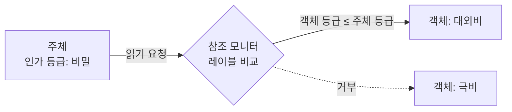
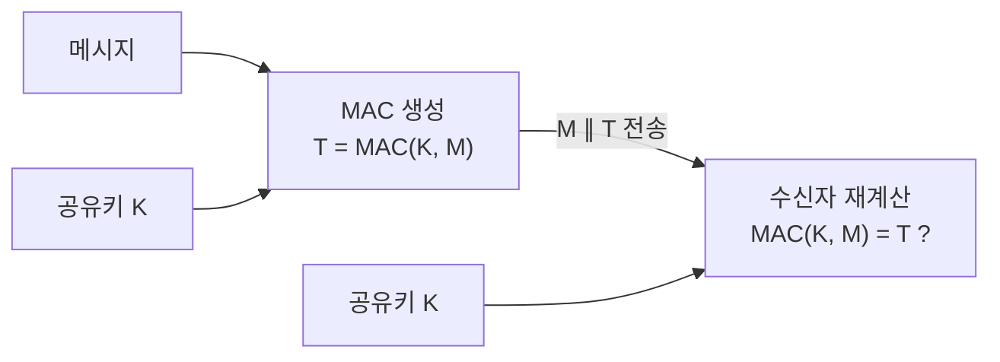

# MAC (Mandatory Access Control / Message Authentication Code)

---

## I. 같은 약어, 두 개념, MAC의 개요

### 가. 정의

- **강제적 접근통제 (Mandatory Access Control)**: 시스템이 **주체의 보안 인가 등급과 객체의 보안 레이블을 비교하여 접근을 강제로 허용·거부**하는 접근통제 모델
- **메시지 인증 코드 (Message Authentication Code)**: **공유 비밀키로 메시지에 대한 짧은 태그를 생성하여 [[무결성]]과 출처를 검증**하는 대칭키 기반 인증 기법

### 나. 특징

| 구분 | 내용 |
| --- | --- |
| 강제적 접근통제 | 소유자가 아닌 시스템 정책이 권한 결정, 사용자가 임의로 권한 변경 불가 |
| | 다단계 보안(MLS), 높은 [[기밀성]] 보장, 유연성 낮음 |
| 메시지 인증 코드 | 키를 아는 당사자만 태그 생성·검증, 해시보다 강한 출처 인증 |
| | 송·수신자가 같은 키를 가져 부인방지 불가 |

---

## II. 구조 및 구성요소

### 가. 강제적 접근통제 동작

- 참조 모니터가 보안 정책(예: BLP의 No Read Up)에 따라 레이블을 비교해 접근 결정

### 나. 메시지 인증 코드 동작

- 송신자는 메시지와 태그를 함께 보내고, 수신자는 같은 키로 태그를 다시 계산해 비교

### 다. 구성요소

| 구분 | 요소 | 설명 |
| --- | --- | --- |
| 강제적 접근통제 | 보안 레이블 | 객체 등급(극비·비밀·대외비 등)과 범주 |
| | 인가 등급 | 주체에게 부여된 취급 등급 |
| | Bell-LaPadula | 기밀성 모델: No Read Up, No Write Down |
| | Biba | 무결성 모델: No Read Down, No Write Up |
| | 구현 예 | SELinux, AppArmor, 군 다단계 보안 시스템 |
| 메시지 인증 코드 | [[HMAC]] | 해시 기반 MAC (HMAC-SHA256) |
| | CMAC | 블록 암호 기반 MAC (AES-CMAC) |
| | GMAC·Poly1305 | GCM·ChaCha20-Poly1305의 인증 구성요소 |
| | 응용 | IPsec·TLS 무결성, 차량 SecOC, API 요청 서명 |

---

## III. 비교 및 동향

### 가. 접근통제 MAC 비교 / 메시지 인증 MAC 비교

| 비교 항목 | [[DAC]] | 강제적 접근통제 | [[RBAC]] |
| --- | --- | --- | --- |
| 권한 결정 | 객체 소유자 | 시스템 정책 | 역할 |
| 기준 | 신분 | 보안 레이블 | 직무 |
| 보안성 | 낮음 | 높음 | 중간 |

| 비교 항목 | [[MDC]] (해시) | 메시지 인증 코드 | 전자서명 |
| --- | --- | --- | --- |
| 키 | 없음 | 대칭 비밀키 | 개인키·공개키 |
| 무결성 | 별도 보호 채널 필요 | 제공 | 제공 |
| 출처 인증 | 불가 | 가능 | 가능 |
| 부인방지 | 불가 | 불가 | 가능 |

### 나. 동향

- **OS 강제 접근통제 기본화**: Android·Linux 배포판에서 SELinux 강제 모드 기본 적용, 컨테이너 격리에 활용
- **AEAD 확산**: 암호화와 MAC을 한 번에 처리하는 AES-GCM·ChaCha20-Poly1305가 표준
- **차량·IoT 경량 MAC**: CAN 메시지 인증(SecOC)에 AES-CMAC 절단 태그 적용

---

### 🔗 연관 토픽

- **소속 도메인**: [[00_보안_MOC|🛡️ 보안]]
- **세부 분류**: `1. 정보보안 원칙 & 거버넌스 · 인증`
- **핵심 연관 토픽**:
  - [[접근 제어 접근 통제|접근 제어/접근 통제(Access Control)]]
  - [[DAC]]
  - [[RBAC]]
  - [[HMAC|HMAC (Hash-based Message Authentication Code)]]
  - [[MDC]]
