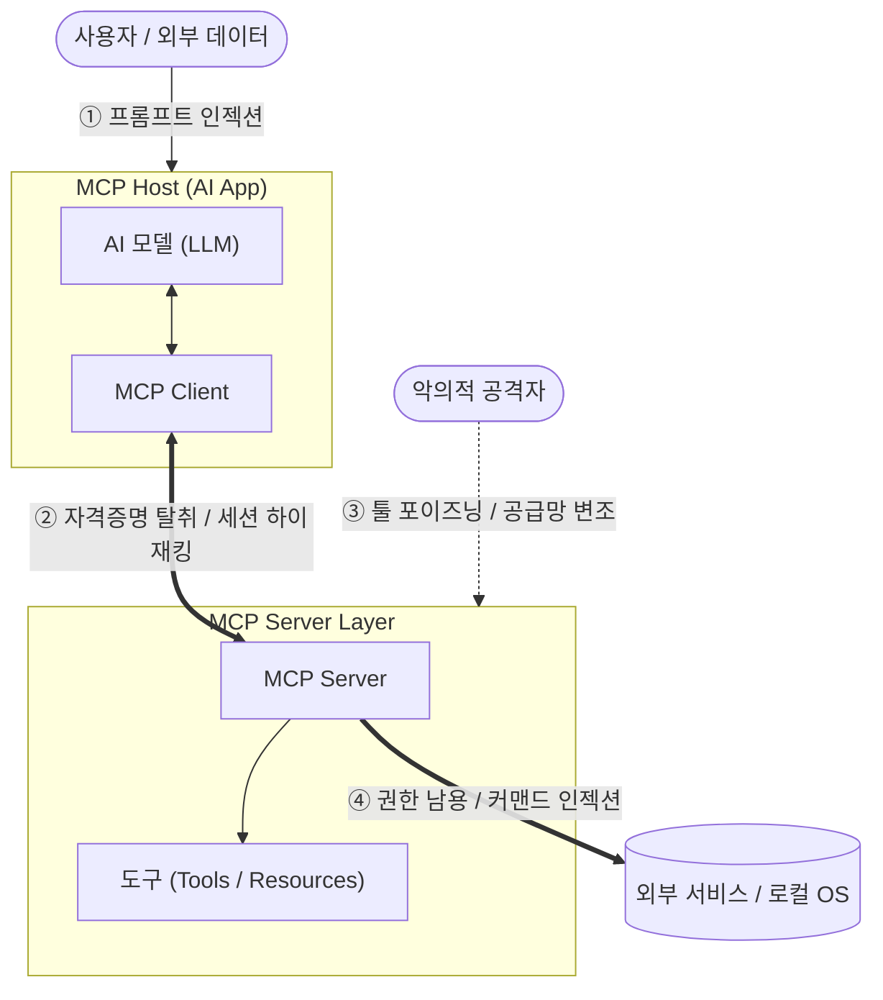

# MCP 보안취약점 및 대응방안

---

## I. AI 에이전트 확장의 양날의 검, MCP 보안취약점의 개요

### 가. MCP 보안취약점의 정의
[[초거대 언어 모델|LLM]]과 외부 시스템을 연결하는 MCP([[MCP|Model Context Protocol]]) 환경에서, 자동화된 도구(Tool) 실행과 양방향 컨텍스트 교환 과정 중 발생하는 정보유출 및 권한남용 등의 통합 보안 위협이다.

### 나. MCP 보안취약점의 발생 배경 및 특징
| 구분 | 세부 특징 |
| --- | --- |
| 에이전트 권한 위임 확대 | 단순 대화를 넘어 파일 수정, DB 쿼리, API 호출 등 실질적 행위 권한이 AI에 위임되며 공격 표면 급증 |
| 다중 서버 통신 복잡성 | 로컬/원격의 다양한 제3자 MCP 서버가 연결되며 신뢰되지 않은 데이터 소스로부터의 간접 주입 위협 상존 |
| 연쇄적 권한 악용 | 프롬프트 인젝션이 도구 실행으로 이어지고 OS 커맨드 인젝션 및 호스트 침투로 전파되는 파급력 |

---

## II. MCP 보안 취약점의 개념도 및 핵심 위협 요소

### 가. MCP 보안 취약점 발생 메커니즘 및 구성도

* LLM의 자연어 처리 취약점(①)과 [[프로토콜]] 통신 구간의 취약점(②)을 통해 서버(③)가 장악되며, 궁극적으로 내부 인프라(④)로 피해가 전파되는 연쇄적 공격 구조

### 나. MCP의 핵심 보안 취약점 요소

| 분류 | 취약점 요소 (키워드) | 세부 설명 |
| --- | --- | --- |
| **입력 변조** | **[[프롬프트 인젝션]] (Prompt Injection)** | 악의적인 텍스트나 지시문이 주입되어, LLM이 의도치 않은 도구(Tool)를 실행하도록 유도 |
| **입력 변조** | **간접 프롬프트 주입 (Indirect Injection)** | 웹 검색 결과나 파일(Resource)에 숨겨진 악성 명령어를 LLM이 읽어들여 2차 공격 수행 |
| **인증/권한** | **대리인 혼동 (Confused Deputy)** | MCP 서버가 사용자 본래의 권한을 초과하여, 서버에 부여된 광범위한 접근 권한으로 비인가 자원에 접근 |
| **인증/권한** | **자격증명 탈취 (Credential Theft)** | MCP 환경 파일에 하드코딩된 API Key, OAuth 토큰 등이 탈취되어 외부 공격자의 수평적 이동에 악용 |
| **악성 도구** | **툴 포이즈닝 (Tool Poisoning)** | 도구의 [[스키마]], 설명(Description) 메타데이터에 악성 명령이나 편향된 로직을 은닉하여 배포 |
| **악성 도구** | **서버 사칭 (Server Impersonation)** | 검증된 공식 도구(예: GitHub, Jira)로 위장한 악성 MCP 서버를 배포하여 트래픽 및 권한 가로채기 |
| **실행 환경** | **OS 커맨드 인젝션 (Command Injection)** | 로컬 MCP 서버에서 파라미터 입력값 검증이 누락되어, 호스트 [[OS(운영체제)\|운영체제]] 수준의 악의적 명령어 실행 |
| **운영/관리** | **섀도 MCP (Shadow MCP)** | 중앙 보안 부서의 승인 없이 배포·운영되어 모니터링 가시성이 확보되지 않은 비인가 [[인스턴스]] |

---

## III. MCP 보안 위협 및 Zero-Trust 대응방안 비교

### 가. 전통적 웹 API 보안 vs MCP 환경 보안 통제 비교

| 비교 항목 | 전통적 웹 API 환경 | MCP (Model Context Protocol) 환경 |
| --- | --- | --- |
| **요청 주체 및 신뢰** | 결정론적 클라이언트/사용자 직접 호출 | **자율적 의사결정을 수행하는 AI 에이전트** |
| **주요 공격 벡터** | SQL 인젝션, XSS, 무차별 대입 | **간접 프롬프트 주입, 툴 메타데이터 오염(Poisoning)** |
| **권한 통제 방식** | 세션 토큰 및 고정된 사용자 RBAC | **도구별 최소 권한(Least Privilege) + HITL 수동 승인** |
| **실행 환경 격리** | API 게이트웨이 및 웹 방화벽(WAF) | **도구 실행 전용 샌드박스 및 컨테이너(gVisor 등) 격리** |

### 나. 향후 전망 및 보안 동향

* **중앙 감사 로깅 및 가시성 확보**: 다중 MCP 서버와 클라이언트 간 JSON-RPC 호출 이력, Payload 크기, API 빈도를 전수 추적하는 통합 감사 로깅 체계 정립
* **검증된 엔터프라이즈 레지스트리 구축**: 비인가 도구 실행을 방지하기 위해 디지털 서명, 공급망 무결성 검증(SCA), 동적 행위 분석을 거친 화이트리스트 기반 MCP 마켓플레이스 도입
* **에이전트 인텔리전트 가드레일 내재화**: 파괴적 행위(DB 삭제, 권한 상승, 결제) 발생 시 사람의 확인(HITL)을 강제하고 툴 호출 파라미터를 실시간 검증하는 보안 프록시 표준화

---

### 🔗 연관 토픽

- **소속 도메인**: [[00_인공지능_MOC|🤖 인공지능]]
- **세부 분류**: `4. 거대언어모델 (LLM) & 생성형 AI`
- **핵심 연관 토픽**:
  - [[프롬프트 인젝션|프롬프트 인젝션(Prompt Injection)]]
  - [[MCP|MCP (Model Context Protocol)]]
  - [[초거대 언어 모델|초거대 언어 모델(Large Language Model)]]
  - [[AI Agent]]
  - [[인공지능 학습용 데이터 품질관리 가이드라인 v3.1]]
