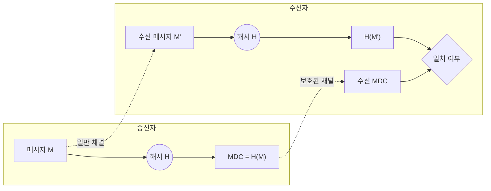

# MDC (Modification Detection Code)

---

## I. 키 없는 변경 감지, MDC의 개요

### 가. 정의

- **비밀키 없이 암호학적 해시 함수만으로 메시지의 다이제스트를 만들어 변경 여부를 감지**하는 [[무결성]] 검증 코드 (MIC, Message Integrity Code라고도 함)

### 나. 특징

| 구분 | 내용 |
| --- | --- |
| 키 미사용 | 키 공유 없이 누구나 계산·검증 가능 |
| 변경 감지 | 우발적 오류와 비인가 변경 탐지 |
| 보호 채널 필요 | 공격자가 메시지를 바꾸고 MDC를 다시 계산할 수 있어, MDC 자체는 별도 보호가 필요 |
| 출처 인증 불가 | 누가 만들었는지 증명하지 못함 |

---

## II. 동작 구조 및 구성요소

### 가. 검증 절차

- 메시지는 일반 채널로, MDC는 변조할 수 없는 채널(공식 사이트 게시, 서명 등)로 받아 재계산 값과 비교

### 나. 구성요소

| 구분 | 요소 | 설명 |
| --- | --- | --- |
| 알고리즘 | 해시 함수 | SHA-256, SHA-3 등 (MD5·SHA-1은 충돌로 부적합) |
| 출력 | 다이제스트 | 고정 길이 값 |
| 안전성 요건 | 역상·제2 역상 저항성 | 같은 MDC를 갖는 다른 메시지를 만들기 어려움 |
| | 충돌 저항성 | 같은 MDC를 갖는 두 메시지를 만들기 어려움 |
| 전달 | 보호 채널 | 공식 웹페이지의 체크섬, 전자서명된 해시 목록 |
| 응용 | 파일 체크섬 | 배포 파일 SHA-256 체크섬 비교 |
| | OpenPGP MDC 패킷 | 암호화된 데이터에 SHA-1 MDC를 붙여 변경 탐지 |

---

## III. 비교 및 동향

### 가. MDC vs MAC vs 전자서명

| 비교 항목 | MDC | [[MAC]] (메시지 인증 코드) | 전자서명 |
| --- | --- | --- | --- |
| 목적 | 무결성 | 무결성 + 출처 인증 | 무결성 + 인증 + 부인방지 |
| 키 | 없음 | 공유 대칭키 | 개인키·공개키 |
| 보호 채널 | 필요 | 불필요 | 불필요 |
| 약점 | 능동 공격자가 재계산 가능 | 부인방지 불가 | 연산·키 관리 부담 |
| 예 | SHA-256 체크섬 | [[HMAC]], CMAC | RSA, ECDSA |

### 나. 동향

- **AEAD로 대체**: OpenPGP 신규 규격(RFC 9580)은 SHA-1 MDC 대신 AEAD 암호화 패킷 도입
- **서명된 해시 배포**: 소프트웨어 공급망에서 해시 목록을 서명(Sigstore 등)해 보호 채널 문제 해결
- **해시 체인 활용**: 로그 무결성 검증에 해시 체인·머클 트리 적용

---

### 🔗 연관 토픽

- **소속 도메인**: [[00_보안_MOC|🛡️ 보안]]
- **세부 분류**: `1. 정보보안 원칙 & 거버넌스 · 인증`
- **핵심 연관 토픽**:
  - [[MAC]]
  - [[HMAC|HMAC (Hash-based Message Authentication Code)]]
  - [[해시함수|해시함수(알고리즘 측면)]]
  - [[일방향 암호화 방식]]
  - [[무결성]]
