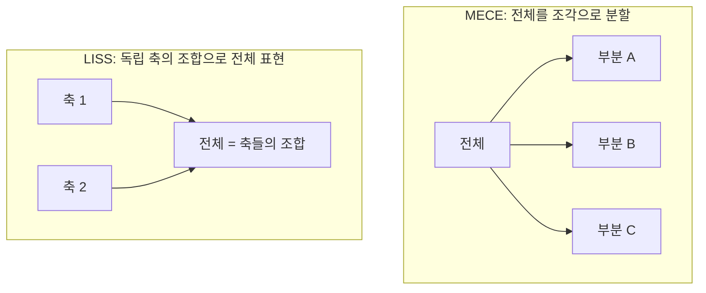

# MECE와 LISS

---

## I. 빠짐없이 나누거나, 독립된 축으로 펼치거나, MECE와 LISS의 개요

### 가. 정의

- **MECE (Mutually Exclusive, Collectively Exhaustive)**: 대상을 **서로 겹치지 않고 합치면 전체가 되도록** 나누는 분류 원칙 (McKinsey, Barbara Minto)
- **LISS (Linearly Independent Spanning Set)**: 선형대수의 기저([[LISS (Linearly Independent Spanning Set)|LISS]])를 문제 구조화에 응용한 원칙으로, **서로 독립적인(다른 요소로 설명되지 않는) 최소 요소들의 조합으로 전체를 설명**하도록 축을 정하는 방법

### 나. 필요성 및 특징

| 구분 | 내용 |
| --- | --- |
| 필요성 | 문제를 누락·중복 없이 구조화해 근본 원인과 과제를 빠르게 도출 |
| MECE 특징 | 분할(Partition) 관점, 로직 트리·프레임워크(3C, 4P 등)의 기본 원칙 |
| LISS 특징 | 기저(Basis) 관점, 상호 독립적인 핵심 축으로 전체를 설명 |
| 공통점 | 중복 배제, 구조적 사고, 하향식 분해 |

---

## II. MECE와 LISS의 구조 및 구성요소

### 가. 개념도

- MECE는 집합을 서로소 부분집합으로 나누는 것(예: 고객을 연령대로 분할), LISS는 독립 변수 축으로 공간을 펼치는 것(예: 가격 × 품질 2축으로 시장 포지션 표현)

### 나. 구성요소

| 구분 | 요소 | 설명 |
| --- | --- | --- |
| MECE | Mutually Exclusive | 항목 간 중복(교집합) 없음 |
| | Collectively Exhaustive | 항목의 합이 전체, 누락 없음 |
| LISS | Linearly Independent | 어떤 요소도 다른 요소들의 조합으로 대체되지 않음 (불필요한 요소 없음) |
| | Spanning Set | 요소들의 조합으로 전체를 설명 가능 (빠진 축 없음) |
| 도구 | 로직 트리 (Logic Tree) | MECE로 과제·원인을 계층 분해 |
| | 이슈 트리 (Issue Tree) | 가설 검증을 위한 질문 단위 분해 |
| | 2×2 매트릭스 | 독립된 두 축으로 대상 배치 (BCG, Ansoff 등) |

---

## III. MECE vs LISS 비교 및 활용

### 가. 비교

| 구분 | MECE | LISS |
| --- | --- | --- |
| 수학적 대응 | 집합의 분할 (Partition) | 벡터 공간의 기저 (Basis) |
| 구성 단위 | 서로소인 부분 | 독립적인 축·요인 |
| 전체와의 관계 | 부분의 합 = 전체 | 축의 조합 = 전체 |
| 적합 상황 | 현황 분류, 원인 분해, 범위 정의 | 핵심 요인·평가 축 설정, 매트릭스 설계 |
| 예시 | 매출 = 고객 수 × 객단가를 고객 세그먼트별로 분할 | [[BCG Matrix]]의 점유율·성장률 2축 |

### 나. 활용

- **ISP·EA 현황 분석**: 업무·시스템 목록은 MECE로 분류해 누락 방지 ([[ISP (Information Strategy Plan)]])
- **평가 모델 설계**: 평가 지표를 서로 독립적인 축으로 구성해 중복 평가 방지 (LISS)
- **데이터 분석**: 상관된 변수를 서로 독립적인 주성분으로 바꾸는 [[PCA(Principal Component Analysis)|PCA]]가 LISS 관점의 대표 예

---

### 🔗 연관 토픽

- **소속 도메인**: [[00_경영전략_MOC|📈 경영전략]]
- **세부 분류**: `1. 경영 환경 분석 & 전략 수립 프레임워크`
- **핵심 연관 토픽**:
  - [[LISS (Linearly Independent Spanning Set)]]
  - [[3C 4C 분석|3C/4C 분석]]
  - [[ISP (Information Strategy Plan)]]
  - [[BCG Matrix]]
  - [[PCA(Principal Component Analysis)|PCA]]
