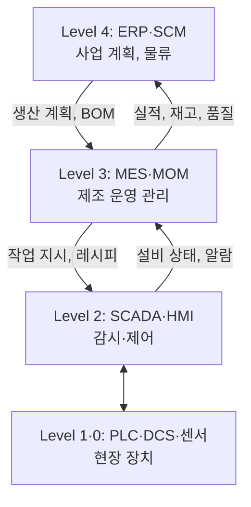

# MES (Manufacturing Execution System)

---

## I. 계획과 설비 사이의 실행 계층, MES의 개요

### 가. 정의

- 상위 ERP의 생산 계획과 하위 제어 설비([[SCADA (Supervisory Control and Data Acquisition)|SCADA]]·PLC) 사이에서 **작업 지시, 공정 실적 수집, 품질·이력 추적을 실시간으로 수행**하는 제조실행시스템 (ISA-95 Level 3)

### 나. 필요성 및 특징

| 구분 | 내용 |
| --- | --- |
| 필요성 | 다품종 소량 생산, 공정 가시성 확보, 품질 이력 추적 규제 대응 |
| 실시간성 | 교대·시간 단위 현장 실적을 즉시 수집·반영 |
| 양방향 연계 | ERP 계획 ↓ 작업 지시 / 현장 실적 ↑ ERP 보고 |
| 추적성 | 원자재 로트부터 완제품까지 이력(Genealogy) 관리 |

---

## II. MES의 구조 및 구성요소

### 가. ISA-95 계층 구조

- MES는 ERP 계획을 공정 단위 작업 지시로 바꿔 하달하고, 설비·작업자 데이터를 수집해 실적·품질로 보고

### 나. 구성요소

| 구분 | 요소 | 설명 |
| --- | --- | --- |
| 생산 관리 | 작업 지시·일정 | 상세 생산 일정 수립과 작업 지시 배포 |
| | 공정·재공(WIP) 관리 | 공정별 진행 상태와 재공품 현황 |
| 품질 | SPC·품질 검사 | 통계적 공정 관리, 불량 판정·이상 경보 |
| | 로트 추적 (Genealogy) | 원자재–공정–완제품 이력의 정·역방향 추적 |
| 설비 | 설비 관리·예지보전 | 가동률(OEE) 산출, 고장 예측 |
| 데이터 수집 | IIoT·[[EDGE\|엣지]] | OPC UA, [[MQTT (Message Queuing Telemetry Transport)\|MQTT]]로 설비 데이터 수집 |
| 표준 | ISA-95 (IEC 62264) | 기업–제어 시스템 통합 모델·용어 |
| 확장 | MOM | 생산·품질·보전·재고를 포괄하는 제조 운영 관리 |

---

## III. 유관 시스템 비교 및 동향

### 가. ERP vs MES vs SCADA

| 구분 | ERP | MES | SCADA |
| --- | --- | --- | --- |
| 목적 | 전사 자원 계획 | 공장 실행·최적화 | 설비 감시·제어 |
| 범위 | 기업 전체 (재무, 구매, 판매) | 공장·공정 단위 | 설비·장치 단위 |
| 시간 단위 | 월·주·일 | 교대·시간·분 | 초·밀리초 |
| 사용자 | 경영·관리 부서 | 생산·품질 관리자, 작업자 | 설비 엔지니어, 운전원 |

### 나. 동향

- **클라우드·모듈형 MES**: 다중 공장 데이터를 통합하는 SaaS형·마이크로서비스형 MES 확산
- **AI 품질·보전**: 비전 AI 외관 검사, 진동 데이터 기반 예지보전, [[디지털 트윈]] 공정 시뮬레이션
- **탄소 데이터 관리**: 설비별 에너지 사용량과 제품 탄소발자국 산정을 MES와 연계 ([[Smart Factory|스마트 팩토리]])

---

### 🔗 연관 토픽

- **소속 도메인**: [[00_경영전략_MOC|📈 경영전략]]
- **세부 분류**: `2. IT 거버넌스 & 엔터프라이즈 아키텍처 (EA/ISP)`
- **핵심 연관 토픽**:
  - [[Smart Factory|Smart Factory/스마트 팩토리(공장)]]
  - [[SCADA (Supervisory Control and Data Acquisition)]]
  - [[SCM (Supply Chain Management)]]
  - [[디지털 트윈]]
  - [[MQTT (Message Queuing Telemetry Transport)]]
