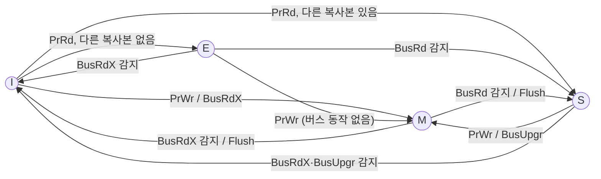

# MESI 프로토콜

---

## I. 네 가지 상태로 캐시를 맞추는, MESI 프로토콜의 개요

### 가. 정의

- 각 캐시 라인을 **Modified·Exclusive·Shared·Invalid 네 상태로 관리**하는 쓰기 무효화 방식의 [[캐시 일관성]] [[프로토콜]] (Illinois 프로토콜, 1984)

### 나. 특징

| 구분 | 내용 |
| --- | --- |
| MSI 개선 | Exclusive 상태를 추가해, 단독 보유 라인에 쓸 때 무효화 버스 트랜잭션 생략 |
| 스누핑 기반 | 각 캐시 제어기가 버스를 감시해 상태 전이 |
| Write-Back 결합 | 수정 데이터는 교체·요청 시에만 메모리에 기록해 트래픽 감소 |

---

## II. 상태 전이 및 구성요소

### 가. 상태 전이도

- E 상태는 다른 캐시에 복사본이 없음을 보장하므로 쓰기 시 버스 트랜잭션 없이 M으로 전이

### 나. 구성요소

| 구분 | 요소 | 설명 |
| --- | --- | --- |
| 상태 | Modified (M) | 수정됨, 메모리와 불일치, 유일한 최신본 |
| | Exclusive (E) | 메모리와 일치, 이 캐시에만 존재 |
| | Shared (S) | 메모리와 일치, 여러 캐시에 존재 가능 |
| | Invalid (I) | 무효, 접근 시 미스 |
| 프로세서 요청 | PrRd / PrWr | 자기 코어의 읽기 / 쓰기 |
| 버스 트랜잭션 | BusRd | 읽기 미스 시 블록 요청 |
| | BusRdX | 쓰기 목적 읽기, 다른 복사본 무효화 |
| | BusUpgr | S 상태에서 쓰기, 데이터 없이 무효화만 전파 |
| | Flush | M 라인을 메모리·요청 캐시에 내려씀 |

---

## III. 비교 및 동향

### 가. MESI vs MOESI vs MESIF

| 비교 항목 | MESI | MOESI | MESIF |
| --- | --- | --- | --- |
| 추가 상태 | E | O (Owned) | F (Forward) |
| 목적 | 불필요한 무효화 제거 | Dirty 데이터를 메모리 기록 없이 공유 | 공유 라인 응답자를 하나로 지정 |
| Dirty 공유 | 불가 (메모리 기록 후 S) | 가능 (O가 응답·책임) | 불가 |
| 공유 읽기 응답 | 메모리 | O 상태 캐시 | F 상태 캐시 하나 |
| 사례 | 범용 멀티코어 | AMD Opteron 이후 AMD | Intel Nehalem(QPI) 이후 |

### 나. 동향

- **디렉터리 결합**: 코어 수가 많은 서버 CPU는 칩 내부 스누프 필터·디렉터리와 MESI 계열 상태를 결합해 브로드캐스트 감소
- **이기종 일관성**: [[CXL]].cache 등으로 CPU와 가속기 간에도 MESI 기반 일관성 유지

---

### 🔗 연관 토픽

- **소속 도메인**: [[00_컴퓨터구조_MOC|💻 컴퓨터구조]]
- **세부 분류**: `1. CPU 프로세서 & 마이크로아키텍처`
- **핵심 연관 토픽**:
  - [[캐시 일관성|캐시 일관성(Cache Coherence) 유지 기법]]
  - [[캐시 메모리]]
  - [[캐시 메모리의 쓰기 정책]]
  - [[CXL|CXL (Compute Express Link)]]
  - [[CPU|중앙처리장치 (CPU Central Processing Unit)]]
