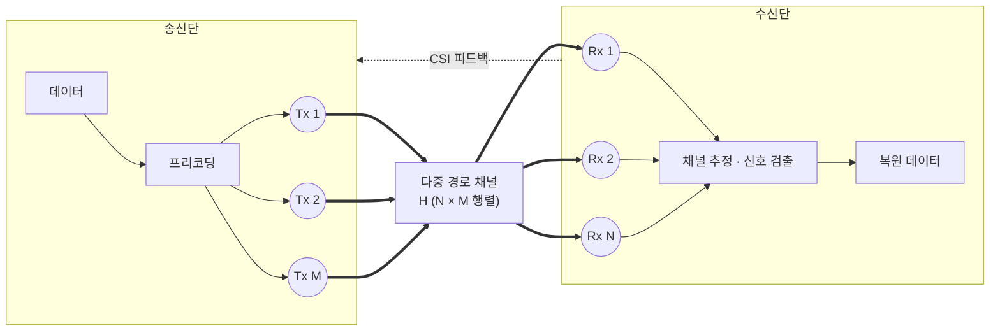

# MIMO (Multiple-Input Multiple-Output)

---

## I. 안테나 수로 용량을 늘리는, MIMO의 개요

### 가. 정의

- 송신·수신 양쪽에 **여러 안테나를 두고 같은 주파수·시간 자원에서 공간 차원을 활용해 전송 용량과 신뢰성을 높이는** 무선 전송 기술

### 나. 필요성 및 특징

| 구분 | 내용 |
| --- | --- |
| 용량 증대 | 대역·전력을 늘리지 않고 공간 다중화로 전송률 향상 (스트림 수 ≤ min(송신, 수신 안테나 수)) |
| [[신뢰성]] | 다이버시티로 다중 경로 페이딩 완화 |
| 간섭 제어 | 빔포밍으로 원하는 방향에 에너지 집중 |
| 다중 경로 활용 | 반사·산란이 많은 환경에서 서로 다른 공간 채널 확보 |
| 적용 | LTE, 5G NR, Wi-Fi 4 이후 무선랜 |

---

## II. 구조 및 구성요소

### 가. MIMO 송수신 구조

- 송신단이 CSI를 바탕으로 프리코딩해 여러 안테나로 보내고, 수신단은 채널 행렬을 추정해 섞인 신호에서 각 스트림을 분리

### 나. 구성요소

| 구분 | 요소 | 설명 |
| --- | --- | --- |
| 이득 유형 | 공간 [[다중화]] | 서로 다른 스트림을 동시에 전송해 전송률 증가 |
| | 공간 다이버시티 | 같은 정보를 여러 경로로 보내 신뢰성 향상 (STBC 등) |
| | 빔포밍 | 안테나별 위상·진폭을 조절해 특정 방향으로 집중 |
| 채널 정보 | CSI | 채널 이득·위상 정보, 프리코딩·빔 계산의 기초 |
| 송신 처리 | 프리코딩 | CSI 기반으로 스트림·사용자 간 간섭을 미리 줄임 |
| 수신 처리 | 검출기 | ZF, MMSE, ML 방식으로 스트림 분리 |
| 다중 사용자 | MU-MIMO (SDMA) | 같은 자원에서 여러 단말을 공간으로 구분 |
| 대규모 | Massive MIMO | 기지국 64T64R 등 다수 안테나, 3D 빔포밍·MU-MIMO 극대화 |

---

## III. 비교 및 동향

### 가. SU-MIMO vs MU-MIMO vs Massive MIMO

| 비교 항목 | SU-MIMO | MU-MIMO | Massive MIMO |
| --- | --- | --- | --- |
| 개념 | 한 단말에 여러 스트림 | 여러 단말에 동시 전송 | 기지국 안테나 수십~수백 개 |
| 안테나 | 2×2, 4×4 | 4~8개 수준 | 32·64 이상 |
| 목적 | 단말 최대 속도 | 셀 전체 [[처리량]] | 셀 용량·커버리지, 정밀 빔 |
| 적용 예 | LTE, Wi-Fi 4 | LTE-A, Wi-Fi 5(하향)·6(양방향) | 5G NR 중대역 기지국 |

### 나. 동향

- **Cell-Free Massive MIMO**: 셀 경계 없이 분산 안테나가 협력해 균일한 품질 제공 (6G 후보)
- **RIS 결합**: 반사 표면의 위상을 제어해 음영 지역 커버리지 보완
- **AI 기반 CSI**: [[딥러닝]]으로 CSI 압축·예측해 피드백 오버헤드 감소 (3GPP Rel-18 이후 연구)
- **XL-MIMO**: 6G 상위 중대역(7~24GHz)에서 초대형 배열 연구

---

### 🔗 연관 토픽

- **소속 도메인**: [[00_네트워크_MOC|🌐 네트워크]]
- **세부 분류**: `2. 네트워크 계층 & 라우팅 프로토콜 (L3)`
- **핵심 연관 토픽**:
  - [[OFDM (Orthogonal Frequency Division Multiplexing)]]
  - [[다중화|다중화(Multiplexing)]]
  - [[5G|5G 주요 기술]]
  - [[6G]]
  - [[Wi-Fi 7|WI-FI 7 (IEEE 802.11be)]]
