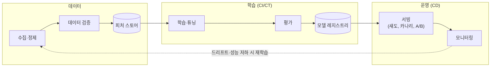

# MLOps (Machine Learning Operations)

---

## I. 모델을 운영 가능한 서비스로, MLOps의 개요

### 가. 정의

- ML 모델의 **데이터 준비·학습·배포·모니터링·재학습 전 과정을 자동화하고 지속적으로 관리**하는 개발·운영 방법론 ([[DevOps]]를 ML에 확장)

### 나. 등장 배경 및 특징

| 구분 | 내용 |
| --- | --- |
| 배경 | 실험 단계 모델의 상당수가 운영에 이르지 못함, 배포 후 드리프트로 성능 저하 |
| 관리 대상 | 코드 + 데이터 + 모델을 함께 버전 관리 |
| 지속적 학습 | CI/CD에 더해 CT(Continuous Training) |
| 재현성 | 데이터·코드·하이퍼파라미터·환경을 기록해 학습 결과 재현 |
| 성숙도 | Google 기준 Level 0(수동) → 1(파이프라인 자동화) → 2(CI/CD 파이프라인 자동화) |

---

## II. 파이프라인 및 핵심 기술

### 가. 파이프라인 개념도

- 데이터 → 학습 → 배포 → 모니터링을 자동화하고, 성능 저하가 감지되면 재학습 파이프라인을 다시 실행

### 나. 핵심 기술

| 구분 | 요소 | 설명 |
| --- | --- | --- |
| 자동화 | CT (지속적 학습) | 신규 데이터·성능 저하 시 자동 재학습, DevOps에 없는 요소 |
| | ML CI/CD | 코드·데이터·모델 검증 후 [[컨테이너]] 이미지 빌드·배포 |
| 데이터 | 데이터 검증 | 스키마·분포 이상 사전 차단 (Great Expectations, TFDV) |
| | 피처 스토어 | 학습(오프라인)·추론(온라인) 피처를 일관되게 제공 (Feast 등) |
| | 데이터 버전 관리 | DVC, lakeFS 등 |
| 모델 | 실험 추적·레지스트리 | 파라미터·지표·아티팩트 기록, 버전·승인 관리 (MLflow 등) |
| 인프라 | 오케스트레이션 | Kubernetes·Kubeflow·Airflow로 워크플로·GPU 자원 관리 |
| 배포 | 서빙 전략 | 섀도·카나리·A/B·블루-그린 배포 |
| 모니터링 | 드리프트 탐지 | 입력 분포 변화(데이터 드리프트), 입출력 관계 변화(컨셉 드리프트), 성능 지표 추적 |

---

## III. 비교 및 동향

### 가. DevOps vs MLOps

| 비교 항목 | DevOps | MLOps |
| --- | --- | --- |
| 관리 대상 | 코드 | 코드 + 데이터 + 모델 |
| 자동화 | CI/CD | CI/CD + CT |
| 테스트 | 단위·[[통합 테스트]], 정적 분석 | 데이터 검증, 모델 성능·공정성 평가 ([[AI 시스템 테스트]]) |
| 모니터링 | 자원, 응답 시간, 오류율 | + 드리프트, 예측 품질, 편향 |
| 버전 관리 | Git | Git + 데이터·모델 버전 |
| 결함 양상 | 코드 결함은 재현 가능 | 코드 변경 없이도 데이터 변화로 성능 저하 |

### 나. 동향

- **[[LLMOps]] 확장**: 프롬프트·RAG 파이프라인·미세조정·LLM 평가와 비용 관리를 포함하는 운영 체계로 확장
- **거버넌스 내재화**: EU AI Act 등 규제 대응을 위해 모델 카드·데이터 계보·공정성 검사를 파이프라인 단계로 자동화 ([[AI 거버넌스]])
- **플랫폼화**: SageMaker, Vertex AI, Databricks 등 관리형 MLOps 플랫폼 활용 확대

---

### 🔗 연관 토픽

- **소속 도메인**: [[00_인공지능_MOC|🤖 인공지능]]
- **세부 분류**: `1. 수학 · 통계학 & 데이터 전처리`
- **핵심 연관 토픽**:
  - [[LLMOps]]
  - [[DevOps]]
  - [[모델 드리프트 컨셉 드리프트 & 데이터 드리프트|모델 드리프트]]
  - [[AI 시스템 테스트]]
  - [[AI 거버넌스|AI 거버넌스 (AI Governance)]]
