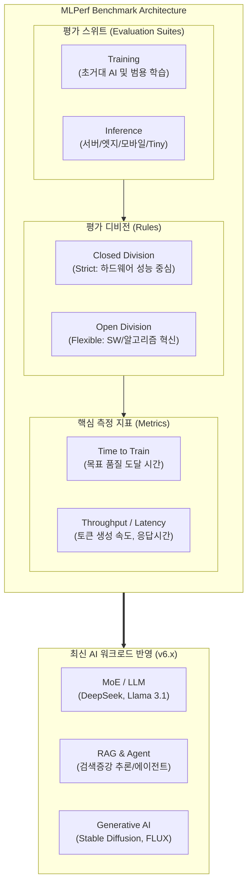

# MLPerf

---

## I. 글로벌 AI 시스템 성능 평가 표준, MLPerf의 개요

### 가. MLPerf의 정의
MLCommons 컨소시엄이 주도하여 다양한 하드웨어 및 소프트웨어 환경에서 [[인공지능]](AI) 모델의 학습(Training)과 추론(Inference) 성능을 공정하고 투명하게 평가하기 위한 벤치마크 표준 규격이다.

### 나. MLPerf의 필요성 및 특징
| 구분 | 세부 특징 |
| --- | --- |
| 객관적 공정성 확보 | 벤더의 독자적 마케팅 수치를 배제하고 엄격한 합의 규정에 따라 하드웨어 가속기 성능을 상호 비교 |
| 2원화 평가 디비전 | 모델과 하이퍼파라미터를 엄격 통제하는 Closed Division과 SW·알고리즘 혁신을 겨루는 Open Division 병행 |
| 전방위 인프라 커버리지 | 초대규모 AI 데이터센터 클러스터부터 엣지, 모바일, 초저전력 TinyML 디바이스까지 전체 하드웨어 평가 |

---

## II. MLPerf의 측정 구조 및 핵심 기술 요소

### 가. MLPerf의 측정 체계 및 동작 원리

* MLPerf는 벤치마크 스위트(학습/추론), 디비전(Closed/Open)으로 체계화되어 있으며, 결과는 훈련 시간(Time to Train)이나 [[처리량]](Throughput) 등의 정량적 지표로 도출됨
* 최신 버전에서는 실제 산업 트렌드를 반영하여 RAG 파이프라인 및 [[MOE(Mixture of Experts)|MoE]](Mixture-of-Expert) 모델의 평가 비중이 대폭 확대됨

### 나. MLPerf의 핵심 기술 및 구성 요소

| 구분 | 요소기술(키워드) | 세부 설명 |
| --- | --- | --- |
| **핵심 스위트** | Training Benchmark | 데이터셋을 사용하여 모델을 훈련시키고 사전에 정의된 '목표 품질'에 도달하는 데 걸리는 시간(Time to Train)을 측정 |
| **핵심 스위트** | Inference Benchmark | 훈련된 모델을 사용하여 새로운 데이터를 처리하는 속도(Throughput)와 지연 시간(Latency) 측정 |
| **평가 규칙** | Closed Division | [[모델 구조]], 데이터셋, 하이퍼파라미터를 엄격히 고정하여 순수 하드웨어 및 시스템 아키텍처의 성능을 비교 |
| **평가 규칙** | Open Division | 알고리즘, 모델 아키텍처, 양자화 기법 등 전반적인 소프트웨어 및 인프라 스택의 자유로운 혁신 허용 |
| **추론 시나리오** | Server / Offline | Server 시나리오는 예측 불가능한 실시간 요청 지연을, Offline 시나리오는 대용량 배치 처리량을 측정 |
| **대상 환경** | Datacenter / [[EDGE\|Edge]] | 클라우드 데이터센터 초대형 클러스터부터 자율주행 등 엣지 디바이스까지 환경별 규격 세분화 |
| **대상 환경** | Mobile / Tiny | 스마트폰 온디바이스 NPU(Mobile) 및 초저전력 IoT 마이크로컨트롤러(TinyML)의 전력 대비 성능 평가 |
| **부가 지표** | Power Measurement | 모델 연산 수행 시 소모 전력(Performance/Watt)을 동시 측정하여 친환경 AI 인프라 평가 기준 제시 |

---

## III. MLPerf의 평가 워크로드 진화 및 최신 동향

### 가. 전통적 워크로드와 최신 워크로드(v6.x)의 비교

| 비교 항목 | 기존 MLPerf (v2.x ~ v4.x) | 최신 MLPerf (v6.x 이후) |
| --- | --- | --- |
| **대표 모델** | ResNet, [[BERT]], GPT-3, DLRM | DeepSeek-V3/R1, Qwen3-VL, Llama 3.1 405B |
| **Language 모델링** | Dense 모델 위주의 단일 평가 | MoE (Mixture-of-Expert) 아키텍처 기반 거대 모델 중심 |
| **Generative AI** | 초기 이미지 생성 (Stable Diffusion) | 텍스트-비디오(Text-to-Video), 고해상도 생성(FLUX.1) 모델 도입 |
| **실무 적용성** | 단일 모델 단위의 입출력 평가 | RAG (Retrieval-Augmented Generation) 및 에이전트(Agentic) 기반의 [[End-to-End]] 파이프라인 평가 |

### 나. MLPerf 향후 전망 및 최신 동향

* **AI 반도체 벤더 간 사실상 표준 실증 지표**: NVIDIA, AMD, 인텔 및 빅테크 자체 가속기(TPU, Trainium) 간의 아키텍처 경쟁력을 비교하는 최우선 공인 지표로 정착
* **와트당 토큰(Tokens/Watt) 에너지 효율 지표 강화**: 초거대 데이터센터 전력 수급 난제에 대응하여 순수 연산 속도 외에 전력 소모 대비 토큰 처리 효율을 핵심 지표로 평가
* **복합 에이전트 및 멀티모달 파이프라인 평가 확산**: 단일 추론을 넘어 도구 호출, RAG 지식 검색, 비전-언어 융합 추론의 엔드투엔드 시스템 지연 시간을 종합 측정하는 워크로드로 고도화

---

### 🔗 연관 토픽

- **소속 도메인**: [[00_인공지능_MOC|🤖 인공지능]]
- **세부 분류**: `6. 설명가능한 AI (XAI) & AI 윤리 · 거버넌스`
- **핵심 연관 토픽**:
  - [[인공지능]]
  - [[MOE(Mixture of Experts)]]
  - [[XAI]]
  - [[End-to-End]]
  - [[모델 구조]]
