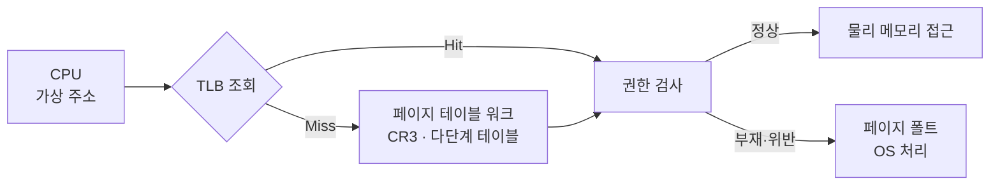

# MMU (Memory Management Unit)

---

## I. 가상 주소를 물리 주소로, MMU의 개요

### 가. 정의

- [[CPU]]가 내는 **가상 주소를 [[물리 주소]]로 변환하고 접근 권한을 검사하는 하드웨어 장치**

### 나. 필요성 및 특징

| 구분 | 내용 |
| --- | --- |
| [[가상 메모리]] 지원 | 물리 메모리보다 큰 주소 공간 제공, 요구 페이징의 기반 |
| [[프로세스]] 격리 | 프로세스마다 독립된 주소 공간, 권한 비트로 침범·커널 접근 차단 |
| 고속 변환 | TLB에 최근 변환을 캐싱해 페이지 테이블 접근 최소화 |
| OS 협력 | 변환 실패·권한 위반 시 페이지 폴트로 OS에 처리 위임 |

---

## II. 구조 및 구성요소

### 가. 주소 변환 흐름

- TLB 미스면 메모리의 다단계 페이지 테이블을 하드웨어가 탐색하고 결과를 TLB에 적재

### 나. 구성요소

| 구분 | 요소 | 설명 |
| --- | --- | --- |
| 변환 캐시 | TLB | 최근 사용한 페이지 번호→프레임 번호 변환 저장 |
| 기준 레지스터 | PTBR (x86 CR3) | 현재 프로세스 최상위 페이지 테이블의 물리 주소 |
| 탐색 | 페이지 테이블 워커 | TLB 미스 시 4단계(또는 5단계) 테이블을 하드웨어로 탐색 |
| [[문맥 교환]] | ASID / PCID | TLB 항목에 주소 공간 ID를 붙여 전환 시 전체 플러시 방지 |
| 보호 | 권한 비트 | PTE의 R/W/X, 사용자/커널, NX 비트 검사 |
| 예외 | 페이지 폴트 | 미적재·권한 위반 시 OS 핸들러로 전환 |
| 성능 | Huge Page | 2MB·1GB 페이지로 TLB 적용 범위 확대 |
| [[가상화]] | EPT / NPT | 게스트 가상 → 게스트 물리 → 호스트 물리 2단계 변환 |

---

## III. 비교 및 동향

### 가. MMU vs IOMMU

| 비교 항목 | MMU | IOMMU |
| --- | --- | --- |
| 변환 요청자 | CPU 코어 | 입출력 장치 ([[GPU]], NIC, NVMe) |
| 대상 | CPU의 가상 주소 | 장치의 [[DMA(Direct Memory Access)\|DMA]] 주소 |
| 보호 | 프로세스 간·커널 격리 | 잘못된·악의적 DMA 차단 |
| 가상화 활용 | 프로세스별 주소 공간 | VM에 장치 직접 할당 (패스스루) |
| 사례 | x86 MMU, ARM MMU | Intel VT-d, AMD-Vi, ARM SMMU |

### 나. 동향

- **[[부채널 공격]] 대응**: Meltdown 대응으로 사용자·커널 페이지 테이블을 분리하는 KPTI 적용
- **공유 가상 주소 (SVA)**: IOMMU·PASID로 CPU와 GPU·가속기가 같은 가상 주소 공간을 공유, [[CXL]] 환경으로 확장

---

### 🔗 연관 토픽

- **소속 도메인**: [[00_컴퓨터구조_MOC|💻 컴퓨터구조]]
- **세부 분류**: `1. CPU 프로세서 & 마이크로아키텍처`
- **핵심 연관 토픽**:
  - [[가상 메모리]]
  - [[물리 주소]]
  - [[문맥 교환|문맥 교환 (Context Switching)]]
  - [[DMA(Direct Memory Access)]]
  - [[메모리 관리]]
