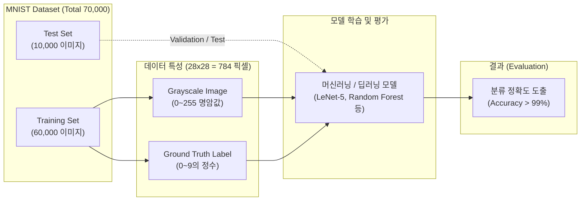

# MNIST

---

## I. 머신러닝의 "Hello World" 벤치마크, MNIST의 개요

### 가. MNIST의 정의
기계학습(ML) 및 컴퓨터 비전 모델의 이미지 분류 성능을 평가하기 위해 고안된, 0부터 9까지의 수기(Handwritten) 숫자 7만 장으로 구성된 표준 벤치마크 데이터셋이다.

### 나. MNIST의 등장 배경 및 특징
| 구분 | 세부 특징 |
| --- | --- |
| 알고리즘 객관적 평가 | 10개 클래스와 고정된 학습/검증 분할을 제공하여 CNN, SVM, MLP 등 모델 간 성능 비교 기준점 확립 |
| 표준화된 전처리 | 28x28 픽셀 크기 정규화 및 질량 중심 기준 중앙 정렬로 추가 전처리 부담 없이 즉시 학습 가능 |
| 신속한 프로토타이핑 | 흑백(Grayscale) 단일 채널 구조로 저비용 컴퓨팅 환경에서도 빠른 알고리즘 검증 및 교육에 최적 |

---

## II. MNIST 기반 분류 프로세스 및 핵심 요소

### 가. MNIST 기반 이미지 분류 프로세스 개념도

* 제공되는 784차원(28x28)의 피처 벡터와 정답 레이블을 모델에 주입하여 학습시키고, 분리된 Test Set을 통해 [[일반화]] 성능(Accuracy)을 도출함

### 나. MNIST의 핵심 구성 요소 및 데이터 특성

| 구분 | 요소기술(키워드) | 세부 설명 |
| --- | --- | --- |
| **데이터 구성** | Training Set | 모델의 가중치를 업데이트하고 학습시키기 위해 고정 할당된 60,000장의 숫자 이미지 |
| **데이터 구성** | Test Set | 학습된 모델의 실질적인 예측 성능을 평가(검증)하기 위한 10,000장의 독립된 세트 |
| **이미지 특성** | 28x28 Resolution | 모든 이미지는 가로 28픽셀, 세로 28픽셀 크기로 이루어져 총 784개의 변수(피처) 제공 |
| **이미지 특성** | Grayscale | 컬러 채널(RGB) 없이 0(흰색)부터 255(검은색)까지의 단일 흑백 명암값으로 픽셀을 표현함 |
| **이미지 전처리** | Size-normalized | 다양한 필체의 크기를 20x20 박스 내에 맞도록 정규화하고 안티앨리어싱을 적용함 |
| **이미지 전처리** | Centered | 질량 중심(Center of mass) 기법을 사용하여 정규화된 숫자를 28x28 프레임의 중앙에 위치시킴 |
| **정답 구조** | 10 Classes (0~9) | 각 이미지가 의미하는 0부터 9까지의 정수를 라벨로 보유하며, 클래스별 분포가 균등함 |
| **대표 모델** | LeNet-5 | MNIST 데이터셋을 활용해 손글씨 인식 분야에서 합성곱 신경망(CNN)의 우수성을 입증한 초기 모델 |

---

## III. 유사 벤치마크 데이터셋 비교 및 최신 동향

### 가. MNIST 및 주요 이미지 벤치마크 데이터셋 비교

| 비교 항목 | MNIST | Fashion-MNIST | CIFAR-10 |
| --- | --- | --- | --- |
| **주요 대상** | 0~9 수기 숫자 | 의류, 신발, 가방 등 10종 | 비행기, 자동차, 개, 고양이 등 10종 |
| **이미지 특성** | 28x28 (흑백) | 28x28 (흑백) | 32x32 (RGB 컬러) |
| **데이터 복잡도** | 매우 낮음 | 보통 (MNIST의 직접적 대안) | 높음 (배경 및 형태 변형 다양) |
| **도입 목적** | 알고리즘의 기초 검증 | 단순 숫자 분류 한계 극복 | 실세계 객체(Object) 인식률 평가 |
| **활용 현황** | 초학습(Tutorial) 및 기본 성능 기준점 | 현대 ML 알고리즘의 1차 성능 벤치마킹용 | 경량 [[딥러닝]] 모델의 범용 평가 지표 |

### 나. MNIST 데이터셋의 한계점 및 향후 활용 동향

* **기초 검증 벤치마크로의 역할 전환**: 현대 딥러닝 모델의 정확도가 99.7% 이상에 도달하여 모델 간 변별력은 상실했으나 알고리즘 구현 직후 스모크 테스트 용도로 지속 활용
* **대안 데이터셋(Fashion-MNIST)으로 세대교체**: 동일한 28x28 흑백 규격을 유지하면서 패턴 복잡도를 높인 의류 이미지 데이터셋으로 머신러닝 기초 벤치마크 전환
* **XAI 및 경량화(TinyML) 테스트베드 활용**: 모델 설명 가능성(Grad-CAM, LIME) 시각화 검증 및 초소형 마이크로컨트롤러 환경의 양자화/프루닝 검증 기준으로 가치 유지

---

### 🔗 연관 토픽

- **소속 도메인**: [[00_인공지능_MOC|🤖 인공지능]]
- **세부 분류**: `2. 머신러닝 기초 & 핵심 알고리즘`
- **핵심 연관 토픽**:
  - [[지도학습]]
  - [[딥러닝]]
  - [[XAI]]
  - [[서포트 벡터 머신|서포트 벡터 머신 SVM(Support Vector Machine)]]
  - [[알고리즘]]
